# SlimeyBeats-EZ-Master

[](https://github.com/slimedragonair/SlimeyBeats-EZ-Master/actions/workflows/ci.yml)
[](https://github.com/slimedragonair/SlimeyBeats-EZ-Master/actions/workflows/web.yml)
[](https://github.com/slimedragonair/SlimeyBeats-EZ-Master/releases/tag/v0.5.0-beta.3)
[](https://github.com/slimedragonair/SlimeyBeats-EZ-Master/releases/latest)
[](LICENSE)

**Local song mastering. Real-time EQ. Your music stays yours.**

**[Open Hybrid Studio v2](https://slimedragonair.github.io/SlimeyBeats-EZ-Master/):** the main web app includes optional server processing; publication follows its successful browser workflow. With **Server processing** selected, normal imports upload the **original file**; Analyze, Master, supported heavy Studio tools and full-resolution exports run on the server. A/B, live EQ and faders use compressed listening streams (**192 kbps MP3 by default**). Source admission is **one hour / 2 GiB encoded and decoded per input**, subject to working-memory/disk quotas; neural separation retains **512 MiB decoded PCM**. Projects last at most **one hour**: download an export/session ZIP before leaving; local recovery does not save streamed projects. Local mode and desktop MCP remain local. [Workflow and limits](docs/HYBRID_STUDIO.md) · [Validation and device gaps](docs/HYBRID_V2_VALIDATION.md) · [v2 protocol](docs/HYBRID_REMOTE_PROTOCOL.md) · [Measured speed](hybrid/deploy/remote-tools/BENCHMARK.md). The web app and Hotfix4 installer remain separate releases.

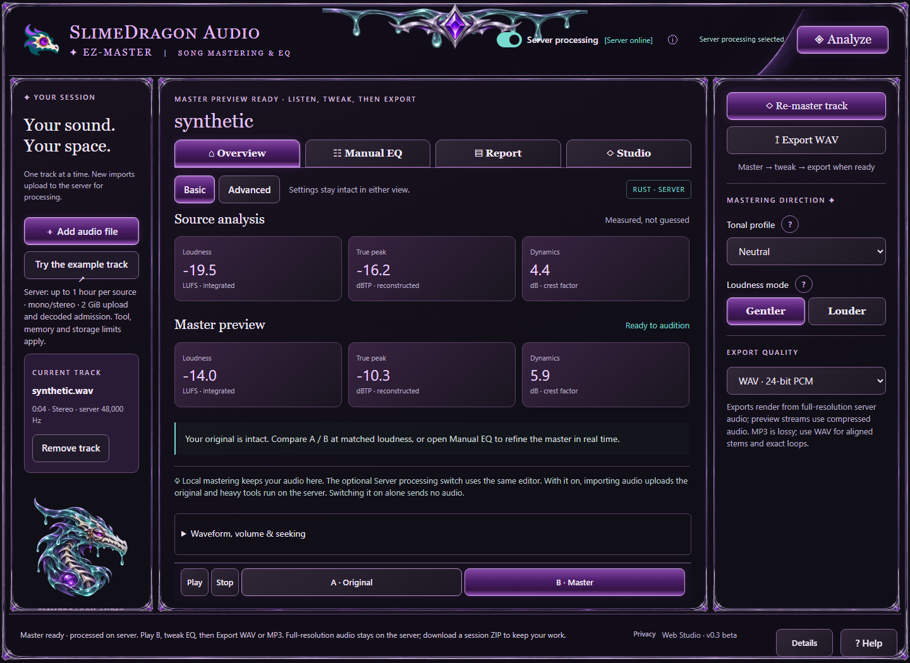

Actual 1440 × 1050 browser capture using a generated four-second stereo fixture and an owned native HTTP backend. This illustrates the shared workflow; physical-phone and maximum-size qualification remain separate from the [recorded checks](docs/HYBRID_V2_VALIDATION.md).

**Validated on the public preview:** an **18-minute, 48 kHz stereo MP3** completed import, Analyze, Master, streamed playback and full WAV/MP3/session ZIP downloads through the real server. Chromium, Firefox and Linux WebKit also passed the native-backed editor workflows and local-to-server migration. [Exact tests, measured timings and physical-device gaps](docs/HYBRID_V2_VALIDATION.md).

SlimeyBeats-EZ-Master is a Rust mastering app with a Windows desktop release, Linux source support, and a private browser preview. Analyze a mix, prepare a master, compare it at matched loudness, adjust the EQ while listening, and export when you are ready.

**Windows x64 · Linux source · Browser preview · MIT licensed · Local processing by default**

[Download desktop preview — Hotfix4](https://github.com/slimedragonair/SlimeyBeats-EZ-Master/releases/download/v0.5.0-beta.3/SlimeyBeats-EZ-Master-0.5.0-beta.3-Hotfix4-Setup.exe) · [Open web app — WAV & MP3](https://slimedragonair.github.io/SlimeyBeats-EZ-Master/) · [Get started](#get-started) · [Example audio](#try-the-example-track) · [User guide](docs/USER_GUIDE.md) · [Build from source](docs/BUILDING.md) · [Your music rights](OUTPUT_OWNERSHIP.md) · [Questions and ideas](https://github.com/slimedragonair/SlimeyBeats-EZ-Master/discussions)

**Hotfix4 desktop refresh — November 15, 2026:** desktop **0.5.0-beta.3**, build revision **2026111501**, brings the shared live-EQ preparation improvements, stem timeline, precise time edits, loop auditioning and **Stem Doctor** into the refreshed Windows package. Its optional **0.2.0-beta.3 MCP companion has 45 tools**. MCP discovery connections no longer create empty temporary folders in the export destination; scratch is allocated when processing needs it. [Release scope and immutable downloads](docs/HOTFIX4.md) · [Release QA report — HOTFIX4-VALIDATION.json](https://github.com/slimedragonair/SlimeyBeats-EZ-Master/releases/download/v0.5.0-beta.3/HOTFIX4-VALIDATION.json). The report records final test results and installer scope separately from these bundled guides.

**Web update — November 15:** the main web app includes local **320 kbps MP3 export**, session ZIPs, portable EQ presets, stem timeline/time edits and **Stem Doctor** issue scans with optional repair previews. Open the web app above; no installation or audio upload is needed. To save MP3, prepare a master, choose **MP3 · 320 kbps** under **Export quality**, then **Export MP3**. In Studio, choose MP3 under **Export format**, then **Export current preview**. [Browser guide](docs/WEB.md) · [Export details](docs/WEB_EXPORTS.md).

**Studio Preview 0.5.0-beta.3** includes the guided desktop interface, Studio, the **0.2.0-beta.3 MCP companion** and the isolated VST3 worker. Import aligned stems from multiple files or a Suno/stem ZIP with **no fixed imported-part count**, rebalance parts, clean a voice, repair a region and save projects. Optional local separation produces two/four stems. Browser Studio **0.3.0-beta.3** shares Rust DSP for imported-stem editing. Preview installs separately from stable. [Release notes and downloads](https://github.com/slimedragonair/SlimeyBeats-EZ-Master/releases/tag/v0.5.0-beta.3) · [Studio guide](docs/STUDIO.md).

**Included from Hotfix3 — recovery and reviewed support reports:** desktop autosave protects loaded mixes, Studio previews and pending controls with local restore points. Inspect a copy before restoring; current work is backed up separately. **Help → Report a problem** generates an exact local preview before reviewed Copy/Save, without automatically collecting audio, names, paths or raw logs. Browser audio recovery is **opt-in**, within separate storage limits. The historical Hotfix3 companion exposed **42 tools**, including reviewed support-report preparation/save. [Recovery, privacy, storage and tested scope](docs/RECOVERY_AND_REPORTING.md).

**Hotfix2 — easier updates and first-use setup:** open **Help → Updates & tools** to check/download a newer build. Codec, stem-engine and missing native-helper setup continue the action that needs them, with progress and Cancel. Install this build once to gain the updater; future hotfixes are detected by build revision without changing the displayed app version. The Hotfix2 companion added optional-tool status/setup; Hotfix3 also adds reviewed support reports, for **42 tools**. [Workflow, privacy and platform limits](docs/UPDATES_AND_OPTIONAL_TOOLS.md).

Prefer the earlier mastering-only release? [Stable v0.4.2](https://github.com/slimedragonair/SlimeyBeats-EZ-Master/releases/tag/v0.4.2) remains available; it does not include Studio, MCP or the new tour. The hosted browser updates from `main` after its checks pass. Desktop remains the flagship for neural extraction, native effects and larger projects.

**Live stem editing is included:** stem gain, mute, solo and balance update during playback. Editing selects B automatically; Before and the live mix are separate listening choices. Studio also prevents a hidden mastering player from sounding underneath it. **Update mix preview** prepares the current balance for saving or further effects; it is no longer needed just to hear fader changes. [Live monitoring and save workflow](docs/STEM_LIVE_MONITORING.md). The refreshed filenames include **Hotfix4**; the app version stays 0.5.0-beta.3.

**Bulk import:** choose several stem files at once or open a Suno/stem ZIP, review the parts, then import explicitly. Within one logical source folder, matching WAV/MP3 basenames count as one part: WAV is preferred, MP3 is optional, and a missing preferred encoding falls back to the available one. Prefer a consistent encoding across the bank; fallback can fail alignment when decoded lengths differ. Guitar, piano, synth, strings and percussion have named types; extensible `part_N` IDs cover repeated/custom instruments. Mixing, direct edits, raw stem exports and desktop projects retain the selected bank, subject to available memory and input safety budgets. All discovered parts start selected for review; uncheck anything you do not want. **Automatic model separation still produces only two/four stems.** Import needs no model.

Native imports retain **512 MiB decoded per input by default**, with a separate **4 GiB decoded-bank guard**; processing needs additional RAM. Owner-configured MCP settings can change the per-input limit. **Local** browser Studio retains its **128 MiB combined decoded-input limit**. The v2 server preview has separate [server admission and working-memory limits](docs/HYBRID_STUDIO.md#admission-limits-and-working-memory); its neural cap remains 512 MiB. [Local import workflow and limits](docs/STUDIO.md#import-a-whole-stem-set).

**Recognizable part names:** original friendly names appear on faders and processing targets and survive edits/undo, raw export manifests and desktop projects. Stable kind IDs and WAV filenames remain unchanged. Native loose-file and ZIP imports preserve distinct source folders, so different takes can share a friendly basename while keeping unique IDs. Filename-based role suggestions keep backing/harmony separate from lead vocals and order the review cards; all parts start selected. This is a naming heuristic, not audio inference: review every selected part before importing.

**Installer note:** these Windows builds are unsigned, so Windows may show an unknown-publisher prompt. See the [installation guide](docs/INSTALLATION.md).


**Active testing branch: [`current-work`](https://github.com/slimedragonair/SlimeyBeats-EZ-Master/tree/current-work).** Work is pushed there in small checkpoints. [Open its live mobile preview](https://slimedragonair.github.io/SlimeyBeats-EZ-Master/current-work/), check the displayed build ID, and expand Build details for the workflow. The preview has separate local recovery/preferences; the released app remains at the main URL. Native/browser CI runs separately on each push. [Preview workflow, privacy and qualification limits](docs/MOBILE_PREVIEW.md).

**In development on `current-work` — November 16:** EQ suggestions share a conservative 10–16 kHz energy-concentration check for possible brittle percussion or hiss. **Suggest EQ → review → Apply curve** keeps existing edits until explicit acceptance and rejects stale results. Twelve native counterexample/regression tests plus a forced combined-cut regression pass; Chromium, Firefox and Linux WebKit passed the proposal workflow at 320/390px. Desktop, WASM, MCP and server transports share the evidence; a matching server rollout is still being qualified. [How it works, validation and rollout scope](docs/EQ_SUGGESTION_INTEGRATION.md). This is source/preview work; the main app and Hotfix4 installer retain their published builds.

**New track editor in `current-work`:** open **Studio → Tracks** on desktop, or **Arrange tracks** in the browser Studio. Import one or many independent tracks, including Suno ZIPs, then move, trim, split, duplicate or delete source-backed clips. Tracks support level, balance, mute/solo and ordering; clips have their own names, levels and fades. Different durations are supported, with resource budgets rather than an instrument-count cap. The existing aligned stem mixer remains available.

**EQ a whole song or just a part:** choose the mix, a track or a clip, then optionally restrict EQ to a selected time range. Clip sections follow the original samples when clips move or split. Applied EQ updates playback; suggested curves require explicit acceptance. Applied effects can be revisited, bypassed and removed. Save a self-contained v2 project separately from delivery audio; the local browser editor supports WAV and **320 kbps MP3**. [Desktop workflow](docs/ARRANGEMENT_NATIVE_UI.md) · [Browser workflow and qualification](docs/WEB_ARRANGEMENT_UI.md) · [Shared core and limits](docs/ARRANGEMENT_CORE.md) · [Native recovery](docs/ARRANGEMENT_RECOVERY.md). Matching source-built MCP tools expose the arrangement by stable IDs. **Use Server Off for the new browser track editor:** server arrangement editing is disabled while a WebKit short-preview/EOF bug is investigated; the existing server mastering and aligned Studio workflows remain available. Physical-phone listening remains separate from automated browser/PCM checks.

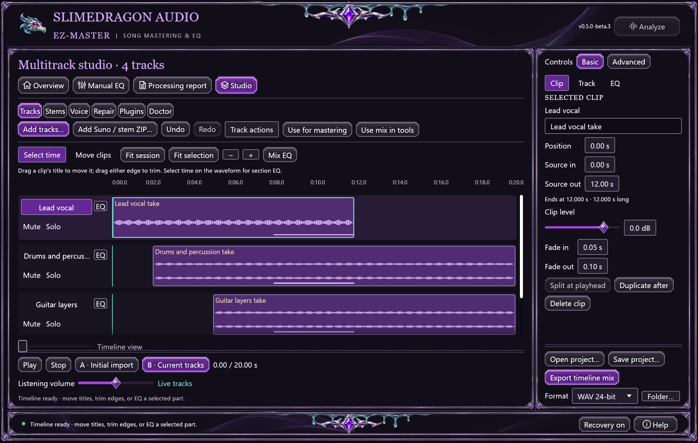

[Full-size editor](docs/images/arrangement-desktop.png) · [Compact editor](docs/images/arrangement-compact.png) · [Section EQ](docs/images/arrangement-eq-desktop.png). These actual source-build captures use generated test audio. The matching development MCP exposes **58 tools**, including editable-project save/reopen and explicit desktop handoff; installed companions retain their older tools until replaced and reconnected.

**Desktop stem editor (Hotfix4 and source builds):** a shared stem timeline, time selection, fit/zoom navigation, loop auditioning and undoable silence/fade/gain/reverse edits. The matching MCP includes `edit_stem_region`. See the [editor workflow, architecture and qualification](docs/STEM_EDITOR.md). Earlier Hotfix3 installers retain their earlier interface; updating the source or opening the web app does not update an installed desktop copy.

**Browser editor parity (main web app):** Studio includes a stem timeline, precise time selection and the same shared Rust silence, fade, gain and reverse tools, with explicit preview commits, undo/redo and local recovery. Open **Stem mix → Time edits**; **Mixer** returns to live faders. [Browser editor workflow, tested scope and remaining checks](docs/WEB_STEM_EDITOR.md). The aligned-bank limits and separate export workflow remain.

**Issue Detector and Stem Doctor (main web app, Hotfix4 and source builds):** Studio offers read-only, timestamped clipping/quiet-gap/possible-ending/low-mid checks, explained findings and explicitly requested repair previews. Scanning never trims or changes audio. Desktop, browser and the matching MCP share the same Rust implementation; the companion includes `scan_audio_issues` and `preview_stem_doctor` among its **45 tools**. [Workflow, limits and validation status](docs/STEM_DOCTOR.md).

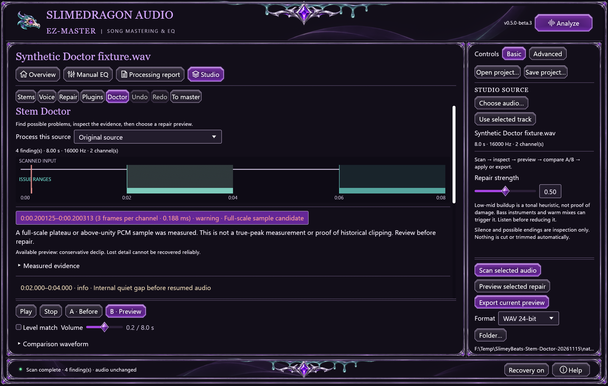

[Full-size desktop Doctor](docs/images/doctor-desktop.png). This actual development capture uses generated test audio; scans and repair previews are separate actions.

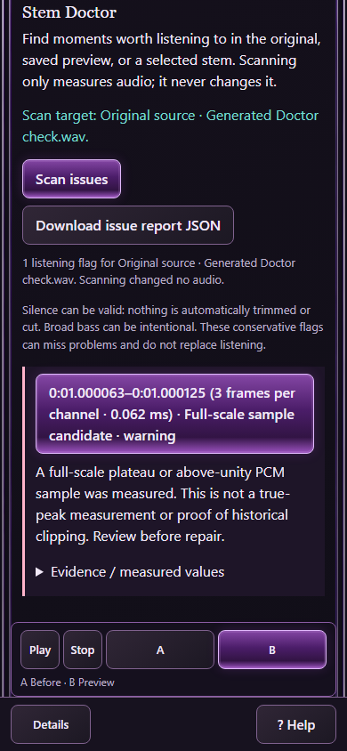

**Inspect, then preview.** Open **Studio → Stem Doctor**, select a saved target and scan. Review the evidence, preview a supported fix, compare and undo before exporting. Compact desktop calls the tab **Doctor**. [Full-size findings](docs/images/doctor-web-findings.png) · [Repair controls](docs/images/doctor-web-repair.png). These actual hosted-browser captures use generated audio and touch emulation; physical-phone listening remains separate.

**Browser recovery fix:** restored stems now replace older playback buffers, keeping audition and export on the same audio. Unchanged live stems still reuse their buffers. [Regression and recovery scope](docs/WEB_STEM_EDITOR.md#restored-playback-must-match-restored-audio).

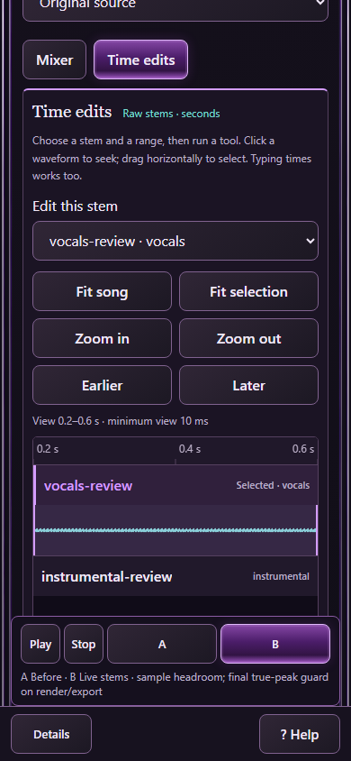

**Time edits on a small screen.** Open **Studio → Stem mix → Time edits**, choose a part, select or type a range, and apply a tool explicitly. **Mixer** returns to live faders. [Full-size timeline](docs/images/web-stem-editor-phone.png) · [Time-edit tools](docs/images/web-stem-editor-tools.png). These actual development captures use generated audio in Chromium phone emulation; they are not physical-device acceptance.

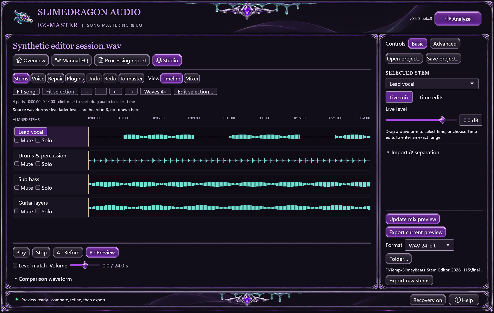

[Full-size development timeline](docs/images/stem-editor-timeline.png) · [Compact layout](docs/images/stem-editor-compact.png) · [Time-edit controls](docs/images/stem-editor-selection.jpg). These actual native captures use generated test tones.

## Start simple, go deeper

The desktop preview starts with **Basic controls**, an optional **eight-step tour**, and **bottom-right Help** with plain-language terms, troubleshooting and desktop MCP setup. **Advanced** reveals detailed controls; changing views preserves your exact audio settings. Finishing or declining the tour is remembered across restarts; Help can replay it whenever you want.

Studio puts active cleanup/repair editors in the workspace and keeps **Preview before Export** visible. Compact stem rows show level, mute and solo together; optional waveforms expand when needed. Manual EQ keeps the spectrum on its curve graph and gives the selected band a sidebar inspector.

**Analyze → Master → Export.** Analyze is at the top right. Master prepares a preview; Export saves it when you are ready. Tweak Manual EQ or re-master in between. The captures below show the beta.3 interface. [Learning, Help and remembered choices](docs/LEARNING_AND_HELP.md).

Use the [Hotfix4 Windows installer](https://github.com/slimedragonair/SlimeyBeats-EZ-Master/releases/download/v0.5.0-beta.3/SlimeyBeats-EZ-Master-0.5.0-beta.3-Hotfix4-Setup.exe), or download the [matching source ZIP](https://github.com/slimedragonair/SlimeyBeats-EZ-Master/releases/download/v0.5.0-beta.3/SlimeyBeats-EZ-Master-0.5.0-beta.3-Hotfix4-Source.zip) and follow [the build guide](docs/BUILDING.md#get-the-learning-preview-source). See [Hotfix4 release scope and QA records](docs/HOTFIX4.md); the original beta.3 tag and earlier assets stay unchanged.

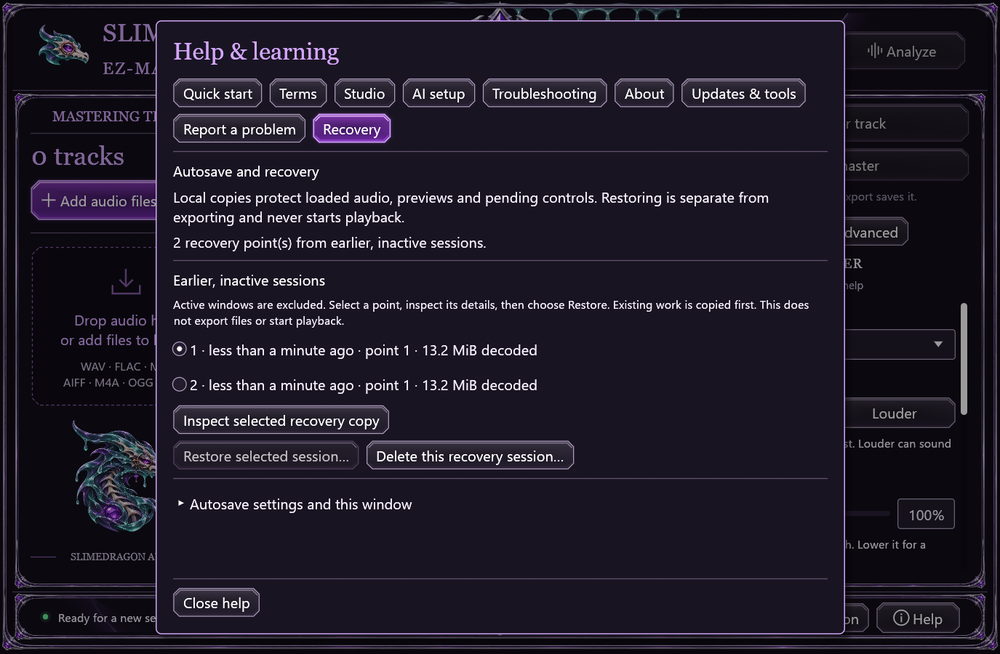

**Recover deliberately.** Background desktop copies protect loaded audio and pending controls. Inspect a saved point before restoring; current work gets a separate backup and playback stays paused. Browser audio recovery is opt-in. Projects and exports remain your lasting copies. [Storage choices and limits](docs/RECOVERY_AND_REPORTING.md).

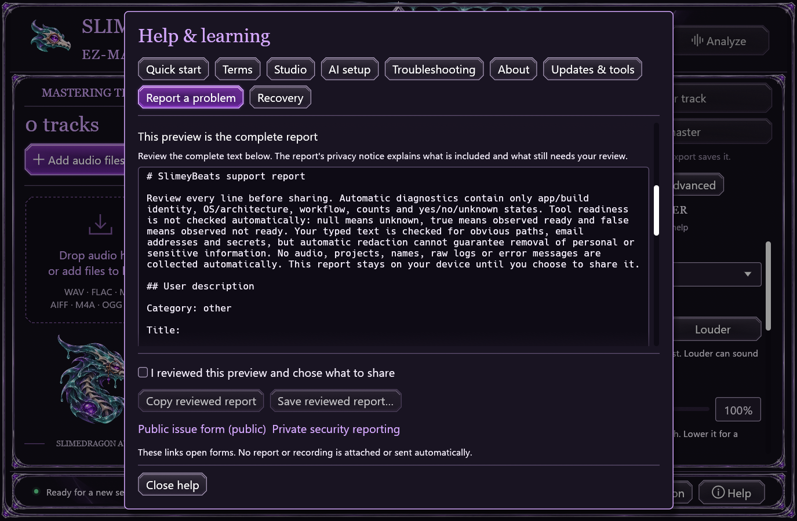

**Share only what you reviewed.** Generate a local report, inspect the complete text, then explicitly copy or save it. Automatic diagnostics omit audio, filenames, paths and raw logs. Public issues and private security reporting are separate choices; opening either form does not attach or submit a report.

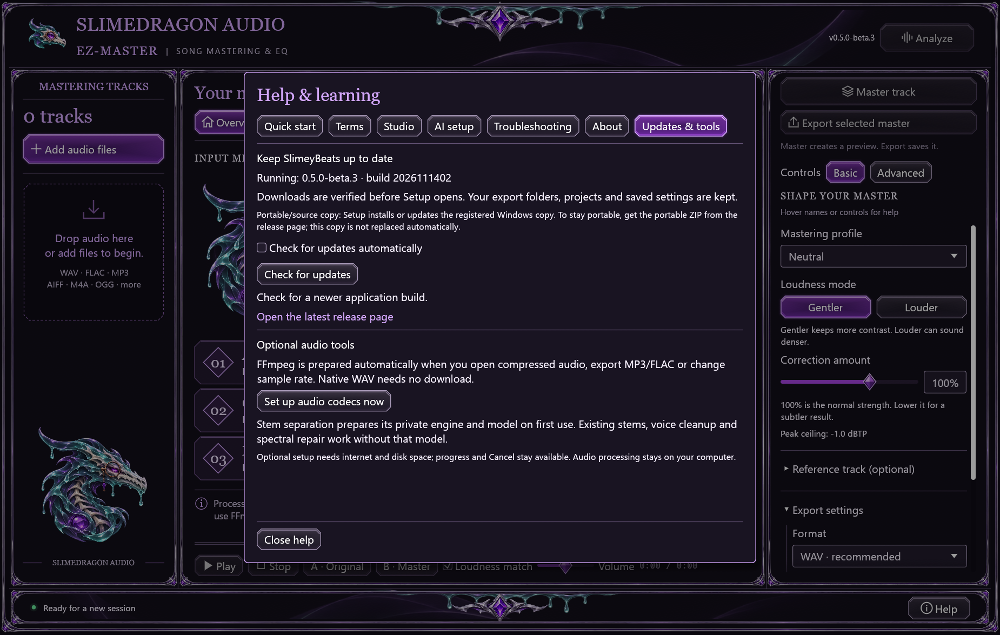

**Updates and setup in one place.** Check for a newer build, download it while working, and open Setup after saving. Optional audio dependencies are prepared by the action that needs them. This actual Hotfix2 capture uses a portable copy with automatic checks disabled; the saved choice survives restarts. [Update workflow and platform limits](docs/UPDATES_AND_OPTIONAL_TOOLS.md).

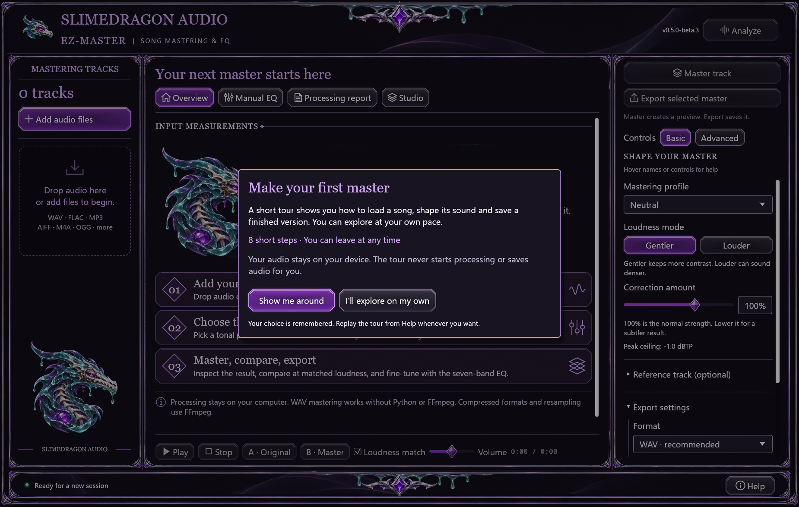

**Start at your pace.** The tour never processes or saves audio for you. Completion or dismissal suppresses future automatic offers when storage succeeds. [Open the actual native introduction at full size](docs/images/ux-first-run.png).

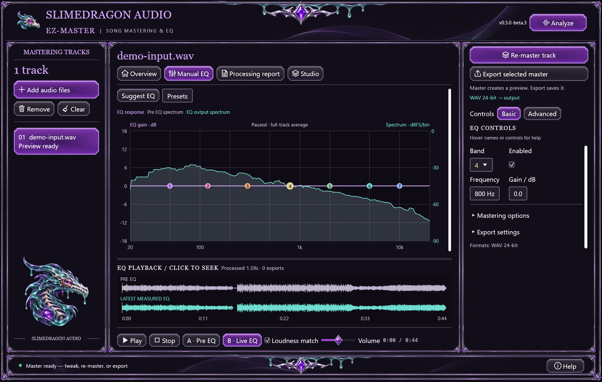

**Shape while listening.** Frequency and gain stay in the selected-band inspector; Advanced reveals shape, Q and output details. The graph above is a paused snapshot of the bundled CC0 demo. [Open the complete EQ capture](docs/images/ux-manual-eq.png).

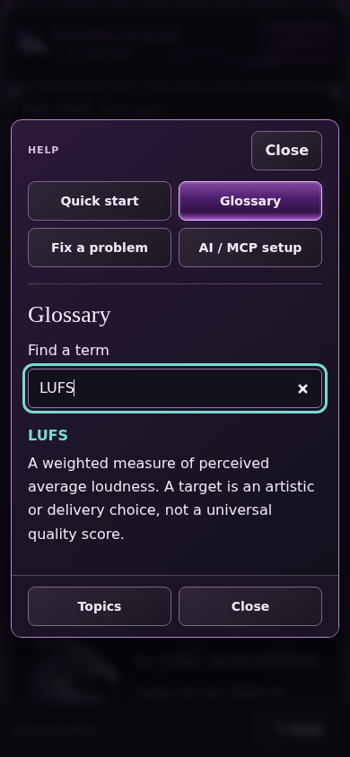

**Help on a phone-sized screen.** Choose a topic or search a term without leaving your audio session. [Open the browser Help capture](docs/images/ux-web-help.png). This is browser emulation, not physical-phone qualification.

## What it does

- **Analyze first.** Inspect loudness, true peak, tonal balance and other measurements before deciding what to change.
- **Master, then refine.** Mastering creates a preview. Re-master or tweak it as often as you need; Export is a separate action.
- **Edit EQ in real time.** Seven editable bands share one graph with the live spectrum. A pinned waveform and playback controls keep the music accessible.
- **Start with an editable suggestion.** Suggested EQ is deterministic and gently influenced by the selected tonal profile. It is rule-based assistance, not a promise that every mix needs correction.
- **Compare fairly.** Original/master and pre-EQ/live-EQ comparisons support listening-only loudness matching.
- **Export carefully.** WAV, FLAC and MP3 options, decoded-file peak checks, optional integer dither and filenames that preserve existing outputs.
- **Learn as you go.** Hover control names for plain-language explanations of LUFS, peak ceilings, frequency, gain, Q and other terms.
- **Edit parts and recordings (Studio Preview).** Rebalance stems, clean a voice, repair a selected time/frequency region, undo, compare and export separately. Desktop supports local neural extraction and compatible VST3 effects; local browser editing has its own limits. The [v2 server preview](docs/HYBRID_STUDIO.md) offloads supported heavy Studio tools and optional two/four-stem separation when advertised. VST3 and desktop MCP remain local. [Local Studio workflows](docs/STUDIO.md).
- **Connect an AI assistant (desktop preview).** The optional local MCP companion exposes analysis, mastering previews, editable EQ and explicit exports through the desktop Rust engine. Open a prepared session in the desktop app to listen and refine it. [Setup, tools and privacy](docs/MCP.md).


## Get started

1. Download [Hotfix4 Studio Preview Setup.exe](https://github.com/slimedragonair/SlimeyBeats-EZ-Master/releases/download/v0.5.0-beta.3/SlimeyBeats-EZ-Master-0.5.0-beta.3-Hotfix4-Setup.exe) for Windows x64, or the matching [portable ZIP](https://github.com/slimedragonair/SlimeyBeats-EZ-Master/releases/download/v0.5.0-beta.3/SlimeyBeats-EZ-Master-0.5.0-beta.3-Hotfix4.zip). [Release scope and QA report](docs/HOTFIX4.md).
2. Run Setup. It installs for your current Windows account without requiring administrator access, separately from stable.
3. Take or skip the optional tour, then add or drop a mono/stereo audio file.
4. Click **Analyze** at the top right. Choose a profile and loudness mode, then **Master track** or **Master queue**.
5. Compare, adjust Manual EQ or re-master. Expand **Export settings** to choose formats and a folder, then **Export selected master**.

WAV input and output work immediately, without Python or FFmpeg. The desktop GUI prepares verified codecs when compressed formats or sample-rate conversion need them, reusing working system tools and preserving PATH. See [installation and codec setup](docs/INSTALLATION.md).

**Remembered preferences (desktop beta.3):** mastering settings, separate master/Studio export destinations and formats, listening volume, level matching and the two/four-stem choice survive normal restarts. Changes save automatically; **Save settings** saves both preference files immediately. Hotfix3 adds separate local recovery for loaded audio, queues and pending controls; only completed recovery points survive an interruption. Use **Save project** and exports for lasting Studio work. [What is remembered and where](docs/USER_GUIDE.md#remembering-desktop-settings) · [Recovery choices and limits](docs/RECOVERY_AND_REPORTING.md). Older packages retain their own behavior.

## Studio Preview

Import aligned stems or mix tracks with **Choose stem files…** or **Choose Suno / stem ZIP…**. There is no fixed nine-part import limit; practical capacity depends on hardware, decoded audio and working memory. On desktop, dropping a ZIP anywhere opens Studio review; dropping several audio files in Studio also prepares a review. Confirm the parts and encoding in the center workspace, then click **Import selected stems**. Leave an original/full mix out when importing its constituent stems. Alternatively, separate a mix into vocals/instrumental or four stems with the optional local model. Rebalance, clean or repair, compare and undo before saving. Imported parts must have identical decoded sample rate, channel count and frame count. This is an aligned mixer: removing the count limit does not add a free timeline, beat matching or new resampling controls. **To master** (**Use for mastering** in wider layouts) sends the prepared mix into the mastering workflow; Export remains separate.

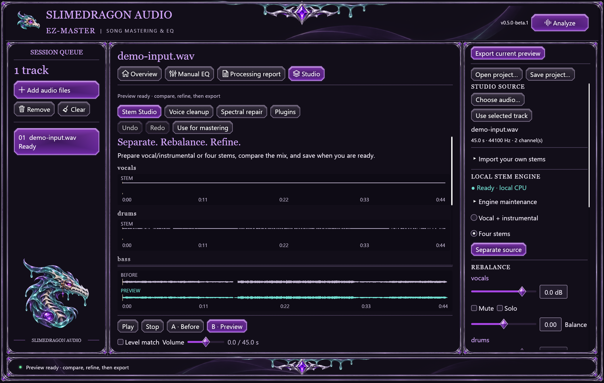

**Rebalance in one place.** Each part has a named row; optional waveforms expand when needed. [Open the current mix capture](docs/images/studio-stems.png). The [earlier 96-part import capture](docs/images/studio-large-import.png) records the larger-bank validation and uses the earlier interface.

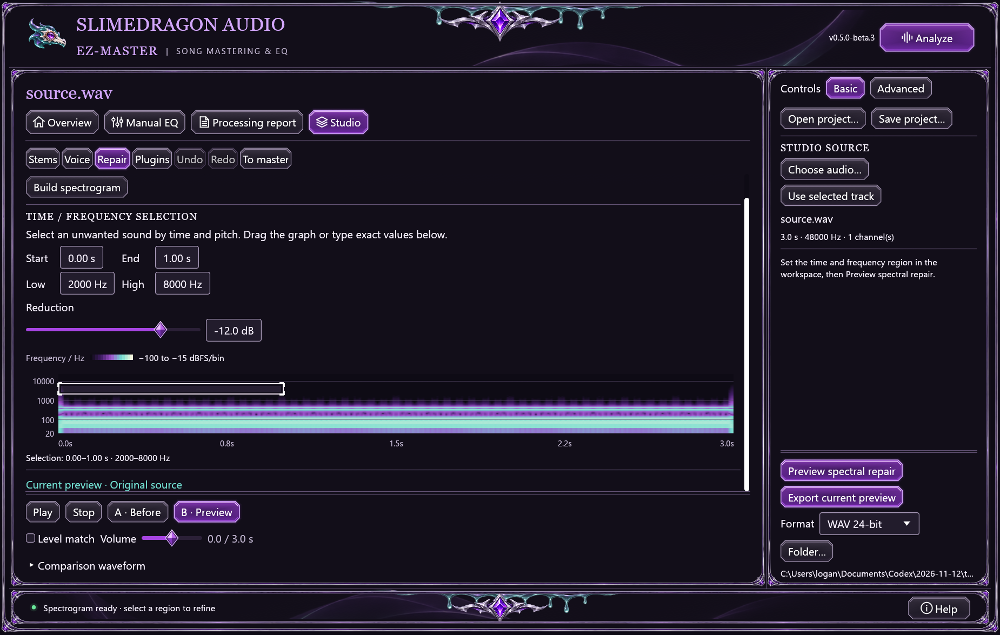

[Open the repair capture](docs/images/studio-repair.png) · [Stem Studio capture](docs/images/studio-stems.png) · [Plugin selection capture](docs/images/studio-plugins.png). These current beta.3 captures use generated test audio; the plugin image shows the initial file/bundle choices, not a loaded third-party effect. [Workflow, model setup, limits and validation](docs/STUDIO.md).

The Preview package includes the desktop, MCP companion and effect worker and uses separate folders/shortcuts from stable. Model setup is optional; imported stems, cleanup and repair work without it. Desktop/local ZIP import reads selected WAV/MP3 audio locally and uploads nothing. Desktop MP3 decoding still requires FFmpeg. **Local browser** editing retains its **128 MiB combined decoded-input budget** and **15-minute per-track guard**; adding tracks divides that budget. A small compressed archive can still exceed decoded limits. The [v2 server preview](docs/HYBRID_STUDIO.md) uploads originals/stem files and applies separate server/ZIP limits. Available working RAM and storage still matter in either mode.

## Try the example track

The same example can also be used to explore Studio's nondestructive preview workflow. See [Studio Preview](#studio-preview).

The repository includes a 45-second electronic-music example based on **Technological Messup** by **Bärghest**, released under **CC0**. The input is a faded, headroom-adjusted excerpt of an existing recording, not an untouched studio premaster.

- [Example input — WAV](examples/audio/demo-input.wav?raw=1)
- [Mastered example — WAV](examples/audio/demo-master.wav?raw=1)
- [Level-matched input — MP3](examples/audio/listen-input.mp3?raw=1)
- [Level-matched master — MP3](examples/audio/listen-master.mp3?raw=1)
- [Credits, source and exact processing](examples/audio/CREDITS.md)

For local playback, open **Examples/Listen.html** in the installed/portable app, or [the source copy](examples/audio/Listen.html) after downloading this repository. The MP3 previews are matched in loudness so a louder file does not automatically seem better. GitHub may download audio links instead of showing a player.

## Your music, your rights

**The app claims 0% ownership and 0% royalties in your music.** You can release, sell, stream or license your own audio without paying the project, adding a watermark or crediting the app.

The **MIT license** lets anyone use, study, change, redistribute and sell the project's original software. Keep its copyright/license notice in software copies. That attribution condition does **not** apply to your music outputs. Third-party material keeps its own rights. Read the [output ownership policy](OUTPUT_OWNERSHIP.md) and [third-party notices](THIRD_PARTY_NOTICES.md).

## Formats and requirements

| Item | Support |
|---|---|
| Desktop | Windows x64; tested on Windows 11 |
| Input | Mono/stereo, 8–384 kHz; WAV is native, other supported codecs use FFmpeg |
| Export | WAV 16/24-bit PCM or 32-bit float; FLAC 16/24-bit; MP3 320 kbps |
| Sample-rate conversion | Optional; requires FFmpeg |
| Processing | Local; full tracks are held in memory. Optional recovery makes separate local copies. |
| Installer data | Settings and exports are kept on your computer and preserved by uninstall |

The installer does not bundle FFmpeg, Python, a DAW, advertising or a cloud mastering service. [Local browser mode](docs/WEB.md) processes audio with Rust/WebAssembly, including real-time EQ and WAV/MP3 export. The separate [v2 hybrid preview](docs/HYBRID_STUDIO.md) adds optional server processing; see the [deployed preview validation](docs/HYBRID_V2_VALIDATION.md). Responsive layouts and desktop-browser benchmarks do not qualify physical iPhone/Android playback or memory. Native Android/iOS apps are future work.

Linux source builds have passed Ubuntu 24.04 x86_64 CI and a separate maintainer-reported Linux-server check. On that server, **all 79 tests and lint checks passed**, mastering and all six export formats were verified, and the GUI passed launch, audio import, mastering and EQ-control checks. Desktop and application-menu launchers were installed. **No application source changes were needed.** See the [Linux validation guide](docs/LINUX.md#additional-linux-server-check).

The server reported **Dummy Output**, with no headphones or speakers connected, so audible hardware playback remains unverified. The file-picker portal was not verified either. The Windows installer channels remain Windows-only; this earlier server check qualifies its named Linux source build and desktop workflow.

## Browser preview

The **desktop app is the flagship workstation**. The browser remains a private, accessible companion, with web/mobile feature coverage expanding as device limits allow. Advanced tools will target desktop first.

**Available in the main web app:** local **320 kbps MP3 export**, desktop-compatible **EQ preset JSON**, and **session ZIP downloads** for mastering and Studio. ZIPs combine the current rendered audio, available imported stems and versioned analysis/settings; full source/reference tracks and undo history are not automatically added. Live EQ spreads filter preparation across processing blocks and coalesces slider bursts. [Workflow, limits and architecture](docs/WEB_EXPORTS.md) · [Tester-requested roadmap, easiest to hardest](docs/BROWSER_PARITY_ROADMAP.md). [Open the updated web app](https://slimedragonair.github.io/SlimeyBeats-EZ-Master/). The isolated [current-work preview](https://slimedragonair.github.io/SlimeyBeats-EZ-Master/current-work/) remains available for testing future changes. Hotfix4 includes the shared EQ preparation changes in desktop; browser export tools and desktop release validation have separate scope.

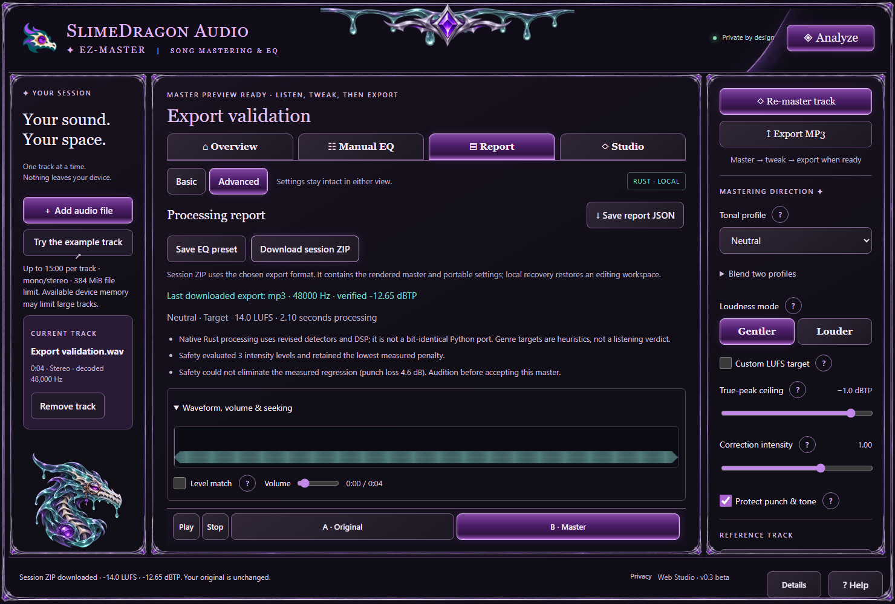

Actual development capture with synthetic test audio. [Validation and remaining device/timing limits](docs/WEB_EXPORT_VALIDATION.md). MP3 is lossy and adds codec padding; keep WAV for exact loops, aligned stems and tracks at the 15-minute reimport boundary.

Open the [browser studio](https://slimedragonair.github.io/SlimeyBeats-EZ-Master/) without installing anything. **Local mode** keeps audio in the tab: Analyze → Master → live EQ → Export WAV or MP3. Local mastering supports **15 minutes per mono/stereo track**, with separate **384 MiB decoded PCM and source-file limits**; local Studio has a **128 MiB combined decoded-input limit**. Device memory can impose a lower limit. Local decoding uses 48 kHz and exports PCM/float WAV or 320 kbps MP3. The [v2 server preview](docs/HYBRID_STUDIO.md) instead uploads originals, retains full-resolution audio remotely and streams listening previews, with one-hour/2 GiB admission subject to additional resources. The desktop also supports batch queues and native-only tools. [Local browser privacy, compatibility and build instructions](docs/WEB.md).

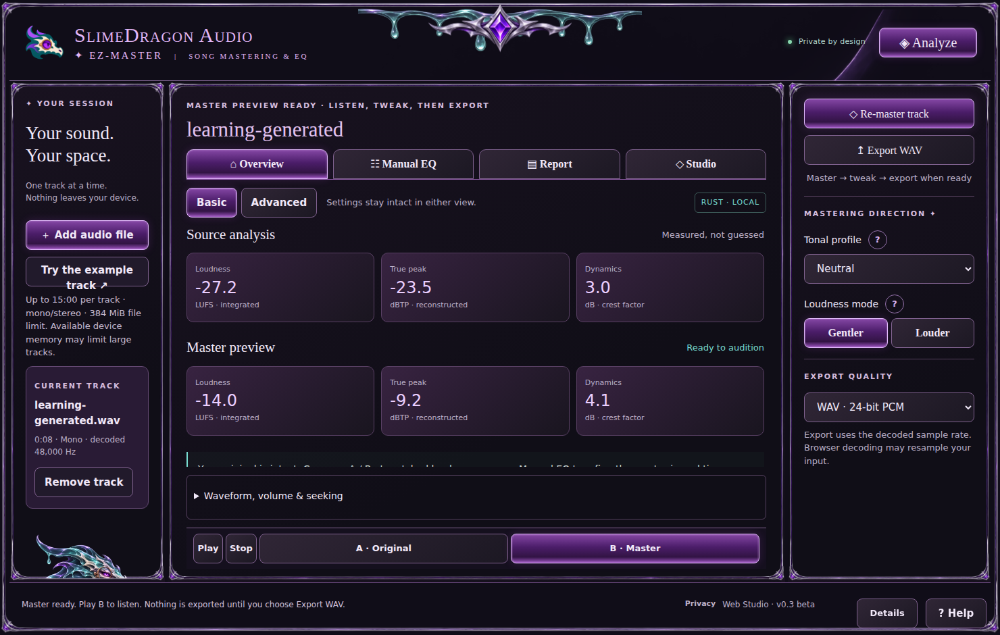

The browser screenshot above uses generated test audio in the current app. [Open it at full size](docs/images/web-basic-overview.png). Basic keeps everyday choices visible; Advanced reveals more detail. Manual EQ shares its curve graph with the spectrum.

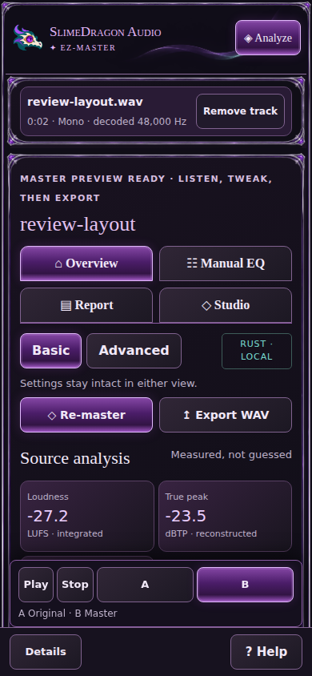

**Phone layout:** Re-master and Export stay separate, and playback remains available while scrolling. The capture uses generated test audio. [Open it at full size](docs/images/web-phone-master.png). This is browser emulation, not physical iPhone/Android qualification.

In local mode, audio and measurements stay in tab memory unless downloaded or saved through opt-in local recovery, which has explicit disable/delete controls and separate size limits. The v2 server preview uploads original/reference files during import and runs supported heavy work remotely. Temporary projects and guest access expire within one hour; local recovery does not download full streamed projects or store credentials. Export or save a session ZIP before leaving; a ZIP is not a permanent server account or full source/reference/history backup. Closing the tab forgets access and does not confirm server deletion. Input codecs, playback and memory still depend on the browser/device. Native Android/iOS packages are not included.

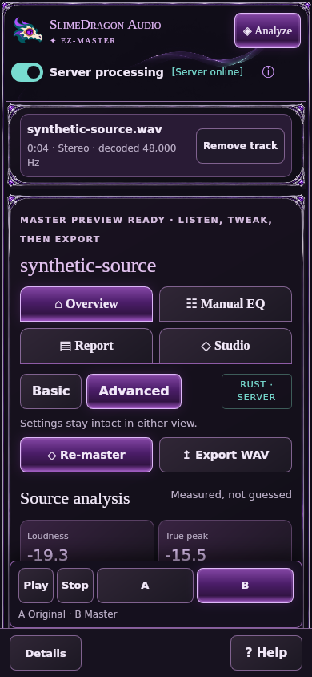

**Historical hybrid capture:** this Linux WebKit image shows the earlier Master-only bridge with synthetic audio and an owned native API fixture. It does not establish deployment or device acceptance for full v2 offload. [Current-work preview](https://slimedragonair.github.io/SlimeyBeats-EZ-Master/current-work/) · [v2 source workflow, limits and verification boundary](docs/HYBRID_STUDIO.md).

## Evidence and limits

**Hotfix4 release validation:** consult [HOTFIX4-VALIDATION.json](https://github.com/slimedragonair/SlimeyBeats-EZ-Master/releases/download/v0.5.0-beta.3/HOTFIX4-VALIDATION.json) for build revision **2026111501**, final source/runtime hashes, test outcomes and installer scope. Installer QA uses a private identity with the production NSIS template and byte-identical payload, including a Hotfix3 → Hotfix4 upgrade; it does not qualify production registration. Earlier editor, Doctor, browser and Hotfix3 results below retain their recorded source/build scope. [Release evidence and limits](docs/HOTFIX4.md).

**Hotfix3 recovery/report checks, November 14:** **352 local Windows native release tests passed**, with two opt-in archive tests excluded; strict format/Clippy checks and 42-tool release MCP protocol checks passed. An actual GUI process was terminated after saving, its input moved, and identical audio/track metadata restored and re-saved. Freshly built Chromium, Firefox and Linux WebKit previews passed recovery, storage-race, editable-Studio and report-privacy checks; existing mastering, Studio and learning/layout browser regressions also passed. The release's **Hotfix3 validation** records exact source/build hashes, hosted checks and installer scope. These checks do not establish physical iPhone/Android storage capacity, hardware audibility or operating-system clipboard acceptance. [Recovery/report workflow and limits](docs/RECOVERY_AND_REPORTING.md).

The figures below qualify their named candidates.

**Hotfix2 update/setup checks, November 14:** the Windows release-profile suite passed **285 native tests** (two opt-in archive tests excluded), with strict Clippy and native update-screen captures at 1100×720 and 1480×940. Actual private codec installation/execution passed on Windows x64 and Ubuntu 24.04 WSL: WAV/FLAC retained exact PCM, MP3 preserved decoded timing, and cached setup/fresh-process lookup worked without another download. These synthetic codec tests do not establish physical audibility. Candidate installer hashes, hosted checks and installation scope are recorded in the release's **Hotfix2 validation** asset; historical results below remain unchanged.

**Beta.3 UI and workflow qualification, November 14:** 171 Windows and 173 Linux native tests, strict Clippy and optimized builds passed. [Native release-profile CI #50](https://github.com/slimedragonair/SlimeyBeats-EZ-Master/actions/runs/43587342464) and [browser CI #33](https://github.com/slimedragonair/SlimeyBeats-EZ-Master/actions/runs/43587342485) passed on the qualified UI source: Chromium, Firefox and WebKit each completed 20 learning groups alongside import/mastering/Studio checks. Independent reviews scored the inspected native/browser layouts 9/10 for readability, task clarity, layout/usability and polish, with candidate-specific scope. [Exact artifacts, input coverage and remaining limits](docs/UX_VALIDATION.md). These results remain distinct from historical reports below.

**Initial beta.3 larger-bank results:** **115 Windows / 117 Linux native tests** passed in the debug/test profile, plus **9 Windows / 10 Linux MCP regressions** and **11 native-host web-DSP binding tests**. Windows native used the `schemas` feature. Live 38-tool checks passed 24/64/100-part loose and paired-ZIP banks; release data/project checks passed eleven-part full-length and 96-part synthetic banks with original inputs unchanged. Chrome 156, Firefox 144 and Linux WebKit 26 each passed **20 workflow groups**. [Measured scope, fresh-agent results and remaining qualification](docs/STUDIO_BETA3_VALIDATION.md).

The subsequent merge fixes cover Unicode Windows connection setup, unapplied fader changes, and cross-source project origins. [Merge regression checks and release/deployment status](docs/MERGE_VALIDATION.md). The badges above show current hosted CI; local validation is recorded separately.

### Earlier beta.2 qualification

The results below belong to the earlier nine-part candidate and do not substitute for the beta.3 qualification above.

Earlier native suites passed **107 Windows / 109 Linux tests**, with **nine Windows / ten Linux MCP regressions**. The refreshed browser distribution passed **18 groups each in Chrome 156, Firefox 144 and Linux WebKit 26**; source-site Chromium 143 also passed **18 groups**. Four actual native/browser views independently scored **9/9/9**. Installer lifecycle passed under an **isolated QA app ID/menu group**, using the production NSIS template and byte-identical runtime payload. The test preserved existing Preview/stable installations and did not install the production Preview registration. See the [dated Studio status](docs/STUDIO.md#validation-status--november-13-2026).

| Scope | Evidence and remaining checks |
|---|---|
| Earlier beta.2 native / MCP | **107 Windows / 109 Linux native tests and nine Windows / ten Linux MCP regressions passed**, with format checks, strict Clippy and release builds. Actual 38-tool MCP ZIP workflows checked paired encodings, sample-exact WAVs, MP3/fallback, explicit subsets, unchanged sources and error retention. [Status](docs/STUDIO.md#validation-status--november-13-2026). |
| Earlier beta.2 browser | The refreshed distribution passed **18 groups each in Chrome 156, Firefox 144 and Linux WebKit 26**; source-site **Chromium 143 also passed 18 groups**. Checks cover review summaries, omitted-part/keyboard disclosure, names/manifests, long labels and normal clicks. The phone Import control regression is fixed. [Scope](docs/STUDIO.md#validation-status--november-13-2026). |
| Optional VST3 worker | Release host build, strict Clippy and host tests passed. Fault checks covered null factories, worker exit and stalled-plugin cancellation while retaining the MCP source. This qualifies the tested fixtures, not arbitrary plugins. |
| Earlier beta.2 appearance / compatibility | Independent native desktop/compact and browser desktop/phone reviews each scored **9/9/9** for look, polish and readability. Current desktop GUI checks reopened earlier and newly named projects without errors, with preview/playback ready; the named project retained all nine original part names. |
| Fresh-agent MCP workflow | Using live help/schemas alone, an agent imported nine paired parts, changed only vocals and prepared a preview without exporting. A separate explicit save request then produced **24-bit WAV/report, nine raw stems and a project**, retaining settings, without invoking mastering; the bridge exited with code 0. This qualifies the tested protocol harness. |
| Full-length desktop fixture | An authorized anonymous 11-part archive was reviewed and nine parts explicitly imported. A **20-check retest passed**, including default role assignment without kind overrides. All **155,347,200 PCM comparisons matched**, with original ZIP/WAV hashes and modification times retained. This does not qualify the real-track browser workflow or establish listening quality. [Measurements and limits](docs/STUDIO.md#validation-status--november-13-2026). |
| Earlier native Studio qualification | Beta.1 passed **94 Windows / 96 Linux native tests**, strict Clippy and release builds. Local model setup, two/four separation, projects, exports and native renders passed. Linux used a synthetic audio sink. These are historical results. [Scope](docs/STUDIO.md). |
| Local MCP source preview | **42 tools** in 0.2.0-beta.3 Hotfix3, including ZIP inspection/import; friendly stem names are exposed separately from stable IDs. Current beta.3 measurements are linked above; the tables in this section preserve earlier qualification. Older stdio/export and discovery checks remain historical. [Setup](docs/MCP.md) · [Studio validation](docs/STUDIO.md). Published v0.4.2 installers do not include this companion. |
| Linux-server integration | Maintainer-reported pass: **79 tests and lint**, mastering, six export formats, GUI launch/import/mastering/EQ, and installed desktop/menu launchers, without application source changes. Hardware playback and the file-picker portal remain unverified. |
| Browser audio | Actual worker mastering and AudioWorklet PCM comparison with the shared Rust processor; deterministic EQ suggestions; mono/stereo/silence; three decoded and independently measured WAV formats. |
| Browser session safety | Same-name reference replacement invalidates the old master; cancellation and late decode results preserve the current track/job; invalid imports preserve the session; processing works offline after loading; listening volume leaves exported samples unchanged. |
| Earlier browser Studio qualification | Chrome, Firefox and Linux WebKit passed two/four imported-stem editing, cleanup, repair, A/B, undo/redo, WAV/ZIP saving and mastering handoff. Failed/cancelled edits preserve the previous preview. Its separate 128 MiB combined-input budget is documented in the [Studio guide](docs/STUDIO.md). |
| Browser duration and memory | Chrome accepted real 6-/15-minute WAV and MP3 imports and completed a 15-minute master/playback/EQ/export workflow. **40 × 30-second replacement/master/export cycles passed** without continuing memory growth. The 15-minute run peaked around **3.64 GiB of browser private memory**; phones can have lower capacity. [Detailed measurements](docs/WEB_VALIDATION.md#long-tracks-and-repeated-use). |
| Browser MP3 timing | Correct recognized encoder padding when WebKit includes it in decoded duration, preserving the strict 15-minute cap. Real long imports and independent mono/stereo timing comparisons cover this boundary. [Scope and results](docs/WEB_VALIDATION.md#mp3-padding-at-the-duration-boundary). |
| Browser matrix | Chromium, Firefox and Linux WebKit integration in [Browser checks](https://github.com/slimedragonair/SlimeyBeats-EZ-Master/actions/workflows/web.yml). Required together with Windows/Linux checks before merging. |
| Earlier appearance review | Actual beta.1 Studio captures—four native views and desktop/phone browser repair—passed independent review **≥9/10** for look, polish and readability. Earlier mastering/EQ states passed separately. Static review does not certify interaction or sound. |

Read the [browser validation record](docs/WEB_VALIDATION.md), [UI qualification](docs/UX_VALIDATION.md) and [Linux validation guide](docs/LINUX.md) for fixtures, results and remaining gaps. Badges track `main`; historical reports qualify their named candidates. **Physical iPhone/Android playback is still unqualified.** Linux-server build, export and GUI checks passed for the reported candidate; audible playback awaits a connected output device, and the file-picker portal still needs testing. A responsive layout or synthetic audio sink does not establish device acceptance.

The following evidence concerns the published native release, rather than the larger current-source suite:

The v0.4.2 release passed **73 automated regression tests**. The 0.4.1 real-music retest covered 12 songs and 24 full-song renders, with independent peak/integrity checks, six export formats and additional EQ/mono/sample-rate cases. Version 0.4.2 packages the same DSP with documentation, licensing, demo audio and an installer.

On three songs on the development PC, median processing ran about **18–22× real time** with four threads. Those timings exclude decoding, startup and export. They are not competitor benchmarks or a subjective sound-quality score. Genre profiles and artifact indicators remain heuristics; listening is essential. See [validation](rust/docs/CORPUS_VALIDATION.md) and [DSP safety design](rust/docs/DSP_SAFETY.md).

## Developers

```powershell
cd rust
cargo build --release --bins
cargo test --release --all-targets
cargo clippy --all-targets -- -D warnings
cargo fmt --all -- --check
```

The native app is in `rust/`; shared built-in profile data is in `mastercraft/data/`. The older Python implementation remains available as a separate reference implementation, with its [historical guide](docs/legacy/python-guide.md). The Rust and Python processors are not sample-identical and do not have identical feature sets.

[Contributing](CONTRIBUTING.md) · [Build and packaging](docs/BUILDING.md) · [Release checklist](docs/RELEASING.md) · [Security reports](SECURITY.md) · [Changelog](CHANGELOG.md)

## License and credits

Original project code, documentation and original bundled SlimeDragon artwork: [MIT](LICENSE), copyright © 2026 SlimeDragon Audio contributors. Separately credited assets and dependencies retain their own licenses. The example recording is CC0; the small Cipher regression fixture is CC BY 4.0. Neither is relicensed by the MIT notice.
