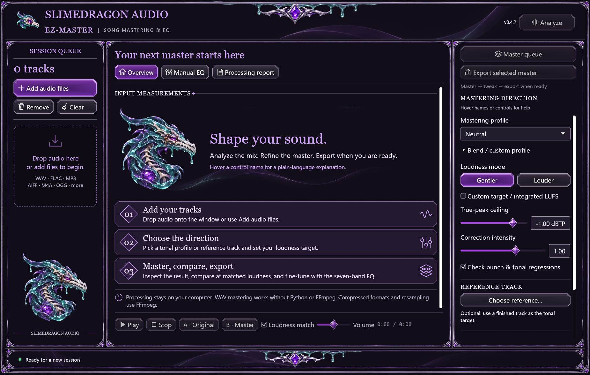
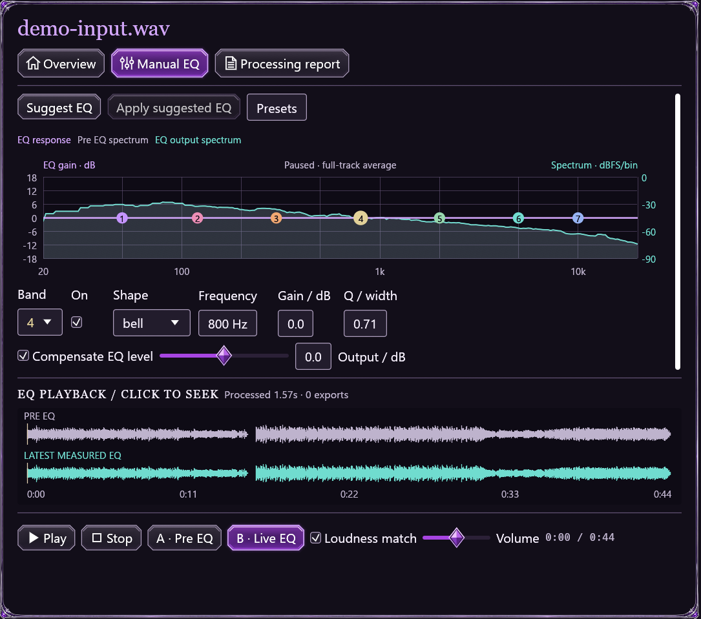

# SlimeyBeats-EZ-Master

[](https://github.com/slimedragonair/SlimeyBeats-EZ-Master/actions/workflows/ci.yml)
[](https://github.com/slimedragonair/SlimeyBeats-EZ-Master/actions/workflows/web.yml)
[](https://github.com/slimedragonair/SlimeyBeats-EZ-Master/releases/latest)
[](LICENSE)

**Local song mastering. Real-time EQ. Your music stays yours.**

SlimeyBeats-EZ-Master is a Rust mastering app with a Windows desktop release, Linux source support, and a private browser preview. Analyze a mix, prepare a master, compare it at matched loudness, adjust the EQ while listening, and export when you are ready.

**Windows x64 · Linux source · Browser preview · MIT licensed · Local processing**

**Studio Preview 0.5.0-beta.1:** local vocal/instrumental and four-stem separation, imported-stem rebalancing, voice cleanup, spectral repair, self-contained projects and optional isolated VST3 effects. The included MCP companion exposes 36 self-describing tools. Browser Studio supports imported stems, mixing, cleanup and repair using shared Rust DSP. The Preview installs separately from stable; these additions are **not included in the v0.4.2 installer**. See the [Studio guide and validation](docs/STUDIO.md).

[Open browser preview](https://slimedragonair.github.io/SlimeyBeats-EZ-Master/) · [Download Windows](https://github.com/slimedragonair/SlimeyBeats-EZ-Master/releases/download/v0.4.2/SlimeyBeats-EZ-Master-0.4.2-Setup.exe) · [Get started](#get-started) · [Example audio](#try-the-example-track) · [User guide](docs/USER_GUIDE.md) · [Build from source](docs/BUILDING.md) · [Your music rights](OUTPUT_OWNERSHIP.md) · [Questions and ideas](https://github.com/slimedragonair/SlimeyBeats-EZ-Master/discussions)

**Installer note:** v0.4.2 is unsigned, so Windows may show an unknown-publisher prompt. See the [installation guide](docs/INSTALLATION.md).



**Analyze → Master → Export.** Analyze is at the top right. Master queue prepares a preview; the separate Export selected master button saves it when you are ready. You can tweak Manual EQ or re-master in between. [Open the welcome screen at full size](docs/images/welcome.png).

## What it does

- **Analyze first.** Inspect loudness, true peak, tonal balance and other measurements before deciding what to change.
- **Master, then refine.** Mastering creates a preview. Re-master or tweak it as often as you need; Export is a separate action.
- **Edit EQ in real time.** Seven editable bands share one graph with the live spectrum. A pinned waveform and playback controls keep the music accessible.
- **Start with an editable suggestion.** Suggested EQ is deterministic and gently influenced by the selected tonal profile. It is rule-based assistance, not a promise that every mix needs correction.
- **Compare fairly.** Original/master and pre-EQ/live-EQ comparisons support listening-only loudness matching.
- **Export carefully.** WAV, FLAC and MP3 options, decoded-file peak checks, optional integer dither and filenames that preserve existing outputs.
- **Learn as you go.** Hover control names for plain-language explanations of LUFS, peak ceilings, frequency, gain, Q and other terms.
- **Edit parts and recordings (Studio development).** Rebalance stems, clean a voice, repair a selected time/frequency region, undo, compare and export separately. Neural extraction and compatible VST3 effects target desktop; imported-stem editing also works in the browser. [Workflows and limits](docs/STUDIO.md).
- **Connect an AI assistant (source preview).** The optional local MCP companion exposes analysis, mastering previews, editable EQ and explicit exports through the desktop Rust engine. Open a prepared session in the desktop app to listen and refine it. [Setup, tools and privacy](docs/MCP.md).



**EQ while listening:** seven bands share a graph with the spectrum; the waveform and playback controls stay below. [Open the EQ detail at full size](docs/images/manual-eq-detail.png) or [the complete Manual EQ screen](docs/images/manual-eq.png). The detail above is a crop of the native app capture; no controls or measurements were redrawn.

## Get started

1. Download the [Windows Setup.exe](https://github.com/slimedragonair/SlimeyBeats-EZ-Master/releases/download/v0.4.2/SlimeyBeats-EZ-Master-0.4.2-Setup.exe) for Windows x64. A [portable ZIP](https://github.com/slimedragonair/SlimeyBeats-EZ-Master/releases/download/v0.4.2/SlimeyBeats-EZ-Master-0.4.2.zip) is available too.
2. Run Setup. It installs for your current Windows account without requiring administrator access.
3. Open the app and add or drop a mono/stereo audio file.
4. Click **Analyze** at the top right. Choose a profile, loudness mode and peak ceiling, then **Master queue**.
5. Compare, adjust Manual EQ or re-master. Expand **Export settings** to choose formats and a folder, then **Export selected master**.

WAV input and output work immediately, without Python or FFmpeg. Compressed formats and sample-rate conversion require FFmpeg/ffprobe installed separately. See [installation and codec setup](docs/INSTALLATION.md).

## Studio Preview

Separate vocals/instrumental or four stems, or import your own aligned parts. Rebalance, clean a voice or repair a selected region, then compare and undo before saving. **Use for mastering** sends the prepared mix into the familiar mastering workflow; Export remains a separate action.


[Open the native capture at full size](docs/images/studio-repair.png) · [Stem Studio capture](docs/images/studio-stems.png) · [VST3 controls capture](docs/images/studio-plugins.png). These are renderer captures of the running beta, using the credited example audio. [Workflow, model setup, limits and validation](docs/STUDIO.md).

The Preview installer includes the desktop, MCP companion and effect worker and uses separate folders/shortcuts from stable. Model setup is optional; imported stems, cleanup and repair work without it. The browser's editing subset keeps audio private and uses a separate 128 MiB combined-input budget.

## Try the example track

The same example can also be used to explore Studio's nondestructive preview workflow. See [Studio Preview](#studio-preview).

The repository includes a 45-second electronic-music example based on **Technological Messup** by **Bärghest**, released under **CC0**. The input is a faded, headroom-adjusted excerpt of an existing recording, not an untouched studio premaster.

- [Example input — WAV](examples/audio/demo-input.wav?raw=1)
- [Mastered example — WAV](examples/audio/demo-master.wav?raw=1)
- [Level-matched input — MP3](examples/audio/listen-input.mp3?raw=1)
- [Level-matched master — MP3](examples/audio/listen-master.mp3?raw=1)
- [Credits, source and exact processing](examples/audio/CREDITS.md)

For local playback, open **Examples/Listen.html** in the installed/portable app, or [the source copy](examples/audio/Listen.html) after downloading this repository. The MP3 previews are matched in loudness so a louder file does not automatically seem better. GitHub may download audio links instead of showing a player.

## Your music, your rights

**The app claims 0% ownership and 0% royalties in your music.** You can release, sell, stream or license your own audio without paying the project, adding a watermark or crediting the app.

The **MIT license** lets anyone use, study, change, redistribute and sell the project's original software. Keep its copyright/license notice in software copies. That attribution condition does **not** apply to your music outputs. Third-party material keeps its own rights. Read the [output ownership policy](OUTPUT_OWNERSHIP.md) and [third-party notices](THIRD_PARTY_NOTICES.md).

## Formats and requirements

| Item | Support |
|---|---|
| Desktop | Windows x64; tested on Windows 11 |
| Input | Mono/stereo, 8–384 kHz; WAV is native, other supported codecs use FFmpeg |
| Export | WAV 16/24-bit PCM or 32-bit float; FLAC 16/24-bit; MP3 320 kbps |
| Sample-rate conversion | Optional; requires FFmpeg |
| Processing | Local; full tracks are held in memory |
| Installer data | Settings and exports are kept on your computer and preserved by uninstall |

The installer does not bundle FFmpeg, Python, a DAW, advertising or a cloud mastering service. The [browser preview](docs/WEB.md) processes audio locally with Rust/WebAssembly, including real-time EQ and WAV export. It has a responsive phone layout; physical iPhone and Android devices still need qualification. Native Android/iOS apps are future work.

Linux source builds have passed Ubuntu 24.04 x86_64 CI and a separate maintainer-reported Linux-server check. On that server, **all 79 tests and lint checks passed**, mastering and all six export formats were verified, and the GUI passed launch, audio import, mastering and EQ-control checks. Desktop and application-menu launchers were installed. **No application source changes were needed.** See the [Linux validation guide](docs/LINUX.md#additional-linux-server-check).

The server reported **Dummy Output**, with no headphones or speakers connected, so audible hardware playback remains unverified. The file-picker portal was not verified either. The downloadable v0.4.2 installer above remains Windows-only; this server check validates the Linux source build and desktop workflow.

## Browser preview

The **desktop app is the flagship workstation**. The browser remains a private, accessible companion, with web/mobile feature coverage expanding as device limits allow. Advanced tools will target desktop first.

Open the [private browser studio](https://slimedragonair.github.io/SlimeyBeats-EZ-Master/) without installing anything. Audio stays in your tab: Analyze → Master → live EQ → Export WAV. Browser preview v0.2 supports **up to 15 minutes per mono/stereo track**, with separate **384 MiB decoded PCM and source-file limits**. Available device memory can impose a lower practical limit. It uses a 48 kHz decoded sample rate and exports 16/24-bit PCM or 32-bit float WAV. The app keeps one active mix plus an optional reference; importing another mix replaces the previous one. The desktop app supports longer files, source-rate handling, batch queues and compressed exports. See [privacy, compatibility, limits and build instructions](docs/WEB.md).


The browser screenshot above is from the running app. [Open it at full size](docs/images/web-preview.png). On phones, select one of seven bands and keep the playback dock available while editing.


**Phone layout:** the EQ and spectrum share a graph, and playback stays available while scrolling. [Open the phone capture at full size](docs/images/web-phone-eq.png). This is a responsive browser capture, not physical iPhone/Android qualification.

Audio and measurements stay in tab memory until you download them. There are no uploads, accounts, analytics or server DSP. The host still serves ordinary static files. Reloading/closing the tab discards the session; save your WAV first. Input codec support and available memory depend on the browser/device. Native Android/iOS packages are not included.

## Evidence and limits

| Current source scope | Verified behavior / maintained checks |
|---|---|
| Windows / Linux native | Studio beta passed **94 Windows / 96 Linux native tests**, strict Clippy and release builds. Real local model setup, two/four separation, projects, exports and native Studio render checks passed. Linux used a synthetic audio sink. [Scope](docs/STUDIO.md). |
| Local MCP source preview | **36 tools**, eight current Windows companion regressions, real stdio workflows and six verified export formats. Studio adds model/imported stems, cleanup, repair, plugins, projects and mastering handoff. A fresh agent completed imported-stem editing using only live discovery/help. [Setup](docs/MCP.md) · [Studio validation](docs/STUDIO.md). Published v0.4.2 installers do not include this companion. |
| Linux-server integration | Maintainer-reported pass: **79 tests and lint**, mastering, six export formats, GUI launch/import/mastering/EQ, and installed desktop/menu launchers, without application source changes. Hardware playback and the file-picker portal remain unverified. |
| Browser audio | Actual worker mastering and AudioWorklet PCM comparison with the shared Rust processor; deterministic EQ suggestions; mono/stereo/silence; three decoded and independently measured WAV formats. |
| Browser session safety | Same-name reference replacement invalidates the old master; cancellation and late decode results preserve the current track/job; invalid imports preserve the session; processing works offline after loading; listening volume leaves exported samples unchanged. |
| Browser Studio development | Chrome, Firefox and Linux WebKit passed two/four imported-stem editing, cleanup, repair, A/B, undo/redo, WAV/ZIP saving and mastering handoff. Failed/cancelled edits preserve the previous preview. Its separate 128 MiB combined-input budget is documented in the [Studio guide](docs/STUDIO.md). |
| Browser duration and memory | Chrome accepted real 6-/15-minute WAV and MP3 imports and completed a 15-minute master/playback/EQ/export workflow. **40 × 30-second replacement/master/export cycles passed** without continuing memory growth. The 15-minute run peaked around **3.64 GiB of browser private memory**; phones can have lower capacity. [Detailed measurements](docs/WEB_VALIDATION.md#long-tracks-and-repeated-use). |
| Browser MP3 timing | Correct recognized encoder padding when WebKit includes it in decoded duration, preserving the strict 15-minute cap. Real long imports and independent mono/stereo timing comparisons cover this boundary. [Scope and results](docs/WEB_VALIDATION.md#mp3-padding-at-the-duration-boundary). |
| Browser matrix | Chromium, Firefox and Linux WebKit integration in [Browser checks](https://github.com/slimedragonair/SlimeyBeats-EZ-Master/actions/workflows/web.yml). Required together with Windows/Linux checks before merging. |
| Appearance | Actual Studio beta captures—four native views and desktop/phone browser repair—passed independent review **≥9/10** for look, polish and readability. Earlier mastering/EQ states passed separately. Static review does not certify interaction or sound. |

Read the [browser validation record](docs/WEB_VALIDATION.md) and [Linux validation guide](docs/LINUX.md) for environments, fixtures, measured results, reproduction commands and remaining gaps. The CI badges and linked artifacts show the latest commit's status. **Physical iPhone/Android playback is still unqualified.** Linux-server build, export and GUI checks passed; audible playback awaits a connected output device, and the file-picker portal still needs testing. A responsive layout or synthetic audio sink does not establish device acceptance.

The following evidence concerns the published native release, rather than the larger current-source suite:

The v0.4.2 release passed **73 automated regression tests**. The 0.4.1 real-music retest covered 12 songs and 24 full-song renders, with independent peak/integrity checks, six export formats and additional EQ/mono/sample-rate cases. Version 0.4.2 packages the same DSP with documentation, licensing, demo audio and an installer.

On three songs on the development PC, median processing ran about **18–22× real time** with four threads. Those timings exclude decoding, startup and export. They are not competitor benchmarks or a subjective sound-quality score. Genre profiles and artifact indicators remain heuristics; listening is essential. See [validation](rust/docs/CORPUS_VALIDATION.md) and [DSP safety design](rust/docs/DSP_SAFETY.md).

## Developers

```powershell
cd rust
cargo build --release --bins
cargo test --release --all-targets
cargo clippy --all-targets -- -D warnings
cargo fmt --all -- --check
```

The native app is in `rust/`; shared built-in profile data is in `mastercraft/data/`. The older Python implementation remains available as a separate reference implementation, with its [historical guide](docs/legacy/python-guide.md). The Rust and Python processors are not sample-identical and do not have identical feature sets.

[Contributing](CONTRIBUTING.md) · [Build and packaging](docs/BUILDING.md) · [Release checklist](docs/RELEASING.md) · [Security reports](SECURITY.md) · [Changelog](CHANGELOG.md)

## License and credits

Original project code, documentation and original bundled SlimeDragon artwork: [MIT](LICENSE), copyright © 2026 SlimeDragon Audio contributors. Separately credited assets and dependencies retain their own licenses. The example recording is CC0; the small Cipher regression fixture is CC BY 4.0. Neither is relicensed by the MIT notice.
