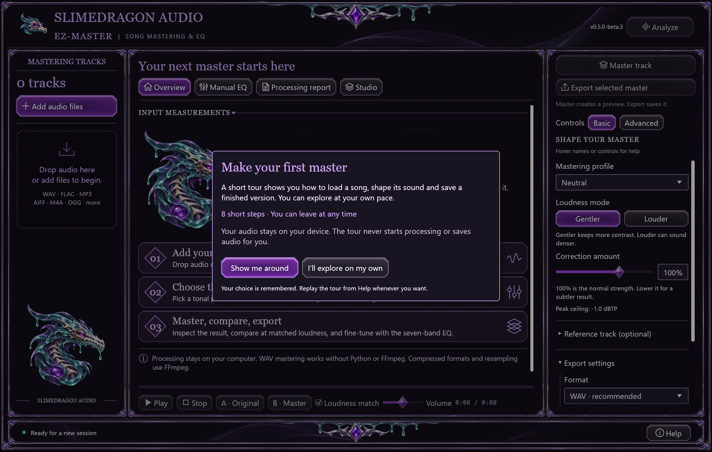
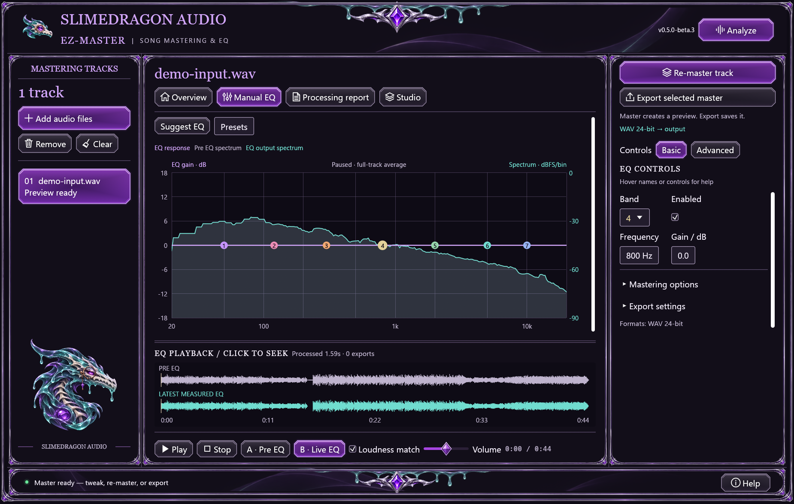
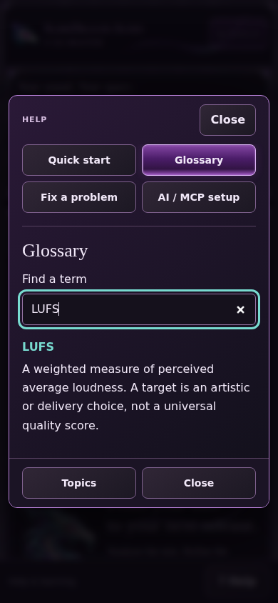
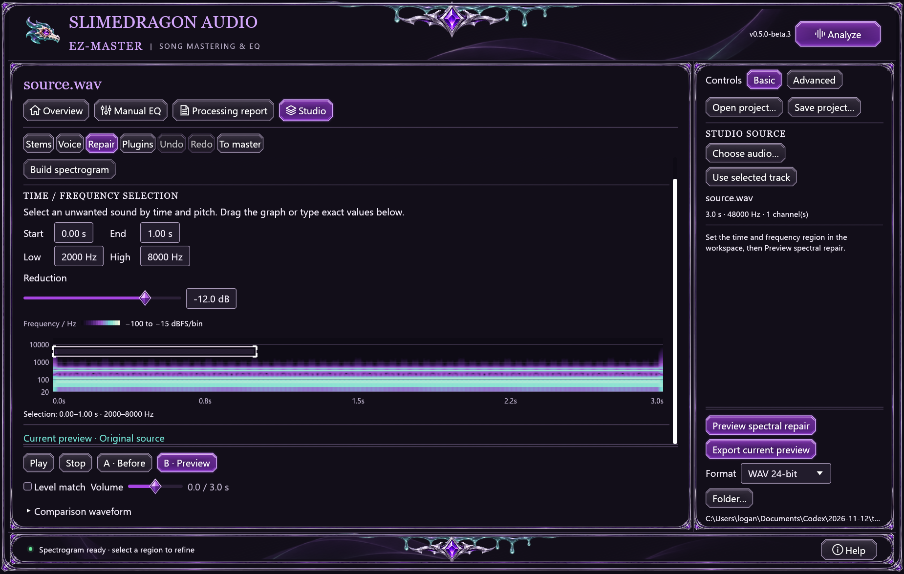
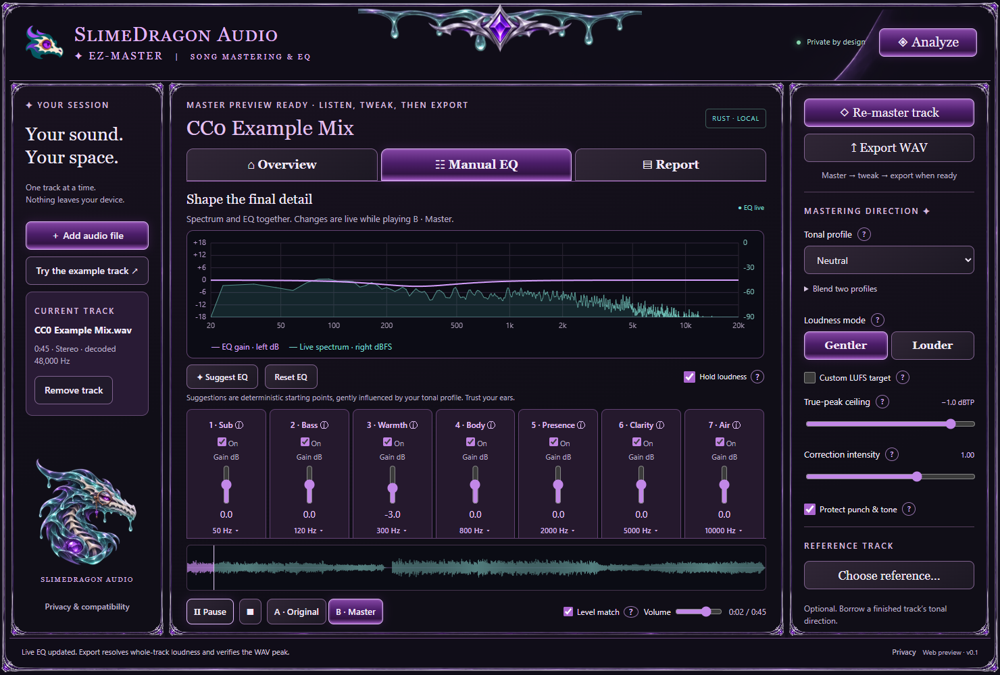
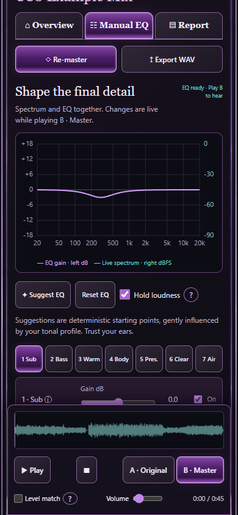

# SlimeyBeats-EZ-Master

[](https://github.com/slimedragonair/SlimeyBeats-EZ-Master/actions/workflows/ci.yml)
[](https://github.com/slimedragonair/SlimeyBeats-EZ-Master/actions/workflows/web.yml)
[](https://github.com/slimedragonair/SlimeyBeats-EZ-Master/releases/tag/v0.5.0-beta.3)
[](https://github.com/slimedragonair/SlimeyBeats-EZ-Master/releases/latest)
[](LICENSE)

**Local song mastering. Real-time EQ. Your music stays yours.**

SlimeyBeats-EZ-Master is a Rust mastering app with a Windows desktop release, Linux source support, and a private browser preview. Analyze a mix, prepare a master, compare it at matched loudness, adjust the EQ while listening, and export when you are ready.

**Windows x64 · Linux source · Browser preview · MIT licensed · Local processing**

[Download desktop preview — Windows](https://github.com/slimedragonair/SlimeyBeats-EZ-Master/releases/download/v0.5.0-beta.3/SlimeyBeats-EZ-Master-0.5.0-beta.3-Setup.exe) · [Open browser preview](https://slimedragonair.github.io/SlimeyBeats-EZ-Master/) · [Get started](#get-started) · [Example audio](#try-the-example-track) · [User guide](docs/USER_GUIDE.md) · [Build from source](docs/BUILDING.md) · [Your music rights](OUTPUT_OWNERSHIP.md) · [Questions and ideas](https://github.com/slimedragonair/SlimeyBeats-EZ-Master/discussions)

**Studio Preview 0.5.0-beta.3** includes the guided desktop interface, Studio, the **0.2.0-beta.3 MCP companion** and the isolated VST3 worker. Import aligned stems from multiple files or a Suno/stem ZIP with **no fixed imported-part count**, rebalance parts, clean a voice, repair a region and save projects. Optional local separation produces two/four stems. Browser Studio **0.3.0-beta.3** shares Rust DSP for imported-stem editing. Preview installs separately from stable. [Release notes and downloads](https://github.com/slimedragonair/SlimeyBeats-EZ-Master/releases/tag/v0.5.0-beta.3) · [Studio guide](docs/STUDIO.md).

Prefer the earlier mastering-only release? [Stable v0.4.2](https://github.com/slimedragonair/SlimeyBeats-EZ-Master/releases/tag/v0.4.2) remains available; it does not include Studio, MCP or the new tour. The hosted browser updates from `main` after its checks pass. Desktop remains the flagship for neural extraction, native effects and larger projects.

**Bulk import:** choose several stem files at once or open a Suno/stem ZIP, review the parts, then import explicitly. Within one logical source folder, matching WAV/MP3 basenames count as one part: WAV is preferred, MP3 is optional, and a missing preferred encoding falls back to the available one. Prefer a consistent encoding across the bank; fallback can fail alignment when decoded lengths differ. Guitar, piano, synth, strings and percussion have named types; extensible `part_N` IDs cover repeated/custom instruments. Mixing, direct edits, raw stem exports and desktop projects retain the selected bank, subject to available memory and input safety budgets. All discovered parts start selected for review; uncheck anything you do not want. **Automatic model separation still produces only two/four stems.** Import needs no model.

Native imports retain **512 MiB decoded per input by default**, with a separate **4 GiB decoded-bank guard**; processing needs additional RAM. Owner-configured MCP settings can change the per-input limit. Browser Studio retains its **128 MiB combined decoded-input limit**; desktop is recommended for full-length sets. [Import workflow and limits](docs/STUDIO.md#import-a-whole-stem-set).

**Recognizable part names:** original friendly names appear on faders and processing targets and survive edits/undo, raw export manifests and desktop projects. Stable kind IDs and WAV filenames remain unchanged. Native loose-file and ZIP imports preserve distinct source folders, so different takes can share a friendly basename while keeping unique IDs. Filename-based role suggestions keep backing/harmony separate from lead vocals and order the review cards; all parts start selected. This is a naming heuristic, not audio inference: review every selected part before importing.

**Installer note:** these Windows builds are unsigned, so Windows may show an unknown-publisher prompt. See the [installation guide](docs/INSTALLATION.md).


## Start simple, go deeper

The desktop preview starts with **Basic controls**, an optional **eight-step tour**, and **bottom-right Help** with plain-language terms, troubleshooting and desktop MCP setup. **Advanced** reveals detailed controls; changing views preserves your exact audio settings. Finishing or declining the tour is remembered across restarts; Help can replay it whenever you want.

Studio puts active cleanup/repair editors in the workspace and keeps **Preview before Export** visible. Compact stem rows show level, mute and solo together; optional waveforms expand when needed. Manual EQ keeps the spectrum on its curve graph and gives the selected band a sidebar inspector.

**Analyze → Master → Export.** Analyze is at the top right. Master prepares a preview; Export saves it when you are ready. Tweak Manual EQ or re-master in between. The captures below show the beta.3 interface. [Learning, Help and remembered choices](docs/LEARNING_AND_HELP.md).

Use the [Windows installer](https://github.com/slimedragonair/SlimeyBeats-EZ-Master/releases/download/v0.5.0-beta.3/SlimeyBeats-EZ-Master-0.5.0-beta.3-Setup.exe), or download the [release source ZIP](https://github.com/slimedragonair/SlimeyBeats-EZ-Master/releases/download/v0.5.0-beta.3/SlimeyBeats-EZ-Master-0.5.0-beta.3-Source.zip) and follow [the build guide](docs/BUILDING.md#get-the-learning-preview-source).



**Start at your pace.** The tour never processes or saves audio for you. Completion or dismissal suppresses future automatic offers when storage succeeds. [Open the actual native introduction at full size](docs/images/ux-first-run.png).



**Shape while listening.** Frequency and gain stay in the selected-band inspector; Advanced reveals shape, Q and output details. The graph above is a paused snapshot of the bundled CC0 demo. [Open the complete EQ capture](docs/images/ux-manual-eq.png).



**Help on a phone-sized screen.** Choose a topic or search a term without leaving your audio session. [Open the browser Help capture](docs/images/ux-web-help.png). This is browser emulation, not physical-phone qualification.

## What it does

- **Analyze first.** Inspect loudness, true peak, tonal balance and other measurements before deciding what to change.
- **Master, then refine.** Mastering creates a preview. Re-master or tweak it as often as you need; Export is a separate action.
- **Edit EQ in real time.** Seven editable bands share one graph with the live spectrum. A pinned waveform and playback controls keep the music accessible.
- **Start with an editable suggestion.** Suggested EQ is deterministic and gently influenced by the selected tonal profile. It is rule-based assistance, not a promise that every mix needs correction.
- **Compare fairly.** Original/master and pre-EQ/live-EQ comparisons support listening-only loudness matching.
- **Export carefully.** WAV, FLAC and MP3 options, decoded-file peak checks, optional integer dither and filenames that preserve existing outputs.
- **Learn as you go.** Hover control names for plain-language explanations of LUFS, peak ceilings, frequency, gain, Q and other terms.
- **Edit parts and recordings (Studio Preview).** Rebalance stems, clean a voice, repair a selected time/frequency region, undo, compare and export separately. Neural extraction and compatible VST3 effects target desktop; imported-stem editing also works in the browser. [Workflows and limits](docs/STUDIO.md).
- **Connect an AI assistant (desktop preview).** The optional local MCP companion exposes analysis, mastering previews, editable EQ and explicit exports through the desktop Rust engine. Open a prepared session in the desktop app to listen and refine it. [Setup, tools and privacy](docs/MCP.md).


## Get started

1. Download [Studio Preview Setup.exe](https://github.com/slimedragonair/SlimeyBeats-EZ-Master/releases/download/v0.5.0-beta.3/SlimeyBeats-EZ-Master-0.5.0-beta.3-Setup.exe) for Windows x64. A [portable ZIP](https://github.com/slimedragonair/SlimeyBeats-EZ-Master/releases/download/v0.5.0-beta.3/SlimeyBeats-EZ-Master-0.5.0-beta.3.zip) is available too.
2. Run Setup. It installs for your current Windows account without requiring administrator access, separately from stable.
3. Take or skip the optional tour, then add or drop a mono/stereo audio file.
4. Click **Analyze** at the top right. Choose a profile and loudness mode, then **Master track** or **Master queue**.
5. Compare, adjust Manual EQ or re-master. Expand **Export settings** to choose formats and a folder, then **Export selected master**.

WAV input and output work immediately, without Python or FFmpeg. Compressed formats and sample-rate conversion require FFmpeg/ffprobe installed separately. See [installation and codec setup](docs/INSTALLATION.md).

**Remembered preferences (desktop beta.3):** mastering settings, separate master/Studio export destinations and formats, listening volume, level matching and the two/four-stem choice survive normal restarts. Changes save automatically; **Save settings** saves both preference files immediately. Audio, queues and Studio projects are not recovered automatically; use **Save project** to continue Studio work later. [What is remembered and where](docs/USER_GUIDE.md#remembering-desktop-settings). Install beta.3 for these preferences and the guided interface; older packages retain their own behavior.

## Studio Preview

Import aligned stems or mix tracks with **Choose stem files…** or **Choose Suno / stem ZIP…**. There is no fixed nine-part import limit; practical capacity depends on hardware, decoded audio and working memory. On desktop, dropping a ZIP anywhere opens Studio review; dropping several audio files in Studio also prepares a review. Confirm the parts and encoding in the center workspace, then click **Import selected stems**. Leave an original/full mix out when importing its constituent stems. Alternatively, separate a mix into vocals/instrumental or four stems with the optional local model. Rebalance, clean or repair, compare and undo before saving. Imported parts must have identical decoded sample rate, channel count and frame count. This is an aligned mixer: removing the count limit does not add a free timeline, beat matching or new resampling controls. **Use for mastering** sends the prepared mix into the mastering workflow; Export remains separate.


**Rebalance in one place.** Each part has a named row; optional waveforms expand when needed. [Open the current mix capture](docs/images/studio-stems.png). The [earlier 96-part import capture](docs/images/studio-large-import.png) records the larger-bank validation and uses the earlier interface.



[Open the repair capture](docs/images/studio-repair.png) · [Stem Studio capture](docs/images/studio-stems.png) · [Plugin selection capture](docs/images/studio-plugins.png). These current beta.3 captures use generated test audio; the plugin image shows the initial file/bundle choices, not a loaded third-party effect. [Workflow, model setup, limits and validation](docs/STUDIO.md).

The Preview package includes the desktop, MCP companion and effect worker and uses separate folders/shortcuts from stable. Model setup is optional; imported stems, cleanup and repair work without it. ZIP import reads only selected WAV/MP3 audio locally, ignores cover/metadata files and uploads nothing. Desktop MP3 decoding still requires FFmpeg. The browser's editing subset retains its **128 MiB combined decoded-input budget** and **15-minute per-track guard**. Adding more tracks divides the same input budget; a small compressed archive can still decode beyond it. ZIP byte/metadata inspection limits also remain in force. Use desktop for larger or full-length sets; available RAM still matters.

## Try the example track

The same example can also be used to explore Studio's nondestructive preview workflow. See [Studio Preview](#studio-preview).

The repository includes a 45-second electronic-music example based on **Technological Messup** by **Bärghest**, released under **CC0**. The input is a faded, headroom-adjusted excerpt of an existing recording, not an untouched studio premaster.

- [Example input — WAV](examples/audio/demo-input.wav?raw=1)
- [Mastered example — WAV](examples/audio/demo-master.wav?raw=1)
- [Level-matched input — MP3](examples/audio/listen-input.mp3?raw=1)
- [Level-matched master — MP3](examples/audio/listen-master.mp3?raw=1)
- [Credits, source and exact processing](examples/audio/CREDITS.md)

For local playback, open **Examples/Listen.html** in the installed/portable app, or [the source copy](examples/audio/Listen.html) after downloading this repository. The MP3 previews are matched in loudness so a louder file does not automatically seem better. GitHub may download audio links instead of showing a player.

## Your music, your rights

**The app claims 0% ownership and 0% royalties in your music.** You can release, sell, stream or license your own audio without paying the project, adding a watermark or crediting the app.

The **MIT license** lets anyone use, study, change, redistribute and sell the project's original software. Keep its copyright/license notice in software copies. That attribution condition does **not** apply to your music outputs. Third-party material keeps its own rights. Read the [output ownership policy](OUTPUT_OWNERSHIP.md) and [third-party notices](THIRD_PARTY_NOTICES.md).

## Formats and requirements

| Item | Support |
|---|---|
| Desktop | Windows x64; tested on Windows 11 |
| Input | Mono/stereo, 8–384 kHz; WAV is native, other supported codecs use FFmpeg |
| Export | WAV 16/24-bit PCM or 32-bit float; FLAC 16/24-bit; MP3 320 kbps |
| Sample-rate conversion | Optional; requires FFmpeg |
| Processing | Local; full tracks are held in memory |
| Installer data | Settings and exports are kept on your computer and preserved by uninstall |

The installer does not bundle FFmpeg, Python, a DAW, advertising or a cloud mastering service. The [browser preview](docs/WEB.md) processes audio locally with Rust/WebAssembly, including real-time EQ and WAV export. It has a responsive phone layout; physical iPhone and Android devices still need qualification. Native Android/iOS apps are future work.

Linux source builds have passed Ubuntu 24.04 x86_64 CI and a separate maintainer-reported Linux-server check. On that server, **all 79 tests and lint checks passed**, mastering and all six export formats were verified, and the GUI passed launch, audio import, mastering and EQ-control checks. Desktop and application-menu launchers were installed. **No application source changes were needed.** See the [Linux validation guide](docs/LINUX.md#additional-linux-server-check).

The server reported **Dummy Output**, with no headphones or speakers connected, so audible hardware playback remains unverified. The file-picker portal was not verified either. The Windows installer channels remain Windows-only; this earlier server check qualifies its named Linux source build and desktop workflow.

## Browser preview

The **desktop app is the flagship workstation**. The browser remains a private, accessible companion, with web/mobile feature coverage expanding as device limits allow. Advanced tools will target desktop first.

Open the [private browser studio](https://slimedragonair.github.io/SlimeyBeats-EZ-Master/) without installing anything. Audio stays in your tab: Analyze → Master → live EQ → Export WAV. The browser mastering page supports **up to 15 minutes per mono/stereo track**, with separate **384 MiB decoded PCM and source-file limits**. Studio has a separate **128 MiB combined decoded-input limit**; the beta.3 removal of the part-count ceiling does not raise it. Available device memory can impose a lower practical limit. It uses a 48 kHz decoded sample rate and exports 16/24-bit PCM or 32-bit float WAV. The app keeps one active mix plus an optional reference; importing another mix replaces the previous one. The desktop app supports longer files, source-rate handling, batch queues and compressed exports. See [privacy, compatibility, limits and build instructions](docs/WEB.md).



The browser screenshot above is from the running app. [Open it at full size](docs/images/web-preview.png). On phones, select one of seven bands and keep the playback dock available while editing.



**Phone layout:** the EQ and spectrum share a graph, and playback stays available while scrolling. [Open the phone capture at full size](docs/images/web-phone-eq.png). This is a responsive browser capture, not physical iPhone/Android qualification.

Audio and measurements stay in tab memory until you download them. There are no uploads, accounts, analytics or server DSP. The host still serves ordinary static files. Reloading/closing the tab discards the session; save your WAV first. Input codec support and available memory depend on the browser/device. Native Android/iOS packages are not included.

## Evidence and limits

The figures below qualify their named candidates.

**Beta.3 UI and workflow qualification, November 14:** 171 Windows and 173 Linux native tests, strict Clippy and optimized builds passed. [Native release-profile CI #50](https://github.com/slimedragonair/SlimeyBeats-EZ-Master/actions/runs/43587342464) and [browser CI #33](https://github.com/slimedragonair/SlimeyBeats-EZ-Master/actions/runs/43587342485) passed on the qualified UI source: Chromium, Firefox and WebKit each completed 20 learning groups alongside import/mastering/Studio checks. Independent reviews scored the inspected native/browser layouts 9/10 for readability, task clarity, layout/usability and polish, with candidate-specific scope. [Exact artifacts, input coverage and remaining limits](docs/UX_VALIDATION.md). These results remain distinct from historical reports below.

**Initial beta.3 larger-bank results:** **115 Windows / 117 Linux native tests** passed in the debug/test profile, plus **9 Windows / 10 Linux MCP regressions** and **11 native-host web-DSP binding tests**. Windows native used the `schemas` feature. Live 38-tool checks passed 24/64/100-part loose and paired-ZIP banks; release data/project checks passed eleven-part full-length and 96-part synthetic banks with original inputs unchanged. Chrome 156, Firefox 144 and Linux WebKit 26 each passed **20 workflow groups**. [Measured scope, fresh-agent results and remaining qualification](docs/STUDIO_BETA3_VALIDATION.md).

The subsequent merge fixes cover Unicode Windows connection setup, unapplied fader changes, and cross-source project origins. [Merge regression checks and release/deployment status](docs/MERGE_VALIDATION.md). The badges above show current hosted CI; local validation is recorded separately.

### Earlier beta.2 qualification

The results below belong to the earlier nine-part candidate and do not substitute for the beta.3 qualification above.

Earlier native suites passed **107 Windows / 109 Linux tests**, with **nine Windows / ten Linux MCP regressions**. The refreshed browser distribution passed **18 groups each in Chrome 156, Firefox 144 and Linux WebKit 26**; source-site Chromium 143 also passed **18 groups**. Four actual native/browser views independently scored **9/9/9**. Installer lifecycle passed under an **isolated QA app ID/menu group**, using the production NSIS template and byte-identical runtime payload. The test preserved existing Preview/stable installations and did not install the production Preview registration. See the [dated Studio status](docs/STUDIO.md#validation-status--november-13-2026).

| Scope | Evidence and remaining checks |
|---|---|
| Earlier beta.2 native / MCP | **107 Windows / 109 Linux native tests and nine Windows / ten Linux MCP regressions passed**, with format checks, strict Clippy and release builds. Actual 38-tool MCP ZIP workflows checked paired encodings, sample-exact WAVs, MP3/fallback, explicit subsets, unchanged sources and error retention. [Status](docs/STUDIO.md#validation-status--november-13-2026). |
| Earlier beta.2 browser | The refreshed distribution passed **18 groups each in Chrome 156, Firefox 144 and Linux WebKit 26**; source-site **Chromium 143 also passed 18 groups**. Checks cover review summaries, omitted-part/keyboard disclosure, names/manifests, long labels and normal clicks. The phone Import control regression is fixed. [Scope](docs/STUDIO.md#validation-status--november-13-2026). |
| Optional VST3 worker | Release host build, strict Clippy and host tests passed. Fault checks covered null factories, worker exit and stalled-plugin cancellation while retaining the MCP source. This qualifies the tested fixtures, not arbitrary plugins. |
| Earlier beta.2 appearance / compatibility | Independent native desktop/compact and browser desktop/phone reviews each scored **9/9/9** for look, polish and readability. Current desktop GUI checks reopened earlier and newly named projects without errors, with preview/playback ready; the named project retained all nine original part names. |
| Fresh-agent MCP workflow | Using live help/schemas alone, an agent imported nine paired parts, changed only vocals and prepared a preview without exporting. A separate explicit save request then produced **24-bit WAV/report, nine raw stems and a project**, retaining settings, without invoking mastering; the bridge exited with code 0. This qualifies the tested protocol harness. |
| Full-length desktop fixture | An authorized anonymous 11-part archive was reviewed and nine parts explicitly imported. A **20-check retest passed**, including default role assignment without kind overrides. All **155,347,200 PCM comparisons matched**, with original ZIP/WAV hashes and modification times retained. This does not qualify the real-track browser workflow or establish listening quality. [Measurements and limits](docs/STUDIO.md#validation-status--november-13-2026). |
| Earlier native Studio qualification | Beta.1 passed **94 Windows / 96 Linux native tests**, strict Clippy and release builds. Local model setup, two/four separation, projects, exports and native renders passed. Linux used a synthetic audio sink. These are historical results. [Scope](docs/STUDIO.md). |
| Local MCP source preview | **38 tools** in 0.2.0-beta.3, including ZIP inspection/import; friendly stem names are exposed separately from stable IDs. Current beta.3 measurements are linked above; the tables in this section preserve earlier qualification. Older stdio/export and discovery checks remain historical. [Setup](docs/MCP.md) · [Studio validation](docs/STUDIO.md). Published v0.4.2 installers do not include this companion. |
| Linux-server integration | Maintainer-reported pass: **79 tests and lint**, mastering, six export formats, GUI launch/import/mastering/EQ, and installed desktop/menu launchers, without application source changes. Hardware playback and the file-picker portal remain unverified. |
| Browser audio | Actual worker mastering and AudioWorklet PCM comparison with the shared Rust processor; deterministic EQ suggestions; mono/stereo/silence; three decoded and independently measured WAV formats. |
| Browser session safety | Same-name reference replacement invalidates the old master; cancellation and late decode results preserve the current track/job; invalid imports preserve the session; processing works offline after loading; listening volume leaves exported samples unchanged. |
| Earlier browser Studio qualification | Chrome, Firefox and Linux WebKit passed two/four imported-stem editing, cleanup, repair, A/B, undo/redo, WAV/ZIP saving and mastering handoff. Failed/cancelled edits preserve the previous preview. Its separate 128 MiB combined-input budget is documented in the [Studio guide](docs/STUDIO.md). |
| Browser duration and memory | Chrome accepted real 6-/15-minute WAV and MP3 imports and completed a 15-minute master/playback/EQ/export workflow. **40 × 30-second replacement/master/export cycles passed** without continuing memory growth. The 15-minute run peaked around **3.64 GiB of browser private memory**; phones can have lower capacity. [Detailed measurements](docs/WEB_VALIDATION.md#long-tracks-and-repeated-use). |
| Browser MP3 timing | Correct recognized encoder padding when WebKit includes it in decoded duration, preserving the strict 15-minute cap. Real long imports and independent mono/stereo timing comparisons cover this boundary. [Scope and results](docs/WEB_VALIDATION.md#mp3-padding-at-the-duration-boundary). |
| Browser matrix | Chromium, Firefox and Linux WebKit integration in [Browser checks](https://github.com/slimedragonair/SlimeyBeats-EZ-Master/actions/workflows/web.yml). Required together with Windows/Linux checks before merging. |
| Earlier appearance review | Actual beta.1 Studio captures—four native views and desktop/phone browser repair—passed independent review **≥9/10** for look, polish and readability. Earlier mastering/EQ states passed separately. Static review does not certify interaction or sound. |

Read the [browser validation record](docs/WEB_VALIDATION.md) and [Linux validation guide](docs/LINUX.md) for environments, fixtures, measured results, reproduction commands and remaining gaps. Badges track main; preview development is tracked in PR #8. Earlier artifacts do not certify the new beta.2 import review. **Physical iPhone/Android playback is still unqualified.** Linux-server build, export and GUI checks passed; audible playback awaits a connected output device, and the file-picker portal still needs testing. A responsive layout or synthetic audio sink does not establish device acceptance.

The following evidence concerns the published native release, rather than the larger current-source suite:

The v0.4.2 release passed **73 automated regression tests**. The 0.4.1 real-music retest covered 12 songs and 24 full-song renders, with independent peak/integrity checks, six export formats and additional EQ/mono/sample-rate cases. Version 0.4.2 packages the same DSP with documentation, licensing, demo audio and an installer.

On three songs on the development PC, median processing ran about **18–22× real time** with four threads. Those timings exclude decoding, startup and export. They are not competitor benchmarks or a subjective sound-quality score. Genre profiles and artifact indicators remain heuristics; listening is essential. See [validation](rust/docs/CORPUS_VALIDATION.md) and [DSP safety design](rust/docs/DSP_SAFETY.md).

## Developers

```powershell
cd rust
cargo build --release --bins
cargo test --release --all-targets
cargo clippy --all-targets -- -D warnings
cargo fmt --all -- --check
```

The native app is in `rust/`; shared built-in profile data is in `mastercraft/data/`. The older Python implementation remains available as a separate reference implementation, with its [historical guide](docs/legacy/python-guide.md). The Rust and Python processors are not sample-identical and do not have identical feature sets.

[Contributing](CONTRIBUTING.md) · [Build and packaging](docs/BUILDING.md) · [Release checklist](docs/RELEASING.md) · [Security reports](SECURITY.md) · [Changelog](CHANGELOG.md)

## License and credits

Original project code, documentation and original bundled SlimeDragon artwork: [MIT](LICENSE), copyright © 2026 SlimeDragon Audio contributors. Separately credited assets and dependencies retain their own licenses. The example recording is CC0; the small Cipher regression fixture is CC BY 4.0. Neither is relicensed by the MIT notice.
