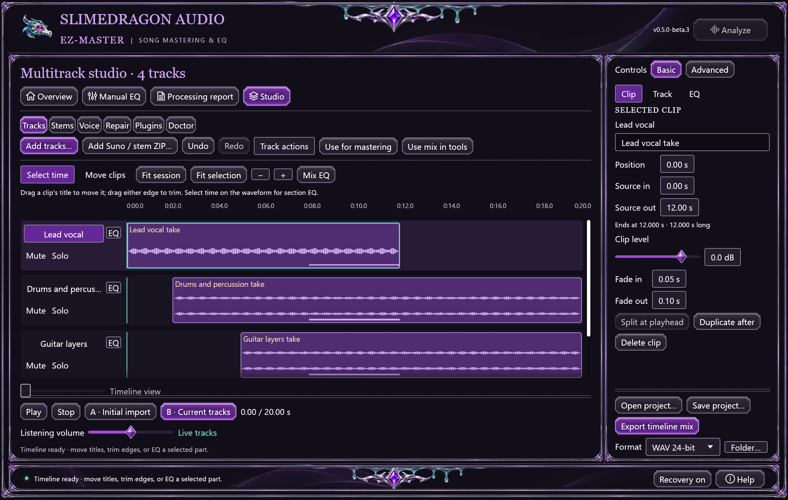
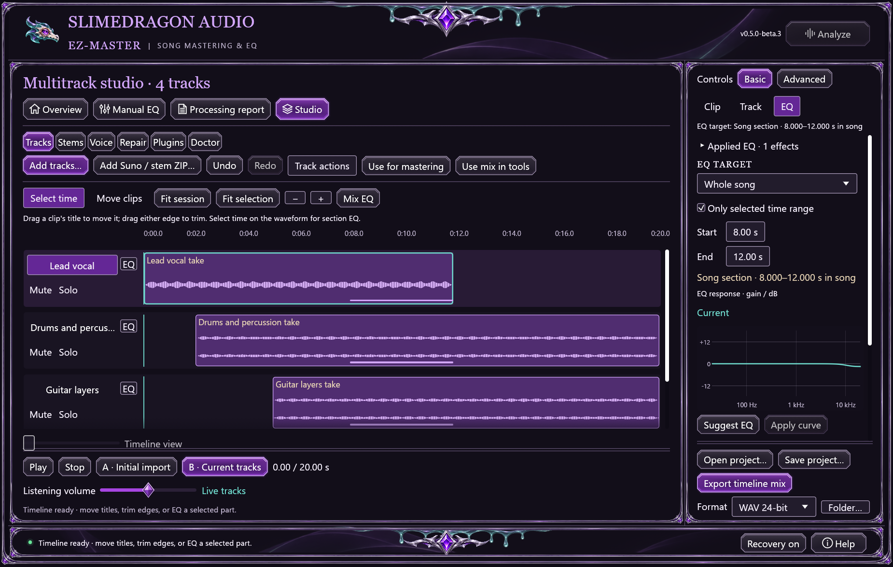
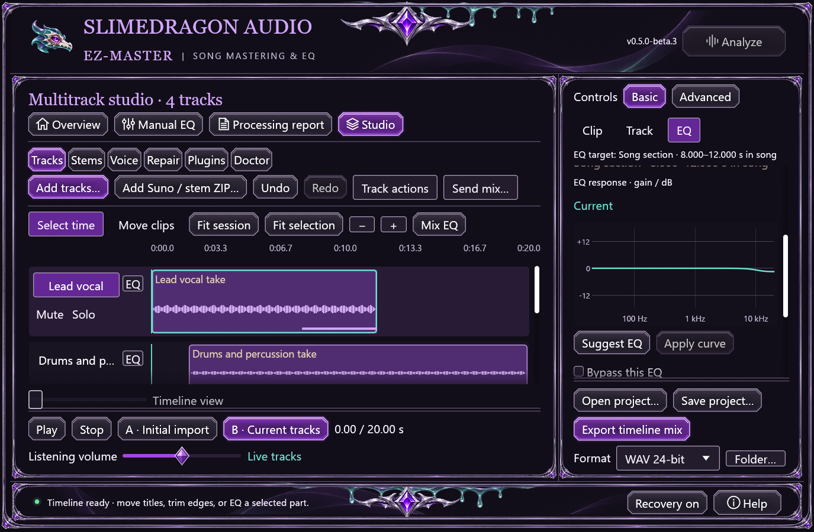

# Native track and section EQ workspace

The **Tracks** page is a nondestructive multitrack editor alongside the existing
aligned stem bank, voice cleanup, repair and plugin workspaces. Source audio is
immutable; clips store source slices and song positions. The shared core and
browser use the same edit and scoped-EQ model. See [core](ARRANGEMENT_CORE.md),
[native audio](ARRANGEMENT_NATIVE_AUDIO.md) and [transport](ARRANGEMENT_TRANSPORT.md).

## Editing flow

1. Add one or many files, or review a Suno/stem ZIP. Alternate WAV/MP3 versions
   count once. Different durations are supported. Native rate conversion makes
   a private derivative when required; the original file is not rewritten.
2. Drag a clip title to move it, its edges to trim, or its waveform to select a
   time interval. Exact position/source-in/source-out fields provide a keyboard
   alternative. Track/clip names, levels, track balance, mute/solo, clip fades,
   track order, split, duplicate and deletion have explicit controls.
3. Choose **Mix EQ**, a track's **EQ** action, or **EQ this clip**. Enable
   **Only selected time range** for section EQ. Whole-song and track ranges use
   song time. Clip ranges stay attached to original source samples after moves,
   trims, splitting and duplication. Ends are exclusive; section EQ needs 20 ms.
4. Manual EQ auditions live. **Suggest EQ** measures the visible target without
   applying a curve; **Apply curve** explicitly accepts the proposal. Current and
   proposed curves show filter response, not a measured output spectrum.
5. **Applied EQ** lists existing effects for editing, bypass or removal. Timeline
   bars mark their intervals. Clip, track and mix effects combine in that order;
   repeated slider gestures update an effect instead of stacking extra filters.
6. **Save project** stores sources, clips, effects and undo history in a new v2
   project directory. **Export timeline mix** renders the current recipe through
   the same shared player and existing native export codecs. Rendering a mix for
   mastering or other tools is a separate action. Later timeline edits make old
   tool snapshots unavailable until the current mix is prepared again.

**A · Initial import** is the original imported session. **B · Current tracks**
uses the current recipe. They are exclusive. Use an individual effect's bypass
for an EQ-only comparison. Listening volume is independent of delivery gain.

Select a waveform clip to open **Clip** timing, trims, level and fades. Select
a track name for **Track** controls; **EQ** has its own target inspector. These
three tabs keep the selected object's controls near the top of the sidebar.

Compact windows group the two snapshot actions under **Send mix…**. **Track
actions** adds an empty track after import, or copies an already loaded mix or
aligned stem bank. Import, Undo/Redo,
timeline controls and the separate delivery dock remain directly reachable.

Dropped files and `--view tracks` use the independent-track review. Space plays
the prepared timeline without requiring a legacy preview. [Studio pane
ownership](NATIVE_STUDIO_NAVIGATION.md) pauses and restores the correct audio
when switching tools; it preserves pending edits and never layers both players.

## Files and responsibilities

- `gui/studio/arrangement_state`, `arrangement_eq_targets`: selection, metadata
  history and explicit scope/source-coordinate translation.
- `arrangement_timeline`, `arrangement_gestures`, `arrangement_waveforms`: visible
  lanes, gestures and cached separate-channel source waveforms.
- `arrangement_inspector`, `arrangement_clip_controls`, `arrangement_eq_*`:
  editable controls, applied effects and proposed/current filter responses.
- `arrangement_import_actions`, `arrangement_preview_actions`,
  `arrangement_project_actions`, `arrangement_loading`, `arrangement_events`:
  cancellable background actions and revision-checked admission.
- `arrangement_runtime`, `arrangement_workspace`, `arrangement_transport`:
  workspace ownership, layout and audio-player synchronization.
- `studio_native/arrangement_import`, `arrangement_project`: bounded native I/O;
  shared manifest, validation, metadata and DSP remain in the core.

Native source limits are resource budgets, not an instrument-count cap: 512 MiB
per decoded source and 4 GiB retained PCM. Project output allocation is bounded
by the caller's local policy; shared files cannot raise that policy. Structural
live changes prepare off the audio callback with bounded filter warmup, which
approximates older IIR history. Offline exports replay from the start.

## Validation status

Implementation is on `current-work`. On November 16, 2026, the native library
suite passed 457 tests with two optional external-tool tests ignored. Focused
editor state/widget/pointer/curve checks passed, including scope
translation, first-drag trims, Escape, exact effect identity, scrolling to clip
fields, focused Clip/Track properties and EQ scrolling with a pinned target and
export dock. Native v2 disk tests
passed exact Float32 recovery, tamper/path/budget rejection and content dedup.

Actual renderer captures passed at logical 1100×720 and 1480×940 on Windows at
125% DPI. An abrupt owned-process termination followed by recovery after moving
the project manifest retained four tracks, four clips, section EQ, exact source
attachments and committed current/undo/redo history. Later layout-only captures
qualify the compact toolbar separately; they do not repeat the crash test.
Audio tests use synthetic PCM. Physical-device listening and manual acceptance
remain unqualified. This is not a claim of complete Audacity/DAW parity.

## Continue a browser or MCP project

For a browser **Save project** ZIP, extract it into a new folder and choose
`arrangement.json` with desktop **Open project**. Keep the `assets` folder beside
that manifest. Native folder projects normally use `project.json`; both names
load the same v2 data. Sources, clip offsets, scoped EQ and retained history are
verified before replacement. A real hosted-browser project and a real saved MCP
project were opened by the native renderer with their expected track/clip/effect
counts; the original browser archive remained unchanged. This is format/UI
qualification, not a physical playback claim.

The development companion also has explicit arrangement save, reopen and desktop
handoff tools. Reopen can survive a new MCP connection when its configured output
root is unchanged; legacy Studio save/export tools address their separate
workspace. A desktop handoff checks v2 project capability before saving or
launching, so an older same-version installer is not treated as compatible.

## Reviewed interface captures

[Full-size editor](images/arrangement-desktop.png) · [Compact editor](images/arrangement-compact.png).
Click a clip for timing and source bounds; Track and EQ have separate inspectors.

[Full-size section EQ](images/arrangement-eq-desktop.png) · [Compact target controls](images/arrangement-eq-compact.png).
The target summary specifies song time; the plot labels frequency and EQ gain in dB.

[Full-size compact EQ curve](images/arrangement-eq-scrolled-compact.png) · [Wide curve and gain control](images/arrangement-eq-scrolled-desktop.png).
The target summary and delivery dock stay visible when the inspector scrolls.
These actual Windows renderer images use generated CC0 test signals at logical
1100×720 and 1480×940 with 125% DPI. An independent screenshot review verified
readable controls, repaired lane EQ buttons and labeled curve axes. Separate
widget tests verify field/curve reachability and pinned target/export geometry.
Screenshots do not qualify physical playback or manual interaction acceptance.
