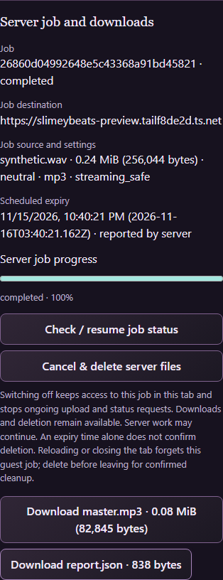

# Hybrid Studio beta preview

The first slice adds explicitly requested server mastering to the existing local
browser app. The browser remains the default engine for local work. Connecting
does not authorize an upload; selecting a separate server input, accepting
temporary processing and submitting a job do. Desktop, browser DSP and the local
MCP companion keep their existing roles.

On November 15, 2026, the dedicated Linux service was connected through
**Tailscale Funnel** and public guest access was enabled. Real public HTTPS
checks completed WAV24 and MP3 processing, report downloads, guest isolation
and deletion. The browser switch ships in the separate `current-work` preview;
the main web app and released desktop installer keep their existing behavior.
Host addresses, login names, credentials and private inventory reports do not
belong in public source. The owner bearer can
manage every job and must never be distributed or embedded in a browser build.
When enabled, guest access uses short-lived tokens restricted to each guest's
own jobs; it does not expose the owner token.

## Scope and implementation boundary

| Area | First preview | Evidence boundary |
| --- | --- | --- |
| `hybrid/server/` | Modular Python standard-library HTTP service and native Rust CLI subprocess | Backend checks and real native-job evidence belong to the integration record. |
| `web/site/hybrid/` | Opt-in connection, upload, job status and authenticated downloads | Browser integration and device checks are separate from deployment checks. |
| `hybrid/deploy/` | Reviewable systemd/environment/tunnel examples and read-only validation tools | Examples do not install software, create accounts or change a firewall/DNS record. |
| Linux beta | Dedicated system service on loopback, reached through Funnel | Native jobs, public HTTPS transfers, guest isolation and deletion tested. |
| Funnel HTTPS origin | Exact `slimeybeats-preview.tailf8de2d.ts.net` pin | No custom-domain DNS changes; bandwidth and provider availability limits apply. |
| Guest sessions | Scoped job ownership, expiry and bounded rate windows | Public-isolation tests passed; these are temporary sessions, not permanent user accounts. |
| Later Studio work | Stem extraction, model jobs, plugins, multitrack editing and permanent accounts | Planned; the mastering endpoint does not implement these features. |

The MCP companion remains local stdio. Its hybrid help topic can explain this
boundary, with `remote_processing_from_mcp: false`; it does not forward files or
tokens to this HTTP service. Do not expose an MCP listener or the desktop app.

## Use the preview

Use the **Use server processing** switch in `current-work`. Local processing is
the default. Switching on checks availability without uploading audio. The
labels distinguish an unreachable server, disabled service, busy service,
missing access and an offline browser. Checks stop while the page is hidden.

Choose your WAV/MP3 using the main file picker, then choose **Review server
master**. Review the server settings, destination, limits and temporary-storage
policy, then consent and choose **Upload & master**. A server source bypasses
local decoding; it never replaces or relabels an existing local player buffer.
Local playback and local exports remain clearly identified as local.

When public guest access is enabled, connection details and session credentials
are handled automatically. **Advanced operator connection settings** retain
explicit endpoint/token setup for private testing. File selection, availability
checks and connection alone never upload audio. Download the prepared
audio/report explicitly, then choose **Cancel & delete server files** when
finished. Switching off preserves access to the existing job in this tab while
stopping upload/status requests. Advanced Disconnect clears its credential;
closing/reloading the tab forgets it. Neither action confirms server deletion.

The token stays in this tab's memory. It is not a login/account system and is
not saved in preferences, recovery or URLs. Server options are separate from
local EQ, references, mastering settings and Studio edits. There is no implicit
replacement of local playback or automatic fallback between engines.

Local recovery restores decoded audio and its display name, rather than the
original encoded WAV/MP3 file. Recovered sessions stay editable/exportable
locally. Reselect the original file explicitly before using server processing;
the server switch does not convert a recovery point into an upload.

## Public beta connection

The selected beta path is **Tailscale Funnel**, with a Tailscale-provided HTTPS
hostname and its non-configurable bandwidth limits. This requires no VPS.
The API origin is `https://slimeybeats-preview.tailf8de2d.ts.net`.
The public website remains the entry point; browser upload consent names the
actual processing endpoint. The dedicated connector uses userspace networking,
with DNS/routing changes and Tailscale SSH disabled. It exposes only the private
mastering HTTP service, never the desktop MCP server. Actual account, endpoint,
transfer and outage verification are recorded separately from source tests.

The browser pins the exact deployed HTTPS origin in its endpoint policy and CSP;
it does not trust arbitrary `*.ts.net` hosts. An Oracle Always Free relay with
Caddy and reverse SSH is a future option when more control is needed; its source
examples are in `hybrid/deploy/relay`. Neither a VM nor a paid account has been
created by preparing these examples. Existing authoritative DNS, website/mail
records and DNSSEC remain unchanged.

Funnel's personal plan is for non-commercial use; confirm the account's free
plan instead of relying on a business trial. Public users need only their web
browser. See [Funnel requirements and limits][tailscale-funnel] and
[free/open-source plans][tailscale-free]. The phone-approved account's plan
has not been independently inspected; no paid plan was activated by this setup.
See the [connector operator guide](../hybrid/deploy/tailscale/PREPARATION.md) for
certificate storage, restart and access-expiry considerations.

This small beta deliberately uses the connector's loopback identity for rate
limits, rather than trusting arbitrary forwarded-IP headers. Visitors therefore
share a limit of four guest-session creations per ten minutes and eight job
starts per hour. There is one worker and four retained jobs across the service.
A busy response is recoverable; wait before reconnecting. Sessions and audio
expire within one hour, and service restarts invalidate guest sessions and
remove temporary jobs. Download your results before leaving the page.



This actual Chromium capture uses generated test audio and the live public
Funnel API. It is 390 px wide with a taller documentation viewport to show the
whole job panel; interaction tests also used 390 × 844. The frontend candidate
was served at the GitHub preview origin, with no API interception.
[Full-size job panel](images/hybrid-server-job.png). Physical phone listening
remains a separate acceptance check.

The browser preview limits each downloaded artifact to **128 MiB**, checking
both declared size and streamed bytes. Choose MP3 for longer material; a large
WAV may be unavailable for browser download even when the server job succeeds.
The upload, decoded-memory and duration limits are separate and appear before
consent. Local mastering retains its own 15-minute guard.

## Files and data flow

| Files | Responsibility |
| --- | --- |
| `hybrid/server/config.py`, `requests.py` | Operator configuration, built-in profile/settings allowlist and consent validation |
| `hybrid/server/audio_guard.py`, `decoder.py` | Validate WAV layout/frame budget; decode MP3 to a bounded, sanitized WAV |
| `hybrid/server/processes.py`, `child.py` | Trusted subprocess launch, resource limits, timeout and descendant cleanup |
| `hybrid/server/storage.py`, `reports.py` | Owned temporary storage and redacted report/artifact publication |
| `hybrid/server/http_server.py`, `http_auth.py`, `jobs.py`, `worker.py` | Authentication/CORS, sequential upload state and one processing worker |
| `hybrid/server/__main__.py`, `service.py` | Module entrypoint, server lifecycle and cleanup scheduling |
| `rust/src/bin/mastercraft_cli.rs`, `rust/src/cli_arguments.rs` | Existing native mastering executable and CLI options |
| `web/site/hybrid/` | Session-memory token, consent, chunked upload and asynchronous job client |
| `hybrid/deploy/validate_deployment.py` | Offline, inventory and HTTP-check command entrypoint |
| `hybrid/deploy/deployment_scaffold.py`, `deployment_inventory.py`, `deployment_health.py` | Separate source, host-prerequisite and bounded network checks |

```text
Local browser processing (default; no server upload)

Explicit server submission
  Browser on GitHub Pages -- HTTPS + bearer --> proposed api.slimedragon.net
    --> optional invitation/Access edge gate --> cloudflared outbound tunnel
      --> HTTP 127.0.0.1:8787 Python service
        --> owned job directory --> validated/sanitized WAV
          --> fixed native CLI --> output audio + redacted JSON report
  Browser polls short job requests, then fetches artifacts with Authorization.
```

The tunnel branch is a later deployment step. Initial Linux acceptance talks
directly to loopback. Python supplies HTTP/job supervision, not another DSP
implementation. Native processing must use a fixed operator-configured
executable with an argument list and no shell. Requests cannot select executables,
paths, custom profile files, input URLs or arbitrary CLI flags.

## Preview contract

The authenticated capability document is authoritative for the running service.
These are the intended first-preview defaults, checked by the deployment helper:

| Setting | Value |
| --- | --- |
| Bind address | `127.0.0.1:8787` |
| Bearer token | Required environment value `SLIMEYBEATS_HYBRID_TOKEN`, at least 32 printable ASCII characters; generate a random value, not a memorable phrase |
| Allowed browser origin | `SLIMEYBEATS_HYBRID_ORIGINS=https://slimedragonair.github.io` |
| Operations and output | `master`; one of `wav24` or `mp3` per job |
| Input | PCM/float RIFF WAV or MP3 only |
| Upload body | At most 1 MiB per append request; 512 MiB total uploaded bytes |
| Processing | One heavy worker; native CLI `--threads 4`; no host-wide thread-pool default |
| Retained jobs | At most four, including uploads/queued/results; not four simultaneous heavy workers |
| Retention | 3,600 seconds; use each snapshot's `expires_at`, with deletion/cancellation available earlier |
| Storage | Dedicated owned directory on a secondary volume; service example uses `/var/lib/slimeybeats-hybrid` |

An origin has no URL path or trailing slash. Both the main app and
`/SlimeyBeats-EZ-Master/current-work/` share the origin above. CORS is an exact
allowlist with no credentialed-cookie mode; it is not an authentication mechanism.
The browser API CSP target is `connect-src 'self' https://api.slimedragon.net`.
Do not broaden it to arbitrary HTTPS hosts, private addresses or wildcards. A
loopback test page needs its own local test configuration; the public Pages
build is not a direct route to a private LAN server.

`GET /health` returns only basic availability. All `/v1/` operations, including
`GET /v1/capabilities`, require bearer authentication; CORS preflight is handled
separately for the configured origin. The job flow is create, upload bounded
chunks at the expected offset, explicitly start, poll, download known artifacts,
and delete. Re-query uploaded bytes after an uncertain append instead of blindly
replaying it. Do not wait for an entire master within a single HTTP response.

The token stays in browser session memory and is discarded on disconnect/reload.
Do not place it in static HTML/JS, build variables, browser storage, recovery,
URLs, download links or logs. Download audio/reports through authenticated fetch.
The first bearer is shared owner/invite access, **not per-user job isolation**;
any holder can operate on jobs exposed by that preview instance. Keep invitations
narrow and rotate the token when revoking access.

## Audio and resource boundary

The native CLI's `audio::load` is not an independent bounded HTTP input parser.
The backend must validate complete WAV headers, sizes, channels, rates and frame
counts before native loading, with a separate **512 MiB decoded f32 budget**.
The uploaded-byte limit alone cannot guarantee decoded memory or working memory.
Reject unsupported/truncated/nonfinite WAVs. The backend source rebuilds accepted
WAVs without unneeded metadata before handing them to the CLI.

MP3 must go through the configured FFmpeg, with forced `-f mp3`,
`-protocol_whitelist file,pipe`, no input URL and a bounded decoded stream into
sanitized WAV. Do not let a renamed playlist or another guessed demuxer select
network resources. WAV input is native; MP3 input/export requires working FFmpeg
and FFprobe. The unit supplies `PATH=/usr/local/bin:/usr/bin:/bin`; an interactive
shell's PATH is not evidence for a service. A backend `--ffmpeg` override does not
automatically change the native CLI's codec lookup, so keep PATH correct too.

Linux child limits must apply before decoding/mastering: address space, CPU time,
output-file size, descriptors, wall timeout, cancellation and whole descendant
cleanup. Source defaults also bound duration (30 minutes), job disk use (2 GiB)
and decoder/master timeouts (120/900 seconds). Those are source limits, not host
performance measurements. Verify `--threads 4` in the actual native argument list;
the unit's `RAYON_NUM_THREADS=4` is an additional bound, not a replacement.

Reports returned by HTTP must redact local input/output paths and raw subprocess
logs. Opaque job IDs and fixed artifact names are the public locators. Failure,
timeout and cancelled-job cleanup need actual negative tests before exposure.

## Linux service example

`hybrid/deploy/slimeybeats-hybrid.service` targets a system service on a Linux host
with systemd/cgroups. It uses a dedicated non-login `slimeybeats-hybrid` account,
root-owned source under `/opt/slimeybeats-hybrid/repository`, and a private
`StateDirectory`. Keep the existing Linux desktop installation and its validation
folders separate. The server agent, not a packaging/helper script, handles account
creation, placement, mounts, unit installation and service activation.

Bind-mount an **empty dedicated subdirectory** of the secondary volume at
`/var/lib/slimeybeats-hybrid`; do not use a shared folder or the whole filesystem's
root containing `lost+found`. The unit requires that mount path. Its inventory
precheck fails if storage is on the root device, has less than 16 GiB free, is
over 85% used, is not private/writable, or lacks CLI/codecs. These are conservative
preview policy thresholds, not measured peak requirements or a disk quota. Leave
additional capacity for building and existing data; recheck space during jobs.

The private staging process may instead use an authorized account's dedicated
secondary-volume directory with explicit `--cli` and `--data-dir`. That does not
establish the system unit's account isolation or sandbox behavior. Do not install
or start this system unit merely to conduct a loopback acceptance test.

The unit sets `NoNewPrivileges`, no capabilities, a read-only system view, protected
home/devices/kernel settings and private temporary directories. State directories
remain writable with `ProtectSystem=strict`. It groups supervisor/CLI/codecs under
`CPUQuota=200%` (two CPUs' time), `MemoryHigh=3G`, `MemoryMax=4G`, no swap and a
64-task ceiling. Limits can terminate an oversized job. Kernel support and the
effective settings must be checked on the actual host; parsing a unit does not
prove sandbox enforcement. See the official [execution/sandbox reference][systemd-exec]
and [resource-control reference][systemd-resources].

The environment example has a deliberately invalid short token, so it must fail
startup until replaced. The server agent creates the real environment file at
`/etc/slimeybeats-hybrid/environment`, owned by root with mode `0600`, and keeps it
outside the checkout. The CLI/storage values are operator settings expanded into
the service's arguments; they are not backend environment-variable features.
Environment-based secrets remain visible to sufficiently privileged local
processes; systemd recommends credential files for stronger secret delivery.
Supporting that would require an explicit backend/launcher change. Do not print
service environments or paste authenticated debug traces into reports.

## Optional Cloudflare control connection

Cloudflare is not needed for the first loopback run and is not assumed installed.
The example `hybrid/deploy/cloudflared.yml.example` routes only health, status
and capability metadata at `api.slimedragon.net` to `http://127.0.0.1:8787`, then
returns 404 for every other path or host. Audio/job/session paths are blocked.
The tunnel UUID and credential filename are placeholders. `cloudflared` runs
separately with credentials private to its account; the audio worker needs none.
This follows Cloudflare's [outbound-only tunnel model][cloudflare-tunnel] and
[ingress configuration][cloudflare-config]. No inbound firewall/port-forwarding
change or personal IP/DNS address is part of this example.

Cloudflare's [published-application guidance][cloudflare-routing] requires an
appropriate service for public large-file traffic. A free Tunnel alone is not
the selected audio-transfer path. Splitting audio into small requests or
disabling caching does not resolve that provider restriction. R2 has a free
allowance but metered overages; no R2 subscription was activated. The staged
Free DNS zone was not made authoritative.

Cloudflare's current [413 documentation][cloudflare-upload] lists 100 MB per
request on Free and Pro; a zone can configure a smaller limit. A 512 MiB audio
file therefore uses many 1 MiB requests, not one 512 MiB request. Chunking does not
remove the backend's total cap. Cloudflare's [524 guidance][cloudflare-async]
recommends status polling for long operations, hence the asynchronous job API.

An Access invitation policy is an optional additional gate, not implemented by
this YAML. Cloudflare Access has [cross-origin cookie/preflight requirements][cloudflare-cors].
The present bearer client uses no credentialed-cookie mode, so enabling an Access
login in front of the API is **not a tested drop-in configuration**. A reviewed
edge/same-origin authentication arrangement and real browser acceptance are needed
before using it. Never embed an Access service secret in the Pages client. Keep
the loopback/invite preview while that integration remains unverified.

## Deployment and acceptance checklist

1. Record the exact source revision, host architecture/Python version, native CLI
   identity and codec availability privately. Preserve the existing app and all
   unrelated folders. Select secondary storage before building or uploading.
2. Build the CLI without desktop dependencies from the selected source:

   ```bash
   cargo build --locked --release --no-default-features --manifest-path rust/Cargo.toml --bin slimeybeats-ez-master-cli
   ```

3. Run backend tests and verify the native process guards above, especially
   decoded-byte bounds, forced MP3 demuxing/protocol restriction, `--threads 4`,
   RLIMIT/timeouts and child cleanup. Source inspection alone is not qualification.
4. Stage a private process on `127.0.0.1:8787` with an empty owned data directory,
   random token and the exact browser origin. Verify the actual listening socket;
   never substitute `0.0.0.0` for convenience. Do not print the token.
5. Run inventory and health checks below, then real small WAV and MP3 jobs. Check
   decoded output, report redaction, source preservation, cancel/delete, rejected
   token/origin, wrong chunk offset, oversize/unsupported audio, four-job limit,
   timeout and expiry/restart cleanup. Keep results and limitations with that run.
6. Only the server agent installs a durable system service after reviewing the
   account, mounts, environment, CLI/codecs and effective CPU/RAM controls. Confirm
   startup refuses missing storage/codecs and service stop kills owned descendants.
7. After private acceptance and auth review, the domain/server operator may create
   the named tunnel/hostname, review invitation policy, validate ingress and TLS,
   and run the same HTTPS/browser checks. Keep the backend bound to loopback.
   Disable caching for API/job/artifact responses; do not enable a cache-everything
   rule for this hostname. No static artifact contains credentials or recordings.
8. Browser acceptance must confirm the destination/consent step, session-only token,
   expected CSP/CORS, chunk progress, polling and authenticated downloads on the
   intended devices. Record actual deployment separately from source readiness.

To stop access, stop the tunnel if enabled, rotate/revoke the bearer and stop the
owned service/process. Download wanted artifacts before cleanup. The job store is
temporary and restart recovery/expiry is not a durable save contract; do not put
source libraries or old validation outputs inside it.

## Read-only validation commands

From the repository root, using only Python's standard library:

```bash
python3 -B hybrid/deploy/validate_deployment.py offline
python3 -B -m unittest discover -s hybrid/deploy/tests -v
python3 -B hybrid/deploy/validate_deployment.py inventory --cli /opt/slimeybeats-hybrid/repository/rust/target/release/slimeybeats-ez-master-cli --storage /var/lib/slimeybeats-hybrid
python3 -B hybrid/deploy/validate_deployment.py health --prompt-token
```

For private staging, supply the actual authorized secondary-volume storage/CLI
paths to `inventory`. Run it as the account that will run the service, with the
same explicit PATH. Add `--require-tunnel` only at the HTTPS stage. The optional
`health --endpoint https://api.slimedragon.net --prompt-token` probes the proposed
hostname only once it exists. Without `--prompt-token`, health reads the token
from `SLIMEYBEATS_HYBRID_TOKEN`; there is no token CLI argument.

Health uses GET/OPTIONS only, limits response bytes and request time, disables
proxy inheritance, rejects redirects and prints boolean checks instead of tokens,
URLs, response bodies or headers. It accepts only explicit IPv4 loopback HTTP or
the proposed HTTPS hostname. It checks unauthenticated denial, authenticated v1
capabilities/defaults and CORS. It does not create a job or prove DSP, isolation,
expiry, effective resource limits, TLS deployment or device behavior by itself.
An Access redirect will fail, rather than be treated as a healthy API.

Offline mode checks consistency of the shipped unit/environment and the fixed
tunnel example subset; it is not a general YAML parser. On Linux, also run:

```bash
systemd-analyze verify --man=no hybrid/deploy/slimeybeats-hybrid.service
# After unit installation, without printing Environment:
systemctl show slimeybeats-hybrid --property=User,Group,MainPID,MemoryHigh,MemoryMax,CPUQuotaPerSecUSec,TasksMax,NoNewPrivileges,ProtectSystem,KillMode
systemd-analyze security slimeybeats-hybrid.service
# Only after the server agent creates the real private tunnel configuration:
cloudflared tunnel --config /etc/cloudflared/config.yml ingress validate
cloudflared tunnel --config /etc/cloudflared/config.yml ingress rule https://api.slimedragon.net/health
```

Deployment scaffold validation on November 15, 2026:

| Check | Result and scope |
| --- | --- |
| Helper regression fixtures | 11 passed on Windows and Ubuntu 24.04/WSL; local HTTP fixtures, not a deployed backend |
| Python syntax | All five deployment/helper test files compiled |
| Backend entrypoint / read-only HTTP | Module `--help` matched the unit; actual backend HTTP class passed all 16 health/auth/capability/CORS checks on temporary local loopback, without storage, a worker or native processing |
| Offline consistency | Passed for the shipped unit, environment and tunnel subset |
| systemd 255 syntax | `systemd-analyze verify` passed; Windows/DrvFS file-mode warnings require proper Linux installation permissions |
| Real cloudflared parser / DNS / Access / HTTPS | Not run by this scaffold task |
| Server jobs / system-unit runtime / physical devices | Separate integration evidence; not established by these checks |

## Earlier private milestone, November 15, 2026

- Real Chromium 143, Firefox 144 and Linux WebKit browser runs at 390 px:
  explicit connection/consent, native WAV24 and MP3 jobs, JSON downloads,
  independently decoded loudness/peaks, deletion, token storage checks and
  unchanged source. Final follow-up checks are recorded with the source checkpoint.
- Native CLI built on the actual Ubuntu host; all **35 backend regressions**
  passed there, including auth/CORS, framing/deadlines, guarded input, queue
  and retention bounds, cancellation, process limits and slow-download cleanup.
- Installed dedicated-account system service bound only to `127.0.0.1`.
  Effective systemd settings include CPU quota, a 4 GiB memory cap, protected
  home/system paths, no new privileges and loopback-only network policy.
  These checks are not a general penetration test or proof against every escape.
- The installed service completed WAV24/MP3/report jobs and an **18-minute
  synthetic mono 8 kHz** source to MP3 in about 45 seconds. A second running
  long job was cancelled/deleted; every test job returned 404 afterwards.
  This fixture is not a full-rate stereo capacity or musical-quality benchmark.
- Public DNS/TLS/tunnel, per-user account isolation, real phone use and subjective
  listening remain unverified. Stem separation and broader server Studio features
  are future work. The released desktop installer and main web app are unchanged.

## Funnel and guest-access validation, November 15, 2026

This follow-up supersedes the earlier milestone's pending-public-ingress status.

| Check | Result and scope |
| --- | --- |
| Backend regressions | **61/61 passed on the actual Ubuntu host**; Windows passed 60 with one Unix-only resource test skipped. Includes public access, ownership, expiry, rate limits and native jobs. |
| Browser module regressions | **72 passed**, including bounded JSON, explicit consent, outage preservation, restored-audio/source separation and local forgetting/reconnection for inaccessible jobs. |
| Real browser / public API | Chromium and Linux WebKit completed guest MP3 upload, processing, report/audio downloads and confirmed cleanup at 390 × 844. Candidate frontend assets used the GitHub preview origin; API requests went through the actual public Funnel with no interception. Local master/source stayed unchanged. |
| Actual backend outage / restart | Chromium displayed **[Server down]**, preserved the remembered job/local master, and recovered through explicit expired-job forgetting and reconnection. No job was automatically replayed. Service readiness was checked separately after restart. |
| Deployment source checks | 23 Cloudflare/helper, 11 optional relay and four Funnel-unit regressions passed. Optional Cloudflare/VPS examples are not deployed. |
| Public API through Funnel | Passed actual public DNS/TLS, exact CORS, rejected unauthorized/foreign-Origin calls, two separate guest sessions, WAV24 and MP3 input/output jobs, JSON reports, foreign-job/artifact denial and confirmed deletion. No operator token was used. |
| Independently decoded public exports | Four-second synthetic stereo source: WAV24 −14.0 LUFS / −9.8 dBTP; MP3 −14.0 LUFS / −9.6 dBTP. These quiet-tone fixtures test file delivery and safety, not musical quality or long-track capacity. |
| Connector | Dedicated userspace system service; actual HTTPS required both `--state` and `--statedir` so its private certificate cache has a writable root. Identity survives connector restart. |
| Device acceptance | Physical iPhone/Android listening remains unverified. Server stems/plugins, permanent accounts and resumable jobs across restarts are not implemented by this mastering endpoint. |

Temporary network/server errors preserve the remembered job. After an explicit
job access attempt returns 401 or 404, **Forget unavailable job** clears only
the local server reference and credential; it does not confirm server deletion.
**Check & connect** then starts a new guest session without reloading or uploading
again. Existing local audio/settings stay available. Download/delete while the
original session is valid whenever possible.

[systemd-exec]: https://www.freedesktop.org/software/systemd/man/latest/systemd.exec.html
[systemd-resources]: https://www.freedesktop.org/software/systemd/man/latest/systemd.resource-control.html
[cloudflare-tunnel]: https://developers.cloudflare.com/cloudflare-one/networks/connectors/cloudflare-tunnel/get-started/tunnel-useful-terms/
[cloudflare-config]: https://developers.cloudflare.com/cloudflare-one/networks/connectors/cloudflare-tunnel/do-more-with-tunnels/local-management/configuration-file/
[cloudflare-upload]: https://developers.cloudflare.com/support/troubleshooting/http-status-codes/4xx-client-error/error-413/
[cloudflare-async]: https://developers.cloudflare.com/support/troubleshooting/http-status-codes/cloudflare-5xx-errors/error-524/
[cloudflare-cors]: https://developers.cloudflare.com/cloudflare-one/access-controls/applications/http-apps/authorization-cookie/cors/
[cloudflare-routing]: https://developers.cloudflare.com/tunnel/concepts/routing/
[tailscale-funnel]: https://tailscale.com/docs/features/tailscale-funnel
[tailscale-free]: https://tailscale.com/docs/account/manage-plans/free-plans-discounts
