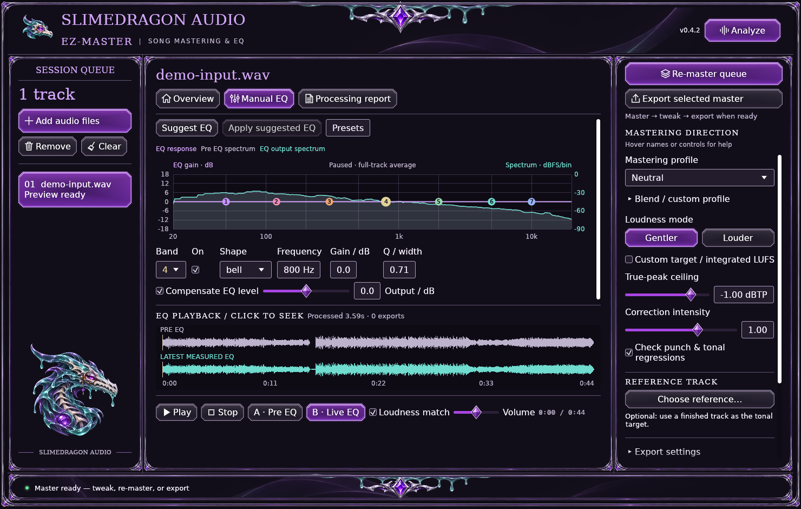

# Linux validation and source builds

Linux checks target **Ubuntu 24.04 x86_64**. The published v0.4.2 installer remains Windows-only; Linux build/render/export validation is separate from a packaged Linux release and physical audio-device qualification.

## Additional Linux-server check

The maintainer supplied a separate Linux-server validation result confirming that the app was installed with desktop and application-menu launchers and left open. This run required **no application source changes**.

| Check | Reported result |
| --- | --- |
| Build, tests and lint | Passed; all **79 tests** passed. |
| Mastering and exports | Verified mastering and all six supported formats: WAV 16/24-bit PCM, WAV 32-bit float, FLAC 16/24-bit and MP3. |
| Desktop workflow | Verified GUI launch, audio import, mastering and EQ controls. |
| Launchers | Desktop and application-menu launchers installed. |
| Audible hardware playback | **Unverified.** The server reported Dummy Output and had no headphones or speakers connected. |
| File-picker portal | **Unverified.** Audio-import validation does not establish that the portal dialog was exercised. |

The detailed report is located on that Linux server at `~/Projects/SlimeyBeats-EZ-Master/linux-validation-2026-11-13/README.md`. This is the maintainer-provided, server-local evidence location, not a downloadable repository artifact; the directory's date label is November 13, 2026. The separate Ubuntu CI checks below retain their own artifacts and scope.

The server result establishes a working source build, desktop workflow and exports on that host. Audible playback needs a follow-up with an actual output device; the file-picker portal remains a separate follow-up.

## Desktop build dependencies

Install a current stable Rust toolchain and these Ubuntu packages:

```bash
sudo apt-get update
sudo apt-get install --no-install-recommends build-essential pkg-config libasound2-dev libdbus-1-dev libxkbcommon-dev libxkbcommon-x11-dev libwayland-dev libxcb-shape0-dev libxcb-xfixes0-dev libgl1-mesa-dev libudev-dev fonts-dejavu-core xdg-utils
```

From the repository root:

```bash
cd rust
cargo build --locked --release --bins
./target/release/slimeybeats-ez-master-cli --help
./target/release/slimeybeats-ez-master-live
```

WAV input/export is native. Install `ffmpeg` for compressed inputs, FLAC/MP3 exports and resampling. The desktop needs a graphical session, a working OpenGL implementation, and an audio output service/device for listening. File selection uses the desktop's XDG portal; install the appropriate `xdg-desktop-portal` backend for your desktop. A headless server can run the CLI without a display or sound device. ALSA/PipeWire/PulseAudio setup is a property of that host, not proof supplied by a passing CLI test.

## User files and desktop integration

For a headless server, build only the CLI without desktop/audio features:

```bash
cargo build --locked --release --no-default-features --manifest-path rust/Cargo.toml --bin slimeybeats-ez-master-cli
```

The CLI's WAV path needs neither a graphical session nor an output device. Add FFmpeg only for the formats/resampling that require it.

- Settings: `$XDG_CONFIG_HOME/slimeybeats-ez-master/rust-settings.json`, defaulting to `~/.config/slimeybeats-ez-master/rust-settings.json`.
- GUI data/profiles/default exports: `$XDG_DATA_HOME/slimeybeats-ez-master/`, defaulting to `~/.local/share/slimeybeats-ez-master/`. Exports go in its `output/` folder unless you choose another location. The CLI retains its explicit `--out`/working-directory behavior.
- Relative XDG environment values are ignored. Absolute overrides are useful for isolated tests. If no absolute XDG/HOME location exists, the legacy executable/development-root fallback remains available and filesystem errors remain visible.
- Open folder uses `xdg-open` with one literal absolute path. DejaVu Sans/Serif are loaded from installed Linux fonts; no Windows fonts are redistributed.

## Repeatable checks

```bash
cd rust
cargo fmt --all -- --check
cargo clippy --locked --all-targets -- -D warnings
cargo test --locked --release --all-targets
sudo apt-get install --no-install-recommends ffmpeg xvfb xauth
xvfb-run -a -s '-screen 0 1920x1080x24' python3 tools/verify_linux.py --gui target/release/slimeybeats-ez-master-live --out /tmp/slimeybeats-new-evidence
```

Use a new evidence directory. The verifier checks native WAV with no FFmpeg on PATH, unchanged native duration/rate/channels, six independently metered formats, actual 48 kHz → 44.1 kHz conversion, source preservation, collisions and errors. GUI captures exercise welcome, default EQ and compact EQ, isolated XDG paths and preview without audio export. The hidden capture-only settings flag invokes the same explicit Save settings action used by the app; settings are not assumed to autosave on exit. Software-rendered captures do not establish physical playback, portal dialogs, every distribution or device latency. Those limits are explicit in the JSON report.

Render-only checks configure an isolated ALSA null sink rather than depending on a sound card in the test host. This is a synthetic output backend, not physical playback qualification. Each native capture includes a state sidecar; error banners, missing mastered previews or unavailable playback sources fail the smoke check even if a PNG was produced.

The `linux` job in Native checks performs these commands on Ubuntu. Keep its artifacts with any platform-specific findings; do not replace a failing measurement with a looser limit to obtain a pass.

## Actual native captures

The plot and spectrum share one graph; waveform and playback controls remain pinned below. These captures use the explicitly synthetic audio backend described above. They illustrate layout rather than certify physical playback. [Open the default EQ at full size](images/linux-manual-eq.png).



At the 1100×720 minimum, the full plot remains visible. Scroll the editing area to reach all band fields while keeping transport available. [Full-size compact plot](images/linux-compact-eq.png) · [Full-size scrolled controls](images/linux-compact-controls.png).
