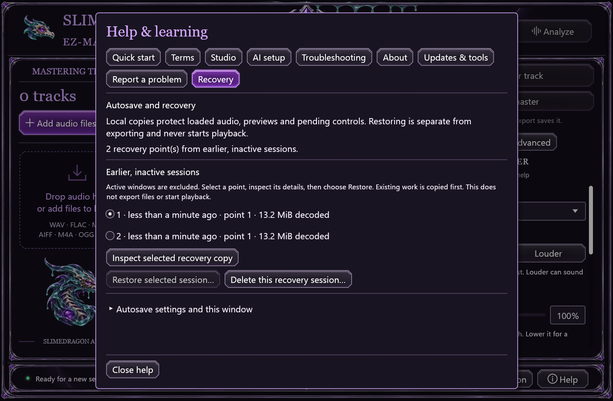
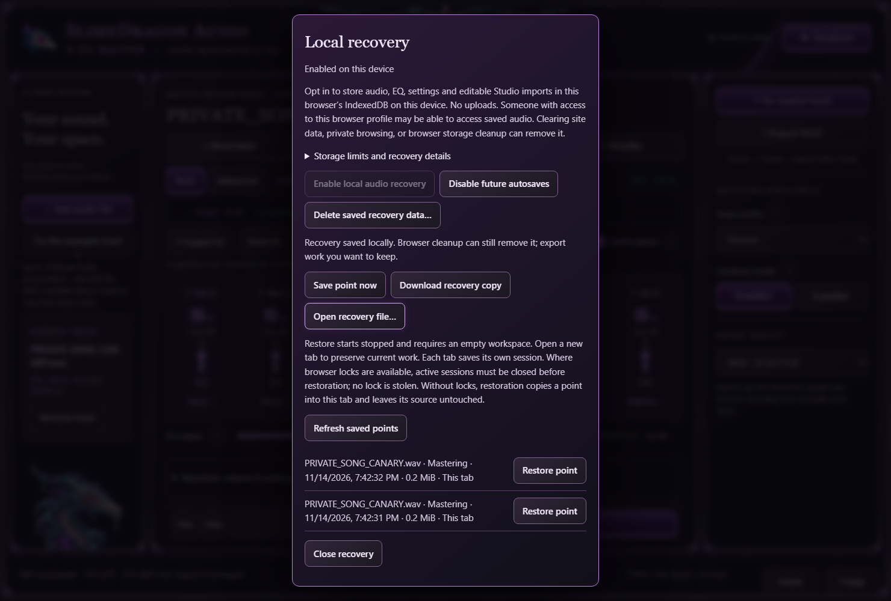
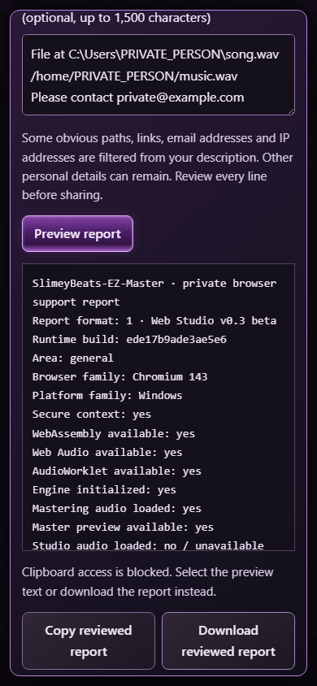
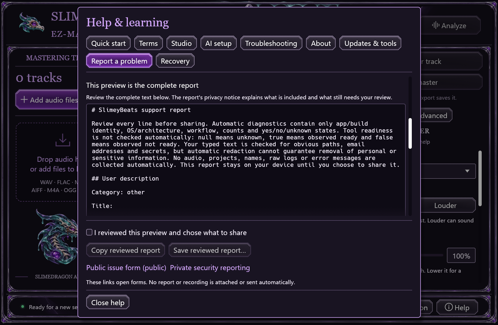

# Autosave, crash recovery and private support reports

Desktop **0.5.0-beta.3 Hotfix3** adds local recovery and reviewed support reports. Browser Studio remains **0.3.0-beta.3** and its audio recovery is **off by default**. The MCP companion remains **0.2.0-beta.3**, with 42 tools. Build revision identifies the newer same-version desktop release.

## Desktop recovery

Open **Help → Recovery** or the recovery indicator beside Help. Autosave starts enabled for the current window and remembers a changed choice for future launches. After edits settle, a worker copies the editing state locally; later saves reuse unchanged immutable audio. Watch for **Recovery saved**. **Save recovery copy now** requests an immediate point.

Recovery preserves loaded queue sources, raw pre-EQ buffers, prepared masters, their measurements, and pending EQ settings. Studio preserves sources, stems and friendly names, prepared previews, direct-stem edit lineage, pending faders/mute/solo, voice/repair controls and selected plugin controls. Restoring does not load or run a native plugin. Recovered loaded mixes can be re-mastered from their cached source even if the original file moved.

Queued items that were never loaded still need their original files. Reference tracks remain linked and must be reselected if moved. Undo/redo history, spectrogram textures, running jobs and playback are not resumed. Pending controls remain pending: update the Studio mix preview or re-master when the normal workflow requires it before exporting.

An earlier session without a completed shutdown marker can offer recovery when starting an empty window. Choose **Review recovery copies**, select a point, and **Inspect selected recovery copy** before restoring. Details show local source names and the saved-audio count. Current work is copied before it is replaced; a failed backup or restore keeps that work. Playback stays paused. Restoring is not an export.

**Keep in recovery history** dismisses the startup offer without deleting its copies and remembers that choice. Closed sessions remain available in Help; active windows are excluded from listing, loading and deletion. A normal close waits for a current copy, with a visible way to cancel closing or close without finishing. Abrupt termination can recover only the last completed point.

Three points are retained per session within an **8 GiB shared recovery-store budget**. Individual audio attachments retain the native 512 MiB decoded limit; metadata and attachment-count bounds also apply. These are recovery limits, not new editing limits or a statement of total RAM use. Full/blocked storage pauses recovery with an error while editing remains available. Use projects and exports for lasting copies.

The recovery folder is independent of the program and export directories: Windows uses the user's Local AppData application folder; Linux follows XDG data storage. Its exact location appears in Help. Recovery contains private audio and settings and is not a support attachment. Local account/filesystem access still governs those files.

Turning autosave off keeps existing copies. **Stop autosave and clear this window's copies…** explicitly removes the current window's owned recovery data while keeping its open audio editable. Earlier inactive sessions have separate confirmed deletion. Unknown/damaged files are preserved rather than treated as disposable. Uninstalling/upgrading the application does not silently erase the separate recovery store.

## Browser recovery

Open **Help → Recovery**. **Enable local recovery** explicitly permits audio/settings storage in this site's IndexedDB, beyond tab lifetime. Interface preferences remain separate in localStorage. No recovery audio is uploaded. People using the same browser profile may be able to recover it; use the explicit disable/delete controls on shared devices.

The browser keeps three points per tab, at most **12 points / 256 MiB globally**, with a **128 MiB snapshot budget**. Storage quota, browser cleanup and device memory can impose lower practical limits. Hitting a recovery limit pauses saves, not importing, mastering, EQ or exports. The recovery panel explains the failure. Audio storage stays off until enabled.

Restore into an empty workspace or a new tab. Another active tab's Web Lock is never expired or stolen. Where locks are unavailable, restoration copies data and keeps the stored source point. Staged restoration is rejected if newer work arrives. Imported Studio stems remain editable; source/bank identity and the exact stored preview are checked before adoption. Engine changes may require the matching build to replay a stored recipe; keep exported audio and recovery files you need.

**Download recovery copy** creates a private `.sbrecovery` file containing audio/settings within the recovery budget; it is not a bug report. Restore it through the recovery panel. Ordinary WAV export remains separate. No new full audio reads begin during tab teardown; the last completed point is the recovery boundary. Always export important work before reload/update when no current recovery point is available.

## Report a problem with a preview first

On desktop choose **Help → Report a problem**. In browser Help choose its report action; it remains available if the DSP application fails to start.

1. Choose an area and describe the problem in your own words. Include steps, expected behavior and observed behavior; avoid private names, credentials and recordings.
2. Generate a local preview. Automatic diagnostics use a fixed allowlist: actual reporting build, platform family, workflow, counts and observed/unknown states. They do not collect audio, recovery/project payloads, filenames, paths, custom-profile/plugin names, environment dumps, raw errors, logs or stack traces.
3. Review the **complete** text. Filtering catches common sensitive patterns but cannot guarantee anonymity. Edit your description and regenerate if needed.
4. Explicitly copy or download/save the reviewed text. Native saves do not overwrite an existing file. The displayed report and saved/copied report are the same content, with no hidden attachments.
5. Choose where to share. Public GitHub issues are public. The private security-report link is a separate route for security-sensitive concerns. Opening a form does not attach or submit the report; paste only what you chose to share.

No report is automatically uploaded or posted. MCP report text is returned to the AI client, which may send it to its model provider; this is stated in tool descriptions/help. Its report covers that connection and compiled engine, not an inferred installed-GUI version. Desktop recovery files are not exposed to the companion by adding these tools. See [MCP reporting](MCP.md).

## Implementation and qualification

- Native `recovery_store` owns OS locks, bounded float-WAV attachments, exact-wire metadata checksums, atomic commits and validated retention/deletion. Capture/restore adapters and a single disk worker keep I/O outside the renderer. Distinct attachment identities stay distinct even when their disk bytes deduplicate.
- GUI recovery scheduling, preferences, inspection/confirmation and report preview live in focused `recovery_*` and `support_report_*` modules. Original files, projects and exports remain separate.
- Browser recovery format/store/controller and workspace staging adapters are independent of the support reporter. The reporter boots without requiring the DSP engine. Metadata indexes do not include binary audio payloads.
- Report generation is a typed allowlist, followed by bounded best-effort filtering of deliberately entered text. No arbitrary log/context map is accepted as automatic diagnostics.

Candidate-specific checks cover real process termination, exact restored audio, missing originals, pending edits, cancellation/late results, locks between windows/tabs, quota/corruption failures, retention and report privacy canaries. Check the release's **Hotfix3 validation** for exact source/build hashes, tests, installer scope and remaining platform/manual limits. Renderer captures and synthetic audio do not establish physical-device listening or universal mobile storage availability.
