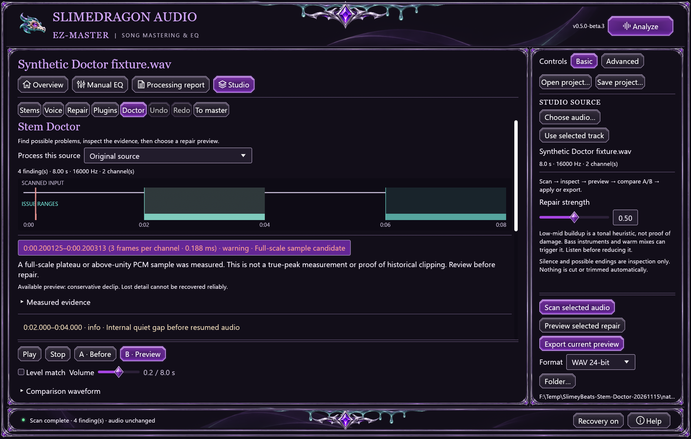
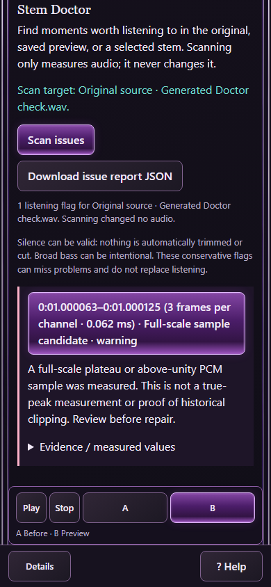
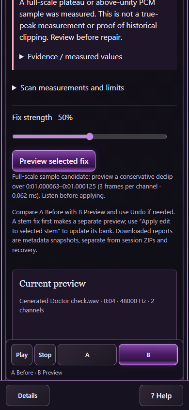

# Issue Detector and Stem Doctor

This development feature is implemented on `current-work`. Desktop and browser Studio
share the same Rust measurements and conservative repair code. The released main
site and Hotfix3 installer retain their separate release scope. The development
preview publishes from [current-work](https://slimedragonair.github.io/SlimeyBeats-EZ-Master/current-work/)
after its checks; check its displayed build ID.

## Inspect before changing sound



[Open the desktop capture at full size](images/doctor-desktop.png).
This actual Windows renderer capture uses isolated preferences/recovery and
generated audio. The compact toolbar's **Doctor** opens the full **Stem Doctor**
page; timestamped findings and a repair preview remain separate actions.

1. Open **Studio** and load a mix, use the loaded mastering mix, or import aligned
   stems. Open **Stem Doctor** (**Doctor** in the compact desktop toolbar).
2. Choose the original, current saved preview, or a stem as the processing target.
   Scanning a raw stem does not include its live fader gain, mute or solo.
3. Scan the selected audio. Review timestamped findings, measured evidence and
   the reported limits. Selecting a finding seeks to its time; markers identify
   its position on a waveform. A flag is a listening prompt, not a quality score.
4. If a finding offers a repair, explicitly prepare its preview. Start at 50%
   strength, compare Before/Preview, and Undo if it does not help.
5. A repair of a selected stem first creates a separate preview. **Apply edit to
   selected stem** retains that repair in the bank and prepares the whole mix.
   This keeps all other stems intact. Export the chosen revision separately.

Pending live faders must be committed with **Update mix preview** before repairs
or applying a preview. Read-only scans describe the saved audio. Changing target,
source, revision or retained history invalidates earlier findings; scan again.
Reports are transient navigation data, not an automatic recovery attachment.




[Full-size findings](images/doctor-web-findings.png) ·
[Full-size repair controls](images/doctor-web-repair.png).
These are actual 390×844 Chromium touch-emulation viewports from the published
development preview, using generated tones and one artificial plateau. The second
capture checks that fixed playback controls leave the repair action reachable.
They are interface illustrations, not physical-phone or listening qualification.

## What is measured

| Finding | Meaning and limits | Offered repair |
| --- | --- | --- |
| Full-scale sample candidate | An absolute full-scale plateau or PCM sample above unity. The track's own normalized maximum is not used. This does not establish historical clipping or measure reconstructed true peak. | Only eligible short plateaus with undamaged context can be interpolated. Other candidates remain inspection only. |
| Quiet region | All channels remain below the stated absolute threshold for a sustained interval. Leading and trailing silence are valid too. | None; no automatic trim, silence removal or zeroing. |
| Possible ending | A sufficiently long internal quiet gap has sustained active audio before and after it. Intentional pauses and hidden sections can satisfy this rule. | None; inspect and decide yourself. |
| Possible low-mid buildup | Sustained sampled broadband energy is unusually concentrated in 200–500 Hz under documented heuristic thresholds. Tonal controls reduce simple-tone false positives; warm instruments and mixes can still trigger it. | An explicit gentle bell cut at 320 Hz, not an instrument-specific diagnosis or reconstruction. |

The report includes exact thresholds, evidence, sampling limits and notes. Issue
storage is capped at 512; `truncated: true` means additional findings were omitted.
The low-mid detector uses at most 512 FFT windows rather than a full-track STFT.
Low-mid findings split at noncandidate windows and measured quiet gaps. Their
coarse sampled spans can include unsampled audio; evidence reports that duration
and does not claim continuous buildup. These settings are engineering heuristics, not calibrated probabilities.

## What a repair changes

`declip` estimates short eligible plateaus from surrounding slopes. It abstains
from unsupported runs, boundaries and missing context. `reduce_low_mids` applies
a bell cut of at most 3 dB, with 20 ms raised-cosine fades inside the requested
time range. Its filter history is warmed from preceding unchanged audio.

Strength is 0–1; zero is a bypass. Times are numeric seconds, rounded to the
nearest complete frame with half frames upward and an exclusive end. Duration,
sample rate, channels, original files and samples outside the selected frames
are retained. Local sample-peak protection is not true-peak certification.
This exact-sample guarantee applies to working audio and raw stem-bank samples.
Later mix or WAV/MP3 delivery peak protection can attenuate the whole saved file,
including samples beyond the selection. Downloads can therefore differ in level
from raw working audio even when the edit itself is strictly local. Keep final
delivery protection separate from judging which samples the repair changed.

There is no automatic repair-all, bleed isolation, missing-harmonic recovery,
genre classifier, neural download or server processing in this milestone.
Listen before accepting a fix; an unchanged or unflagged scan does not establish
artifact-free audio.

## Browser and MCP

Browser **Download issue report JSON** explicitly saves a metadata snapshot of
the scanned target/revision. It contains no audio and is separate from session
ZIPs and optional recovery. Existing browser audio/history/memory limits remain.

The development companion exposes **45 tools**. Start with `get_capabilities`
and `get_help(topic="doctor")`; no source checkout or chat history is needed.

```json
{"tool":"scan_audio_issues","arguments":{"audio_id":"<current source or Studio asset ID>"}}
```

Poll its job for `result.report`. Only after an explicit repair request:

```json
{"tool":"preview_stem_doctor","arguments":{"audio_id":"<same current ID>","repair":{"action":"reduce_low_mids","start_seconds":1.0,"end_seconds":3.0,"strength":0.5}}}
```

Those example times must be replaced by the actual selected range. Poll for the
new `studio_preview_id`, notes and changed-sample count. Rescan or audition that
revision; undo/redo use existing Studio tools. A direct stem preview still needs
`apply_preview_to_stem` before it changes the bank. Exports and project saves
remain separate explicit user actions. MCP metadata may reach the AI client's
provider; local processing does not change the client's privacy policy.

## Implementation

- `rust/src/studio/doctor/`: thresholds, bounded sample/spectral measurements,
  strict request validation and length-preserving repair.
- `rust/src/gui/studio/doctor_*`: background jobs, target/revision identity,
  findings, controls and waveform markers.
- `web/dsp/src/studio_doctor.rs`: shared-engine WASM binding.
- `web/site/studio-doctor*`: revision-bound reports, responsive controls,
  markers and explicit JSON download; worker repairs use proposal/commit and
  recovery replay.
- `mcp/server/src/doctor_*`: protocol schemas, read-only jobs, temporary repair
  previews and self-contained tool help.

Future detectors belong beside these measurements with explicit thresholds,
false-positive controls and cancellation. New repair actions require their own
bounded source-preserving implementation and tests, then matching UI/MCP help.

## Validation status — November 15, 2026

Before edits, native library checks passed **346 tests with 2 ignored**, browser
binding checks passed **20**, and MCP library checks passed **36**.

Current local checks passed:

- **31 shared Doctor tests**, covering clean bass/full-scale sine counterexamples,
  clipped runs, silent/right-only channels, local low-mid spans, quiet/tonal splits,
  finite values, cancellation, bounded reports and exact outside-region samples.
- The final local Windows library suite passed **369 tests, 2 ignored** through
  the relocated cache paths. Focused native Studio interaction/layout checks
  include the new scan, stale-result, pending-mix and preview workflows.
- **22 browser binding tests** and **47 MCP tests** (41 unit, 6 integration).
- **12 complete Doctor browser workflow groups in each engine**: Chromium 143,
  Firefox 144 and Linux WebKit 26. The actual built WASM/worker, candidate commit/
  discard, undo/redo, fresh-worker recovery, direct-stem application, report JSON,
  stale results and all-muted output PCM passed. Touch checks at 320/390px and
  100%/200% root text measured no document overflow after a Firefox volume-row fix.
- **8 real MCP stdio workflow groups**, including all four issue kinds, both
  repairs, exact outside-region PCM, explicit stem application with independently
  summed whole-mix PCM, refreshed IDs and bank undo/redo. General mastering,
  optional-tool and reviewed-support-report stdio checks also passed with 45 tools.
- One fresh agent used only initialize/discovery/help to inspect generated audio
  and prepare one gentle temporary preview, without MCP errors or final exports.
  This checks the guided workflow, not listening quality or universal agent support.
- A repeat read-only scan of the owner's authorized **179.8-second stereo WAV**
  returned identical reports, left the source hash/Studio state unchanged and
  raised no flags. This does not establish artifact-free sound.
- Four companion packaging tests, eight existing timeline tests and 24 publishing
  helper tests passed. Native/MCP/WASM strict Clippy and relevant formatting passed.

Actual native renderer captures used isolated preferences/recovery and generated
fixtures at requested 1480×940 and 1100×720 sizes. Each recorded a completed scan,
four findings and no error. Windows 125% DPI produced 1850×1175 and 1375×900 pixels.
Native input/layout checks, rendered pixels and audio listening are distinct.

The first checkpoint's mobile publication workflow passed. An independent check
of its actual public HTTPS app passed scan/report download, selected repair,
exact untouched **raw** PCM, explicit delivery peak-guard gain, exact undo/redo
working audio and exports, 320/390px layout and 87 consistently versioned runtime
asset requests. No request escaped into the production root or uploaded audio.
Existing Chromium Studio and time-editor regressions also passed 25 and 21 groups.

The broader native CI caught a compact toolbar wrap that clipped the fourth
fader. The follow-up uses **Doctor** in compact navigation and removes its
redundant **View** label, preserving every action and existing visibility
assertion. **72 focused Studio tests** passed, including both reported failures,
new Doctor navigation/four-row coverage and precise timestamp/hover checks;
strict Clippy and formatting passed. The complete Windows and Linux release CI
rerun passed on implementation commit `82e6e5e`.
The owner's Rust cache relocation has completed; an offline MCP check and full
browser build passed through the preserved paths with the same browser runtime
and WASM bytes. Physical phones and hardware listening remain unqualified;
Linux WebKit is an engine check, not iPhone acceptance. Windows WebKit's installed
build lacks Web Audio; its unsupported-audio runs are not reported as passes.

## Qualified implementation and publication

Implementation commit **`82e6e5ef61ff44aeebd87db0c5d0e8dccb5ec6a8`** passed:

- [Windows and Linux native checks](https://github.com/slimedragonair/SlimeyBeats-EZ-Master/actions/runs/43756165559), including the repaired compact layout, MCP protocol and export checks.
- [Full browser checks](https://github.com/slimedragonair/SlimeyBeats-EZ-Master/actions/runs/43756165674), including the existing recovery, long imports, live EQ, portable exports, Studio, timeline, Doctor, memory, live playback, learning and compact-layout matrices.
- [Current-work preview publication](https://github.com/slimedragonair/SlimeyBeats-EZ-Master/actions/runs/43756165646), including its mobile smoke, Doctor, time-edit engine and root/preview storage checks.

All **372 stable-site artifact file hashes** matched the pre-feature baseline.
An independent post-deployment fetch verified five critical stable files and four
preview files against the publication manifest. This distinguishes the complete
artifact comparison from the smaller set fetched from the public server.

Later documentation-only updates refresh this guide and its screenshots; they
do not expand the implementation or physical-device qualification above. Main
and the Hotfix3 installer were not promoted or replaced by this development work.
