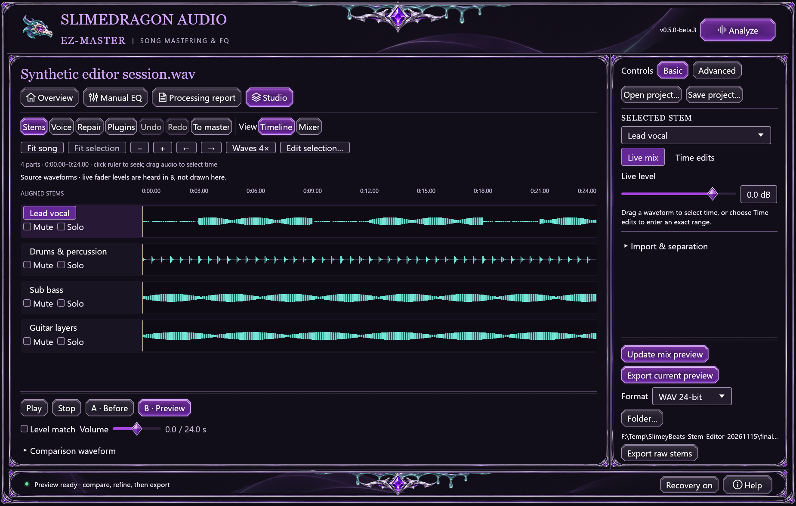
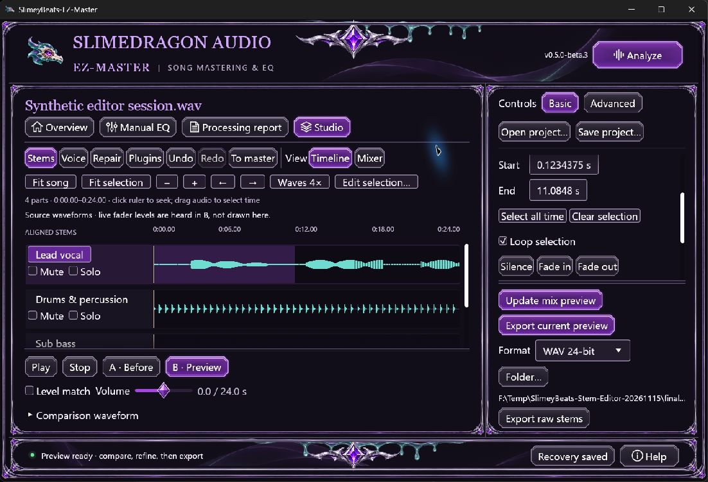

# Desktop stem editor development

The `feature/stem-editor-workspace` source branch starts the next desktop editing milestone. The published **0.5.0-beta.3 Hotfix3 installer** and hosted browser retain their documented interface until this work is released. Desktop is the first target; browser/mobile parity follows practical, tested features.

## Timeline and selection

Open **Studio → Stems** after importing or separating a stem set. **Timeline** places the parts on a shared seconds ruler. **Mixer** returns to compact faders and optional individual plots.

[Open the full-size timeline](images/stem-editor-timeline.png) · [Open the compact layout](images/stem-editor-compact.png). Smaller windows scroll the stem lanes; Mixer provides the denser fader overview. Source replacement and optional separation are grouped under **Import & separation** once a bank is loaded.

1. Click a stem name or choose it in **Selected stem**. Its highlighted lane and inspector refer to the same stable part, including repeated instrument names.
2. Click the ruler or a waveform to seek. Drag a waveform to select time on that stem; releasing reveals **Time edits** in the inspector. **Edit selection…** opens it directly, with numeric **Start / End** fields. **Live mix** returns to the selected stem's fader.
3. Navigate with **Fit song**, **Fit selection**, **− / +**, and the left/right view buttons. These change the view, not the audio's timing.
4. Adjust live gain, mute, solo and advanced stereo balance. **B** auditions the mix; **A · Before** is a separate comparison. Muted parts remain muted even when soloed. Parts excluded by solo are labeled.
5. Enable **Loop selection** to repeat an interval of at least **50 ms** while listening to the whole mix. The minimum avoids repeatedly priming live DSP for tiny loops; single-frame sample edits remain available. Looping never changes exported audio. Playback stays pinned below the editor.

Waveforms show current bank samples, including applied time edits. **Waves 1× / 2× / 4× / 8×** magnifies the drawing only; touching a lane edge at an enlarged scale does not imply audio clipping. The drawing does not include live fader gain, listening volume, peak protection or the A/B crossfade. It aggregates absolute peaks across all channels rather than displaying left/right separately. Fit/zoom retains a minimum 10 ms view; sample selections remain frame-accurate, and ruler precision increases at close zoom.

## Edit the selected stem

[Open the time-edit view at full size](images/stem-editor-selection.jpg). Playback and exports remain pinned. The images use generated tones, not personal recordings.

Select a nonempty time range, then choose an explicit edit:

| Action | Result |
| --- | --- |
| Silence | Replace selected samples with zeros, retaining the gap and every stem's timing. |
| Fade in / Fade out | Apply a linear fade inside the selection. A one-frame fade is silent. |
| More time edits → Region gain → Apply gain | Change selected samples by −60 to +12 dB. Positive gain can increase peaks. |
| More time edits → Reverse selection | Reverse frames in the range while keeping stereo channels together. |

Boundaries round to the nearest sample frame; half frames round upward. The end frame is exclusive. Edits preserve rate, channels and duration. Samples outside the range and other bank members stay unchanged. Invalid or cancelled work leaves the previous revision available.

Time edits render explicitly. If live faders are pending, use **Update mix preview** first. An edit replaces one immutable bank member and prepares the complete mix with the current controls. Mix peak protection can affect the rendered mix outside the selection; unchanged-sample guarantees refer to the stem bank. An edit does not export. **Undo / Redo** restore bank and preview revisions; the existing history retains at most four earlier previews. This is not unlimited, source-backed clip history.

**Save project** retains the edited bank, source, controls and prepared preview in the existing self-contained format. **Export raw stems** includes edited bank samples without faders; **Export current preview** saves the prepared mix using the usual export checks. Original files remain unchanged. Autosave captures edited bank audio and its preview through the existing recovery system. Selection, zoom, loop and lane scroll are session navigation state and reset on project/recovery reopen. Recovery does not restore undo history or start playback.

## AI assistant support

The matching development companion adds **`edit_stem_region`**. Discover the current bank and stable kinds with `get_studio_session`, supply the selection and operation, then poll the job. The result is a temporary mix preview and new IDs; export remains explicit. Read [MCP setup and discovery](MCP.md) for current schemas and self-contained help. Looping is desktop auditioning, not an exported repetition.

## Implementation map

| Files | Responsibility |
| --- | --- |
| `rust/src/studio/region_edit.rs` | Shared, cancellable, length-preserving sample edits; no UI or I/O. |
| `rust/src/gui/studio/editor_state.rs` | Selected stem, frame-snapped selection and time viewport. |
| `editor_timeline.rs`, `editor_envelope.rs` | Virtualized lanes and multiresolution peak caches, retained for unchanged source buffers. Playhead repaints do not rescan the song. |
| `editor_toolbar.rs`, `editor_controls.rs` | Navigation and selected-part inspector using existing live controls. |
| `editor_audio.rs` | Guarded workers, immutable bank replacement and complete preview commits. |
| `rust/src/gui/playback_loop.rs`, `audio_source.rs` | Coherent loop bounds and frame-boundary wrapping, including DSP delay priming. |
| `mcp/server/src/region_edit_*` | Companion validation, worker integration and regressions. |

Future movable clips need a separate arrangement model referencing immutable assets. Do not weaken aligned-bank validation to pretend different lengths or offsets are aligned. Project/recovery serialization, undo, live playback, exports and MCP descriptions must evolve together.

## Following milestones

This establishes a waveform editor, not full Audacity or FL Studio parity. Planned later: source-backed trim/split, movable/duplicated clips, grouped time removal, markers, automation and bus routing. MIDI, instruments and a piano roll are outside this milestone. The browser retains its existing aligned-stem workflow.

Workflow research used the official [Audacity timeline](https://manual.audacityteam.org/man/timeline.html), [selection](https://manual.audacityteam.org/man/audacity_selection.html), [zoom](https://manual.audacityteam.org/man/zooming.html) and [track/clip](https://manual.audacityteam.org/man/audacity_tracks_and_clips.html) manuals, plus Image-Line's [Playlist](https://www.image-line.com/fl-studio-learning/fl-studio-online-manual/html/playlist.htm) and [Audio Clips](https://www.image-line.com/fl-studio-learning/fl-studio-online-manual/html/generators_audioclip.htm) references, accessed November 15, 2026. SlimeyBeats retains its own design and audio model.

## Validation

The unmodified baseline passed **352 Windows native tests**, with two existing ignored checks. Qualification on November 15, 2026:

| Check | Result and scope |
| --- | --- |
| Studio widget suite | **51 passed** in the cached debug test profile, including real pointer/key events, precise typing, bounded 290/332-point inspectors, 100-part scrolling, undo/redo and maximum-length Unicode project save/reopen. |
| Final Windows release suite | **406 passed**, two existing ignored checks (344 library + 62 integration). Child-process output is not counted twice. Locked/offline all-target release run with schemas enabled. |
| Formatting and strict native Clippy | Passed across all targets with schemas enabled. |
| MCP Rust | **42 passed** (36 unit + 6 integration); actual stdio discovered **43 tools**. |
| MCP region workflow | All five edits, unchanged other-stem PCM, controls, undo/redo and saved projects passed. Twenty invalid/stale requests retained Studio state. General protocol/report and four package checks also passed. |
| Fresh-agent discovery | A history-free agent imported four synthetic parts and faded the vocals using discovery/help alone: **10 tool calls, zero errors**, with no final export, download or app launch. This qualifies one agent/transport workflow. |
| Shared browser DSP compilation | Locked/offline WASM check passed. The new desktop timeline and controls have not been ported to the browser. |
| Final native captures and input check | Final release candidate captured at **1480×940 and 1100×720** with preview/playback preparation ready and no errors. Actual Windows input passed drag selection/reveal, Fade out, Undo/Redo, precise typed seconds with Enter-to-frame commit and loop toggling while paused. Original fixture hashes remained unchanged; the private app closed cleanly. Physical audibility was not tested. |

`python rust/tools/verify_stem_editor.py --gui <built exe> --out <fresh private folder>` creates a synthetic four-part project and captures the actual native renderer at 1480×940 and 1100×720. It verifies load/preview/playback preparation and pixels; it does not prove pointer interactions, installation or physical audibility. Native hardware listening, Linux runtime and physical mobile checks are separate from this Windows milestone. Previous release validations in the main Studio guide retain their original build scope.
