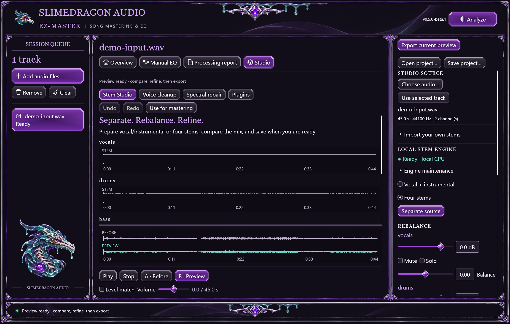

# Studio editing preview

Studio Preview **0.5.0-beta.2** supports **2–9 imported stems**, including multi-file and Suno/stem ZIP import. Its matching companion is **MCP 0.2.0-beta.2** and its browser Studio version is **0.3.0-beta.2**. Beta.2 is current development source and is **not yet publicly released**. The published beta.1 release predates these import changes; stable v0.4.2 does not include Studio. Preview uses a separate install identity and can coexist with stable. Existing mastering and Manual EQ remain available; preparing a preview and exporting remain separate actions.

## Desktop workflow

1. Open **Studio**, choose a local recording, or use the selected mastering-queue track. **Analyze** at the top right measures the selected Studio input.
2. In **Stem Studio**, choose **Vocal + instrumental** or **Four stems** (vocals, drums, bass and other). Install the optional local engine once, then **Separate source**. Setup downloads a private CPU runtime and verified upstream model; separation uses local files. The optional environment does not alter global Python.
3. Alternatively, use **Choose stem files…** for several aligned files at once or **Choose Suno / stem ZIP…**. Review the center-workspace cards, then **Import selected stems**. [The import workflow below](#import-a-whole-stem-set) covers formats, selection and limits. Imported stems need no model. Automatic separation still produces only two/four stems; a nine-part bank requires separately supplied parts.
4. Adjust gain, mute/solo and stereo balance; **Update mix preview** renders from the bank. A muted part stays muted even if soloed. Repeated fader changes do not accumulate processing.
5. Use **Voice cleanup** on a voice recording or vocal stem. Start gently with rumble removal, noise reduction and de-essing. A noise-only region can teach stationary noise; the optional quiet-gap gate reduces low-level gaps. Cleanup does not itself isolate speech from music.
6. In **Spectral repair**, choose the source and build its spectrogram. Drag a rectangle or enter exact seconds/Hz, then preview attenuation or healing. Bright energy is not automatically a defect. Healing estimates surrounding spectral magnitudes; it cannot reconstruct missing words or instruments.
7. A direct stem edit can be **applied to the selected stem**, rebuilding the full mix while retaining the other stems. Apply each direct edit before chaining another. Undo/redo retains a bounded set of recent revisions.
8. Compare **A · Before** and **B · Preview**. Listening volume and level matching do not alter exports. **Use for mastering** creates a private working source for the existing mastering queue. It does not save a final master.
9. **Export current preview** saves the prepared revision and report. Individual stem export saves aligned 32-bit float WAVs at their relative bank levels; fader/solo changes affect the mix, rather than those raw files. Existing output files/folders are preserved.

**Save project** writes a new self-contained folder with source, stem, before/preview WAVs, mix controls and hashes. Open its `session.studio.json` to continue without the original library files or model runtime. Projects contain private audio: share them only intentionally. They retain the prepared audio and mix, not an entire undo history or vendor-plugin state.

The engine maintenance disclosure offers **Verify installed model** and **Repair stem engine**. Verification checks the installed model files. Repair reinstalls the isolated dependencies and model; unknown/user-added cache files are preserved in a backup. Setup and inference have cancellation and process supervision. Readiness is a quick status check, rather than continuous hashing of model files.

## Import a whole stem set

1. In **Stem Studio**, click **Choose stem files…** and select the aligned audio together, or **Choose Suno / stem ZIP…** and choose one ZIP. Dropping one ZIP anywhere in the desktop app opens Studio review. Dropping several loose audio files while Studio is open also prepares a review.
2. Review the part cards in the **center workspace**. Matching WAV/MP3 filenames are one logical part: `Guitar.wav` and `guitar.MP3` count once, even in different ZIP folders. **Prefer WAV** is the default; **Prefer MP3** selects MP3 when present. If the preferred encoding is absent, the available version is used. Two files with the same basename and extension are ambiguous and must be renamed before import.
3. Select **2–9 parts**. If more than nine are found, all appear and the first nine in the suggested role order start selected; uncheck a part before selecting another. Filename-based suggestions use a trailing role such as `(Backing Vocals)`, keep backing/harmony on generic parts so `vocals` is reserved for the lead, and prioritize common instruments plus lead/backing ahead of Brass/FX. This is a filename heuristic, not audio inference. Review the selection and each unique part type before importing; no part is silently discarded or imported. Available types include vocals, instrumental, drums, bass, other, guitar, piano, synth, strings and percussion. Use `part_1` through `part_9` for custom instruments or repeated parts, such as two guitar takes. Leave an original/full mix out when importing its constituent stems.
4. Click **Import selected stems** to decode and replace Studio with the prepared bank/mix. Opening a review does not replace the current audio. **Discard file selection**, cancellation or an invalid import retains the previous preview. Files must have matching sample rate, channels and frame count; import does not silently trim or align them.

Prefer WAV consistently across the selected bank when available. WAV and MP3 counterparts can decode to different frame counts; available-format fallback does not guarantee alignment. A mixed-encoding selection is rejected if its decoded rates, channels or lengths differ.

Original filename-derived friendly names are retained in the bank, faders and processing-target labels, including through direct edits, undo/redo and project reopening. Stable kind IDs still address each part, and raw WAV filenames remain based on those IDs. Native raw exports include `stems.json` with `file`, `kind` and `display_name` mappings.

The existing **Assign files individually** panel remains available. Choose **Up to 9 stems** for a partial/larger bank and leave unused slots empty. Mixing, direct edits, raw stem export and desktop projects retain up to nine parts. Instrument types identify imported parts; they do not add extraction targets to the local two/four-stem model.

ZIP import accepts **WAV and MP3 only**; cover art, metadata and other files are ignored. Only selected audio is extracted into private temporary files. Source files are preserved and audio is not uploaded. No model installation is needed; native MP3 decoding requires FFmpeg/ffprobe as before. Use an ordinary unencrypted ZIP with stored/deflate compression.

| Import limit | Desktop / MCP | Browser Studio |
| --- | --- | --- |
| Selected parts | 2–9 | 2–9 |
| ZIP file size | 1 GiB | 128 MiB |
| WAV/MP3 entry size after ZIP decompression | 512 MiB each | 128 MiB each |
| Inspection metadata | At most 512 entries / 64 distinct parts | At most 512 entries / 64 distinct parts |
| Decoded audio | 512 MiB per input by default; MCP can configure this | 128 MiB **combined across all imported stems** |
| Duration | Subject to input limits and available RAM | Existing 15-minute per-file guard also applies |

These are input bounds, not total RAM limits. Multiple parts, mixing, history and export need additional working memory. Use desktop for full-length multi-part songs; the browser memory budget has not increased.

The desktop also accepts a ZIP as a startup file. With multiple loose inputs, `--view stems` prepares a batch review; both routes still require explicit import:

```powershell
.\slimeybeats-ez-master-live.exe "D:\Music\My Song stems.zip"
.\slimeybeats-ez-master-live.exe --view stems "D:\Music\vocals.wav" "D:\Music\guitar.wav"
```

## Optional VST3 effects



[Open the stem workspace at full size](images/studio-stems.png). This earlier beta.1 capture illustrates four-stem editing; the instructions above describe beta.2 import review.

Build/install the `plugins/host` helper beside the desktop/MCP binaries. Choose a trusted VST3 file or x64 bundle, probe its audio-effect classes, adjust discovered generic parameters and **Preview plugin effect**. Values use each plugin's normalized 0–1 mapping. Compare before exporting.

The initial host supports compatible mono/stereo float32 audio effects and offline preview rendering. It compensates reported latency and trims the result to the source duration. Native vendor editors, MIDI/instrument sequencing, arbitrary plugin compatibility and persistent vendor state are outside this initial scope. Plugins run native code in a separate process for crash/cancellation containment; this is not an OS security sandbox. Plugins may have their own network/licensing behavior.

## Browser Studio

[Native repair view](images/studio-repair.png) · [Native effect controls](images/studio-plugins.png) · [Responsive browser repair view](images/studio-web-phone.png).

The browser **Studio** tab supports a recording or **2–9 imported aligned stems**, rebalancing, voice cleanup, a selectable spectrogram, repair, A/B playback, undo/redo, WAV export and a raw stem ZIP. Use **Choose stem files** to select several files, **Choose Suno / stem ZIP** for an archive, or drop files onto **Import a whole stem set**. Review the parts and preferred encoding, then **Import selected stems**. The same grouping and selection rules above apply: all parts are shown, at most nine are selected, and the previous preview remains available during review or after an invalid/cancelled import. The individual-file panel also remains available, including **Up to 9 stems** with unused slots left empty. Each selected part needs a unique type. The summary beside **Import selected stems** shows selected/omitted counts, preferred encoding and fallback use. Expand **Left out** to inspect every omitted part; the disclosure also works from the keyboard. Review this summary before importing.

**Use preview for mastering** loads a working copy into the existing browser mastering workflow while retaining Studio. **Close Studio** releases its workspace. Reloading/closing the page discards unsaved audio.

Neural separation and native VST3 hosting remain desktop features. Browser processing stays in local WebAssembly workers; user audio is not uploaded. Studio cancellation waits for its current bounded processing step, then discards the proposed revision, preserving the previous preview. This differs from the mastering worker's terminate-and-restore cancellation behavior.

Browser Studio has a **128 MiB combined decoded-input budget**, in addition to a 15-minute per-file ceiling and 128 MiB source-file bound. This is distinct from the original mastering page's 384 MiB limits. Decoding uses a 48 kHz context. At stereo 48 kHz the input budget represents approximately 5:49 for one recording, 2:54 per file for two equally long stems, 1:27 per file for four, or **38.8 seconds per file for nine**. Mono files use half that PCM memory. Increasing the part count does not increase the memory budget. The stricter applicable bound wins. Processing, history, A/B and export allocate additional memory; the input budget is not a total RAM cap or a phone guarantee. Desktop is recommended for longer stem projects.

WAV downloads use the shared export peak checks and may apply protective attenuation. Raw float stem ZIPs retain bank samples and relative levels. A browser raw export contains one WAV per selected part **plus `stems.json`**: nine parts produce nine WAVs and the manifest. The manifest maps stable filenames/kinds to the preserved friendly `display_name` values. Unapplied tool settings are identified; **Export current preview** saves the already prepared audio. Preview again to hear new settings. Listening volume never changes saved samples.

## MCP workflows

The matching **0.2.0-beta.2** companion exposes **38 tools**. Begin with `get_capabilities`, then `get_help` topics `stems`, `voice`, `repair`, `plugins` or `studio_export`. Discover current audio, stem-bank and preview IDs with `get_studio_session`; poll every returned job ID. The editing workspace is separate from the mastering preview.

Loose aligned files can be batched with `import_stems`, assigning a unique `kind` to each. For ZIPs, `list_audio_files` marks archives with `stem_archive: true`; call read-only `inspect_stem_bundle` with `library`/`path`, then `import_stem_bundle`. Inspection returns zero-based `parts[]` positions, names, suggested kinds and available versions. `get_studio_session` exposes friendly stem names in `assets[].display_name`; `assets[].label` retains the stable kind for compatibility. Import accepts `preferred_format: "wav"` (default) or `"mp3"` and optional `parts: [{"part_index": 0, "kind": "guitar"}, …]`; `kind` is optional, but an explicit 2–9-part selection is required when more than nine are found. `get_help` topic `stems` includes the full workflow and keeps exports separate from import. Neural extraction uses `separate_stems` and remains two/four only.

`mix_stems`, `clean_voice`, `repair_audio` and `render_plugin` create temporary previews. `apply_preview_to_stem` applies a direct current-stem edit. Explicit saving uses `export_studio_audio`, `export_stems` or `save_studio_project`. `open_studio_in_desktop` creates a self-contained project for listening/refinement. `use_studio_for_mastering` promotes the prepared mix to the original mastering flow. Desktop and AI sessions evolve independently after handoff.

Plugin execution additionally requires owner-configured `--plugin-root` folders; audio-library access alone does not authorize native plugins. The AI client controls its own handling of filenames, measurements and tool results. No audio bytes are returned through MCP. See [MCP setup/privacy](MCP.md).

## Validation status — November 13, 2026

Final native suites passed **107 Windows / 109 Linux tests**, with **nine Windows / ten Linux MCP regressions**. The refreshed browser distribution passed **18 groups each in Chrome 156, Firefox 144 and Linux WebKit 26**; source-site Chromium 143 also passed **18 groups**. All four actual native/browser views independently scored **9/9/9**. Installer lifecycle passed under an **isolated QA app ID/menu group**, using the production NSIS template and byte-identical runtime payload. The test preserved existing Preview/stable installations and did not install the production Preview registration. These checks do not establish subjective sound quality or physical-phone acceptance.

| Beta.2 follow-up | Observed result / remaining check |
| --- | --- |
| Native / MCP | **107 Windows / 109 Linux native tests and nine Windows / ten Linux MCP regressions passed**, including name/role coverage. Format checks, strict Clippy and locked release builds passed. |
| Optional VST3 worker | The release host build, strict Clippy and host tests passed after the lockfile update. The fault suite passed null-factory failure, plugin-initiated worker exit and cancellation of a stalled factory while retaining the MCP source. This covers the tested fixtures, not arbitrary third-party effects. |
| Latest names/classification | **21 focused tests passed**, including friendly-name/role-classification coverage. Name/manifest/import functional steps are also covered by the source-browser results below. |
| MCP ZIP workflow | Actual stdio discovery exposed **38 tools**. Import passed with nine WAV/MP3 pairs and sample-exact WAV results, real MP3 decoding/preferred-format fallback, nine selected from twelve parts, source hashes preserved and prior-preview retention on errors. |
| Browser ZIP/UI | The refreshed distribution passed **18 groups each in Chrome 156, Firefox 144 and Linux WebKit 26**. Source-site **Chromium 143 also passed 18 groups**. Coverage includes pairing, MP3/fallback, names/manifests, explicit subsets, corrupt-import retention, 390px controls, selection/preference/fallback summaries, a 55-part omission list, keyboard disclosure and long labels. The phone Import control regression is fixed; tests use actual normal clicks. |
| Authorized full-length desktop fixture | An anonymous **289.5 MiB** archive contained **11 WAV/MP3 pairs**. Nine parts were explicitly selected, including lead/backing vocals; **Brass/FX were left unselected** after review. The **179.8-second WAVs** passed **155,347,200 PCM comparisons with zero mismatches**. Original ZIP/WAV hashes and modification times were unchanged. No source music or identifying paths are published. |
| Actual-data retest | **20 checks passed** using the default first-nine role order without kind overrides: `vocals` correctly identifies the lead, while the original backing name is retained on `part_1`. Brass/FX were explicitly left unselected. Named mix/edit/raw-export/project behavior passed and original inputs remained unchanged. |
| Encoding-duration observation | For that fixture, independent decoding found all nine selected MP3s aligned with each other but **648 frames / 13.5 ms longer** than their WAV counterparts. The difference was not introduced by the importer. Cross-encoding duration equality is not assumed; prefer consistent WAV inputs, since mixed-format fallback can fail alignment. |
| Resource scope | Local desktop RAM was observed at about **1.17 GiB** for that fixture; this is an observation, not a memory guarantee. The real-track browser workflow was not qualified and exceeds its unchanged 128 MiB input budget. |
| Fresh-agent MCP ZIP | An agent without project/chat history used only live instructions, schemas and help to import nine WAV parts from eighteen WAV/MP3 encodings, lower vocals by 2 dB and prepare a preview. The other eight controls remained at 0 dB, centered and unmuted; no export was called during preview preparation. On a separate explicit save request, the agent then exported **24-bit WAV plus report, nine raw stems and a self-contained project**, retaining settings and without invoking mastering. The bridge closed with exit code 0. This qualifies the tested protocol harness, not every AI client/model. |
| Final visual review | Independent inspection of **four actual views**—native desktop/compact and browser desktop/phone—scored each **9/9/9** for visual quality, polish and readability. The browser and native selection fixtures are distinct; screenshot review does not certify sound or every interaction. |
| Project / Linux GUI checks | Earlier and newly named projects reopened in the current desktop without errors, with preview/playback ready; the named project retained all nine original names. Linux passed **12 fresh GUI state captures**, covering eleven-part reviews, named mix/backing-edit projects, legacy projects and self-contained reopening after external source removal. This verifies the tested cases, not audible hardware playback. |
| Installer lifecycle | **Passed under an isolated QA app ID and menu group**, using the same production NSIS template, generated file lists and byte-identical runtime payload. Checks covered drive-root/other-channel rejection, native WAV CLI use without FFmpeg, installed GUI processing/Studio project reopening, MCP origin/plugin faults, upgrade path/user-data preservation, and uninstall cleanup with user files/sentinels retained. Existing Preview files, shortcuts/configuration and the stable channel were preserved. **The production Preview registration itself was not installed by this test.** |
| Candidate packaging audit | The checked candidate passed with **378 source files**, dependency license notices, matching bundled-example provenance and **28 local guide links**. Private input audio, models and build products were excluded. These results apply to that candidate; the final build will be audited again. |

The following table records **earlier beta.1 qualification**, including model/plugin checks and illustrative captures. Those checks have not all been rerun for beta.2.

| Earlier scope | Observed result |
| --- | --- |
| Shared audio DSP | Eight focused regressions passed for stem reconstruction/mixing, cleanup, spectrogram behavior and localized repair. Samples outside the selected repair time remain unchanged before later export stages. |
| Local model | Real CPU separation passed in two/four modes, including a multi-chunk fixture and a 45-second source-rate adapter test. Aligned finite stems and neutral reconstruction were checked. This is not a listening-quality benchmark. |
| Native/MCP | Real stdio tests passed editing, stale-ID rejection, undo/redo, explicit exports, imported stems, direct stem replacement, mastering promotion, self-contained projects and desktop handoff. Source hashes were retained. |
| Earlier native regression | **94 Windows / 96 Linux native tests**, eight Windows / nine Linux MCP regressions, strict Clippy and release builds passed on the earlier beta source. The original stdio workflow passed all six export formats. Project regressions preserve direct stem-edit lineage after reopening. |
| Runtime recovery | A real installed test cache passed verification, detected same-size model-index corruption, then completed explicit repair, reinstallation and inference self-test with the original index hash restored. Four extraction/cache regressions passed, including preserving malformed provenance in a backup. |
| VST3 | External gain fixtures passed mono/stereo processing, generic gain changes and a fixed 137-frame latency case, with sample-exact expected gain after compensation and source duration retained. Existing files were preserved. A native fault module passed null-factory failure, plugin-initiated worker exit and cancellation of a stalled factory; the MCP parent retained its source and could analyze again. This covers compatible fixture effects, not arbitrary third-party plugins. |
| Browser Studio | Chrome 156, Firefox 144.0.2 and Linux WebKit 26.0 passed real UI/worker workflows: two/four imports, gain/mix, cleanup applied to one stem while preserving others exactly, repair, A/B, undo/redo, WAV/ZIP export and mastering handoff. Failed/cancelled edits and misaligned imports retained the previous preview. 390px layout/reachable export checks passed. |
| Browser regression | The original Chrome mastering/EQ suite passed, including AudioWorklet samples matching shared Rust exactly, three WAV formats, reference invalidation, cancellation/late decode safety, offline analysis and unchanged exports at different listening volumes. |
| Waveform regression | Actual Canvas/AudioBuffer checks reproduce and fix a blank right-only stereo waveform. The plot now includes both channels and caches immutable peak envelopes; repeated redraws do not read/rescan source channel buffers. |
| Fresh-agent MCP | An agent with no project/chat history imported four stems, cleaned and applied the vocal edit, retained other stems, rebalanced and prepared a preview using only live instructions/schemas/help. It did not export until a later explicit save instruction, then saved WAV/report, raw stems and a self-contained project and closed cleanly. A missing returned bank ID it reported was fixed. This qualifies the tested protocol harness, not every AI client/model. |
| Visual review | Actual beta.1 captures passed independent review in all six supplied native/browser views, each ≥9 for look, polish and readability. The compact native repair view scored 9.2 / 9.1 / 9.1. Review establishes appearance in those regions, not hearing or pointer precision. |
| Import bounds | Actual WASM staging accepted 128 MiB combined and rejected one frame over. A 900-second 8 kHz mono binding input was accepted and one frame over duration rejected; a rejected load preserved the prior source. This tests binding guards, not full-length physical-phone processing. |
| Studio replacement soak | Chrome completed 60 × 10-second source replacement/cleanup/undo/redo/download cycles without Close or forced GC. Studio WASM capacity remained 12.5 MiB; isolated browser private memory peaked at about 745 MiB. Private memory grew during the run, including retained download/engine allocations, so this is a bounded successful soak, not proof of a total-memory plateau or a phone maximum. |
| Installer | The beta.1 candidate passed install, actual GUI/MCP/worker use, self-contained project reopening, upgrade without repeating its custom directory, and uninstall. Settings, profiles, exports, an edited example and Studio projects remained intact. The existing stable channel was unchanged. |
| Platform scope | Linux validation used a private Xvfb display and synthetic ALSA null output. Physical iPhone/Android playback, mobile memory/thermal limits and broad third-party plugin compatibility remain unqualified. Windows WebKit stalled; the maintained Linux WebKit environment completed the suite. |

Reproduce browser checks with `python web/tools/verify_studio_browser.py --out PATH`, selecting `--browser firefox` or `--browser webkit` as needed. `verify_studio_memory.py` exercises repeated replacement, cleanup, undo/redo and downloaded export without forcing garbage collection; `--check-limits` additionally stages the actual boundary buffers. Existing `verify_browser.py` remains the mastering/live-EQ check. CI runs the Studio suites separately. A desktop browser engine or a synthetic audio sink does not qualify a physical iPhone/Android device.

## Implementation

Shared DSP lives in `rust/src/studio`; `stem_import_plan.rs` groups alternate encodings and validates selection, while `stem_archive.rs` bounds ZIP inspection/reads. Native runtime, project and plugin adapters live in `rust/src/studio_native`; `stem_bundle.rs` extracts only selected audio and uses the existing decoder. Desktop state/jobs/controls/plots live in `rust/src/gui/studio`, with review cards in `stem_bulk_import.rs`. The VST3 worker is a separate crate in `plugins/host`. MCP Studio routes are separate from mastering routes; `stem_bundle_protocol.rs` owns ZIP inspection/import.

The browser's `web/dsp/src/studio.rs` owns immutable PCM, revisions and shared DSP. `studio-worker.js` prepares proposed revisions on a fork sharing immutable audio; the controller commits only a successful, still-current proposal. Worker errors and cancellation discard the proposal. `studio-client.js` owns request IDs, `studio-player.js` owns independent audition buffers, `studio-controls.js` and `studio-selection.js` own forms/selection, and `studio-plots.js` draws actual audio/spectral data. `studio-importer.js` owns the selection under review, `studio-import-actions.js` decodes/commits selected files, and `web/dsp/src/stem_import.rs` uses the shared ZIP/import planner. `studio-zip.js` produces bounded raw-stem export ZIPs. The existing versioned JS/WASM asset graph includes these modules.
