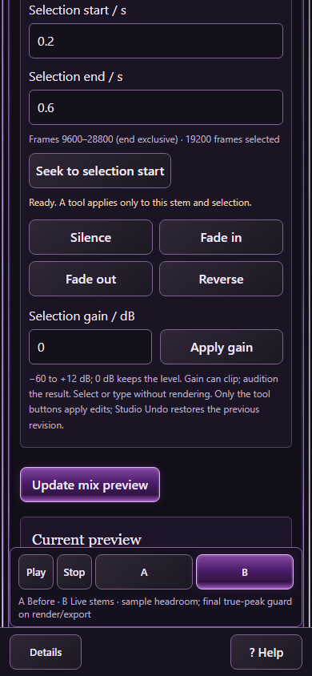

# Browser stem timeline and time edits

This development milestone brings selected desktop editor tools to the private
browser Studio. Check the build ID in the [current-work preview](https://slimedragonair.github.io/SlimeyBeats-EZ-Master/current-work/).
The released main site and Windows installer have their own release scope.

## Edit a part

1. Open **Studio** and import at least two aligned stems, using multiple files or
   a Suno/stem ZIP. Review the selected parts before importing.
2. Choose **Stem mix → Time edits**, then the stem you want to edit. **Mixer**
   returns to the live faders. Friendly names identify the
   parts; stable internal IDs keep repeated instrument names distinct.
3. Select a time range on its waveform, or enter exact **Start / End** seconds.
   Numeric inputs provide an alternative to dragging on a small touchscreen.
4. Choose **Silence**, **Fade in**, **Fade out**, **Reverse**, or set **Region gain**
   and apply it. Selection and zoom alone do not process audio.
5. Compare the prepared mix, use **Undo / Redo** when needed, then export
   separately. **Export raw stems** includes applied edits without mix faders;
   **Export current preview** saves the complete prepared mix.

If fader changes are pending, first choose **Update mix preview**. Time edits use
the committed mix settings and cannot silently discard uncommitted gain, mute,
solo or balance changes. Voice cleanup and spectral repair retain their existing
**Process this source** selector; timeline time edits use their selected stem.
After cleaning or repairing a stem, use **Apply edit to selected stem** if you want
that preview retained in the stem bank before a time edit. Time tools operate on
the bank shown in their waveforms; they do not silently apply a separate cleanup
preview to it.

## What the tools change



[Open the tools capture at full size](images/web-stem-editor-tools.png) ·
[Timeline and view navigation](images/web-stem-editor-phone.png).
These captures show generated fixtures in Chromium 143 at a 390px viewport,
scrolled to the relevant controls. The pinned listening controls remain separate.

| Tool | Result inside the selected range |
| --- | --- |
| Silence | Set samples to zero, keeping the gap and every part's alignment. |
| Fade in / Fade out | Apply a linear fade between silence and the imported level. A one-frame fade is silent. |
| Region gain | Apply −60 to +12 dB. Positive gain can increase peaks; audition the result. |
| Reverse | Reverse complete frames while preserving left/right channel positions. |

Times round to the nearest frame, with half frames rounded upward and an
exclusive end frame. An edit must contain at least one complete frame. Rate,
channels, duration, samples outside that range and all other stem-bank members
remain unchanged. Original files are never overwritten.

The full mix is rendered again after an edit. Its existing peak protection can
affect the rendered mix outside the selection; the unchanged-sample guarantee
applies to raw stem-bank audio. Waveforms show the bank, without live fader gain,
listening volume or mix peak protection. Display amplitude is not a clipping
diagnosis.

## Navigation, history and recovery

Fit/zoom and time navigation change the view rather than moving audio. Seeking
changes the listening position. Selection, viewport and selected lane are
temporary navigation state, reset on a new import, Close or recovery reopen.
This milestone does not add movable clips, trim/split, MIDI or browser loop
auditioning.

**Undo / Redo** restore the edited bank and prepared preview through the existing
browser revision history. Browser Studio retains at most two earlier previews,
also bounded by its existing preview-memory budget. This is not unlimited edit
history. The desktop editor has its own documented history limits.

Applied edits participate in the existing optional local recovery recipe. Up to
128 recorded Studio operations can be replayed; beyond that limit recovery
pauses with an explanation while editing/export remain available. Recovery
reconstructs edited audio, not timeline navigation, and does not start playback.
Use exports for lasting copies. Recovery remains opt-in and local.

The **128 MiB combined decoded-stem budget** and **15-minute per-input guard**
remain. Rendering, live buffers, history and exports need additional memory;
these input limits are not a guarantee that every phone can edit a project at
the limit. Desktop remains the choice for larger sessions and native-only tools.

### Restored playback must match restored audio

A follow-up regression reproduced an older cache bug: a fresh recovery worker
could assign the same pointer/length hint to different stem audio, causing the
player to retain the previous live buffer while exports used the restored bank.
Newly supplied PCM now always replaces that buffer. Unchanged stems from the
same worker still reuse their buffers. The regression checks every prepared
sample and peak against the replacement, preserves the previous failure, and
runs in the preview smoke check as well as the complete editor suite.

## Implementation and checks

- `rust/src/studio/region_edit.rs`: the existing shared sample-edit processor.
- `web/dsp/src/studio_region_edit.rs`: immutable bank replacement and complete mix
  rendering, committed only after both succeed.
- `web/site/studio-worker.js`, `studio-recovery-worker.js`: staged revisions,
  explicit commit/discard and recovery replay of the `region` operation.
- `web/site/studio-timeline*.js`, `studio-timeline.css`: focused editor state,
  cached envelopes, interactions and responsive drawing.
- `web/site/studio-app.js`: existing job/cancellation, pending-mix and export
  workflow integration. No new native MCP tool is needed for this browser UI.

The unmodified November 15, 2026 baseline passed the existing 25-group Chromium
Studio suite. The final local candidate runtime `0d93bfe1af172e69` has the following
results; the live page identifies its own subsequently published build.

| Check | Result and scope |
| --- | --- |
| Binding and navigation tests | 20 native-host WASM-binding tests and eight Node navigation/envelope tests passed. WASM build, formatting and strict Clippy passed. |
| Actual Chromium 143 engine, worker and app | 21 groups passed: all five tools in mono/stereo, exact unchanged samples/other stems, one-frame/end/rounding boundaries, invalid/stale/overlapping requests, discard/commit, undo/redo, changed-stem transfers, recovery replay and fresh-worker playback-buffer replacement. |
| Downloads and actual restore | Independently extracted raw/session ZIPs retained exact edited float32 bank and committed preview; changing listening volume did not change saved PCM. Actual recovery save/reload/restore reproduced the bank and preview with playback stopped. |
| Touch and layout | Chromium 143 exercised all five tools and six navigation controls at 320/390px on the second stem, with exact PCM and undo/redo checks, uncovered controls and no overflow. These are browser touch events, not physical-phone tests. |
| Existing workflow regressions | Chromium 143 passed 25 Studio groups, 20 learning/layout groups and 14 recovery groups, including a confirmed owned-browser process termination. |
| Live audio regression | Actual worklet output matched direct shared processing exactly in tested 48 kHz stereo and 44.1 kHz mono fixtures. Live-stem tests retained mute/solo/A-B isolation, smooth updates and source reuse. Synthetic output does not establish physical audibility. |
| Independent interface review | Actual main-app captures/checks in Chrome 156 and Chromium 143 covered desktop and 320/390px Mixer/Time edits switching, selection/audio/fader retention, pending-mix explanations and reachable pinned playback. |
| Firefox / WebKit | Firefox 144 and Linux WebKit 26 each passed all 21 editor groups, including actual native stem-chooser interaction, all five edits with exact PCM/undo/redo and 320/390px checks at 100/200% root text size. |

Earlier WebKit candidates exposed selected native text beyond its in-bounds
select rectangle: the 320px page grew to 364px after a stem selection/edit. Keeping
the native select inline-level inside a block label corrected it without clipping
the page. Final checks preserve the strict width assertions, exercise the chooser,
and confirm the page remains 320px after editing. At 200% root text size, time
navigation, tools and gain reflow to one column. Earlier failed reports were
retained; a compile or a desktop-only layout check did not establish this fix.

No physical Android/iPhone run, hardware listening, interruption/thermal test or
full-capacity phone-memory qualification is claimed. The installed Windows
WebKit build lacks Web Audio; Linux WebKit is used for those audio checks.

Reproduce against a fresh built site:

```sh
node --test web/tools/timeline_state.test.mjs
python web/tools/verify_region_edit_browser.py --site web/dist --out output/playwright/stem-editor
```

Use `--browser firefox` or `--browser webkit` for another installed engine, or
`--worker-only` to explicitly exclude UI qualification. CI runs the complete
editor checks in all three engines separately from preview publishing.
